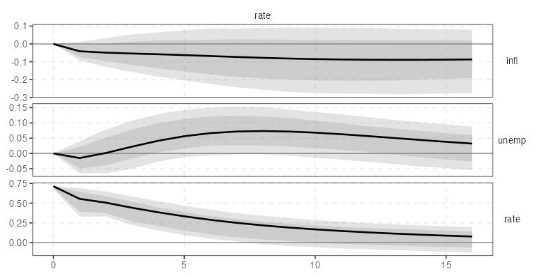
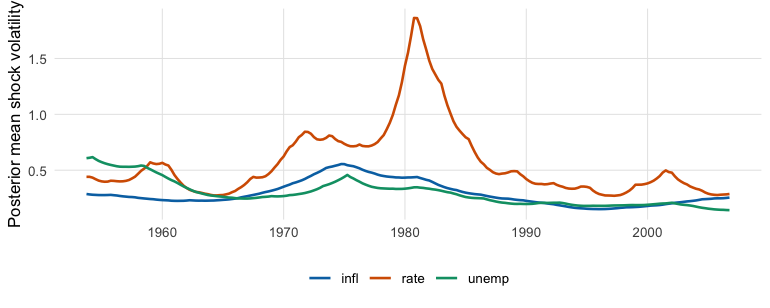
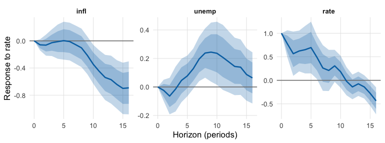

<!-- README.md is generated from README.Rmd. Please edit that file -->

# varm

<!-- badges: start -->

[](https://lifecycle.r-lib.org/articles/stages.html#experimental)
[](https://codecov.io/gh/kvasilopoulos/varm?branch=master)
[](https://github.com/kvasilopoulos/varm/actions)
<!-- badges: end -->

`varm` is a fast R package for frequentist and Bayesian vector
autoregressions (VAR, BVAR, TVP-VAR with stochastic volatility),
structural identification and local projections (LP). The estimators,
bootstraps, MCMC samplers and identification loops run in compiled
Rcpp/RcppArmadillo code. A 3-variable hierarchical BVAR draws 1000
posterior samples in about 0.1 s, a full 3-variable local projection
takes about 0.4 ms, and results are checked against `vars`, `BVAR`,
`lpirfs`, `lm` + `sandwich` and exact posteriors to between $10^{-13}$
and Monte Carlo accuracy (see [Validation](#validation) and the
[validation
report](https://kvasilopoulos.github.io/varm/articles/validation.html)).

The design idea is **one currency for uncertainty**: the bootstrap, the
asymptotic Monte Carlo and each Bayesian sampler return a `varm_draws`
object of reduced-form draws $(B, \Sigma)$. `irf()`, `fevd()`, `hd()`
and `forecast()`, and every identification scheme (`id_chol()`,
`id_longrun()`, `id_sign()`, `id_given()`, …) work on that object, so a
new estimator inherits all identification schemes and a new
identification scheme works with every estimator.

The package is experimental (version 0.1.0); see
[Limitations](#limitations).

## Installation

``` r
# install.packages("pak")
pak::pak("kvasilopoulos/varm")
```

A C++ toolchain is required (the package compiles RcppArmadillo code).
The reference implementations used in the tests (`vars`, `BVAR`,
`lpirfs`, `bsvars`, `sandwich`, `mvtnorm`) are in `Suggests`.

## Tidy by design

- **Tibbles with broom column names.** `tidy()`, `glance()` and
  `augment()` (re-exported from `generics`) return tibbles with `term`,
  `estimate`, `std.error`, `conf.low`, `conf.high`, `horizon`, `level`.
  `as_tibble()` is an alias of `tidy()` for IRF, FEVD, forecast,
  historical decomposition, LP and Bayesian objects.
- **tidyselect arguments.** Every argument that names variables takes
  bare names, strings, positions or helpers:
  `lp(yraw, shock = rate, contemp = c(infl, unemp))`,
  `id_chol(order = c(infl, unemp, rate))`,
  `autoplot(ir, shocks = rate)`,
  `varm(df, p = 2, vars = c(infl, rate))`.
- **ggplot2 for every result.** `autoplot()` returns a `ggplot` for
  VAR/BVAR IRF, FEVD, forecast and historical decomposition objects,
  draws, MCMC diagnostics, TVP-VAR paths and every local-projection
  result; `plot()` prints the same object. The figure is yours to modify
  with `+`.
- **One theme and palette.** `theme_varm()` and the colour-blind-safe
  `varm_palette()` are used by all plots and available for your own.
- **Pipe-friendly.** The data or model is always the first argument and
  there is no hidden state:
  `yraw |> varm(p = 2) |> irf(horizon = 16) |> autoplot()`.

## Thirty seconds with each family

All examples use `yraw`, three quarterly US series (inflation `infl`,
unemployment `unemp`, interest rate `rate`; Koop and Korobilis,
1953Q1-2006Q3). Each ends in an `autoplot()` figure and shows one
`tidy()` and one `glance()` call.

### VAR: impulse responses with bootstrap bands

``` r
library(varm)
fit <- varm(yraw, p = 2)
fit
#> <varm> VAR(2) with 3 variables, 213 effective observations
#> logLik = -338.416; max |eigenvalue| = 0.946
#> 
#>             infl   unemp    rate
#> infl.l1   1.5378 -0.0095  0.5457
#> unemp.l1 -0.2809  1.3297 -0.6475
#> rate.l1  -0.0571 -0.0210  0.7766
#> infl.l2  -0.5418  0.0341 -0.4395
#> unemp.l2  0.2336 -0.4290  0.6730
#> rate.l2   0.0580  0.0457  0.1232
#> const     0.2872  0.3654  0.0052
tidy(fit, conf.int = TRUE)
#> # A tibble: 21 × 8
#>    response term     estimate std.error statistic  p.value  conf.low conf.high
#>    <chr>    <chr>       <dbl>     <dbl>     <dbl>    <dbl>     <dbl>     <dbl>
#>  1 infl     infl.l1   1.54       0.0596    25.8   2.13e-66  1.42       1.66   
#>  2 infl     unemp.l1 -0.281      0.0622    -4.52  1.05e- 5 -0.403     -0.158  
#>  3 infl     rate.l1  -0.0571     0.0295    -1.93  5.45e- 2 -0.115      0.00112
#>  4 infl     infl.l2  -0.542      0.0613    -8.84  4.41e-16 -0.663     -0.421  
#>  5 infl     unemp.l2  0.234      0.0592     3.95  1.09e- 4  0.117      0.350  
#>  6 infl     rate.l2   0.0580     0.0291     2.00  4.72e- 2  0.000715   0.115  
#>  7 infl     const     0.287      0.0955     3.01  2.96e- 3  0.0989     0.475  
#>  8 unemp    infl.l1  -0.00952    0.0643    -0.148 8.82e- 1 -0.136      0.117  
#>  9 unemp    unemp.l1  1.33       0.0670    19.8   1.09e-49  1.20       1.46   
#> 10 unemp    rate.l1  -0.0210     0.0318    -0.660 5.10e- 1 -0.0838     0.0418 
#> # ℹ 11 more rows
glance(fit)
#> # A tibble: 1 × 8
#>       K     p  nobs logLik   AIC   BIC    HQ max_root
#>   <int> <int> <int>  <dbl> <dbl> <dbl> <dbl>    <dbl>
#> 1     3     2   213  -338.  731.  822.  768.    0.946
```

Responses to a policy-rate shock (recursive identification, `rate`
ordered last), with 68% and 90% wild-bootstrap bands. `autoplot(ir)`
without `shocks` gives the full shock-by-response grid:

``` r
set.seed(1)
ir <- irf(fit, id = id_chol(), horizon = 16, ci = "wild", nboot = 1000)
tidy(ir)
#> # A tibble: 306 × 7
#>    response shock horizon estimate level conf.low  conf.high
#>    <fct>    <fct>   <int>    <dbl> <dbl>    <dbl>      <dbl>
#>  1 infl     infl        0   0.308    0.9   0.297   0.311    
#>  2 unemp    infl        0  -0.0117   0.9  -0.0204  0.0000663
#>  3 rate     infl        0   0.0877   0.9   0.0505  0.104    
#>  4 infl     unemp       0   0        0.9   0       0        
#>  5 unemp    unemp       0   0.332    0.9   0.321   0.334    
#>  6 rate     unemp       0  -0.268    0.9  -0.285  -0.235    
#>  7 infl     rate        0   0        0.9   0       0        
#>  8 unemp    rate        0   0        0.9   0       0        
#>  9 rate     rate        0   0.715    0.9   0.681   0.719    
#> 10 infl     infl        1   0.472    0.9   0.410   0.497    
#> # ℹ 296 more rows
autoplot(ir, shocks = rate)
```



### BVAR with stochastic volatility

A triangular (equation-by-equation) Gibbs sampler with a Minnesota prior
and stochastic volatility:

``` r
set.seed(1)
bfit <- bvarm(yraw, p = 2, prior = prior_triangular("minnesota"), sv = TRUE,
              ndraw = 2000, nburn = 1000)
bfit
#> <bvarm> triangular-minnesota-sv BVAR(2), K = 3, 2000 posterior draws
#> 
#> posterior mean of B:
#>             infl   unemp    rate
#> infl.l1   1.2908 -0.0149  0.1870
#> unemp.l1 -0.1210  1.2135 -0.3127
#> rate.l1  -0.0022 -0.0097  1.0203
#> infl.l2  -0.2992  0.0483 -0.1303
#> unemp.l2  0.0739 -0.2804  0.2884
#> rate.l2  -0.0033  0.0231 -0.0959
#> const     0.3075  0.1943  0.3286
tidy(bfit)
#> # A tibble: 21 × 6
#>    response term     estimate std.error conf.low conf.high
#>    <chr>    <chr>       <dbl>     <dbl>    <dbl>     <dbl>
#>  1 infl     infl.l1   1.29       0.0548   1.20      1.38  
#>  2 infl     unemp.l1 -0.121      0.0346  -0.177    -0.0632
#>  3 infl     rate.l1  -0.00223    0.0168  -0.0299    0.0263
#>  4 infl     infl.l2  -0.299      0.0563  -0.391    -0.207 
#>  5 infl     unemp.l2  0.0739     0.0329   0.0195    0.127 
#>  6 infl     rate.l2  -0.00335    0.0151  -0.0297    0.0203
#>  7 infl     const     0.307      0.0843   0.165     0.445 
#>  8 unemp    infl.l1  -0.0149     0.0417  -0.0843    0.0530
#>  9 unemp    unemp.l1  1.21       0.0544   1.12      1.30  
#> 10 unemp    rate.l1  -0.00968    0.0173  -0.0370    0.0193
#> # ℹ 11 more rows
glance(bfit)
#> # A tibble: 1 × 7
#>       K     p  nobs ndraw method                  logml accept
#>   <int> <int> <int> <int> <chr>                   <dbl>  <dbl>
#> 1     3     2   213  2000 triangular-minnesota-sv    NA     NA
```

`autoplot(bfit, type = "coef")` plots the coefficient posteriors, and
`volatility()` returns the posterior-mean shock volatilities, which are
one `tidy()`-style reshape away from a ggplot:

``` r
library(ggplot2)
vol <- volatility(bfit)
d <- data.frame(
  quarter = rep(seq(1953.25 + 2 * 0.25, by = 0.25, length.out = nrow(vol)), ncol(vol)),
  variable = rep(colnames(vol), each = nrow(vol)),
  volatility = as.vector(vol)
)
ggplot(d, aes(quarter, volatility, colour = variable)) +
  geom_line(linewidth = 0.8) +
  scale_colour_manual(values = varm_palette(3)) +
  labs(x = NULL, y = "Posterior mean shock volatility", colour = NULL) +
  theme_varm()
```



The default prior of `bvarm()` is instead the conjugate hierarchical
Minnesota prior of Giannone, Lenza and Primiceri (2015), with exact
draws for the coefficients and a Metropolis step for the
hyperparameters. Both return a `bvarm` object, and
`irf(bfit, id = id_chol())` works the same way as for `fit`.

### Local projections

`shock` and `contemp` are tidyselect arguments (bare names, strings or
`c()`); `contemp` lists the variables ordered before the shock, which
reproduces the recursive identification used above.

``` r
lpf <- lp(yraw, shock = rate, contemp = c(infl, unemp), horizon = 16, lags = 2,
          lag_augment = TRUE)
lpf
#> <lpm> local projection of infl, unemp, rate on 'rate', horizons 0..16 (3 lags, HC)
#>       infl   unemp    rate
#> 0   0.0000  0.0000  1.0000
#> 1  -0.0590 -0.0243  0.7763
#> 4  -0.0117  0.0456  0.6506
#> 8  -0.1030  0.2381  0.2098
#> 12 -0.5391  0.1760 -0.1398
#> 16 -0.6921  0.0634 -0.4354
tidy(lpf)
#> # A tibble: 102 × 7
#>    horizon response  estimate std.error level  conf.low conf.high
#>      <int> <fct>        <dbl>     <dbl> <dbl>     <dbl>     <dbl>
#>  1       0 infl      4.85e-15  1.27e-13   0.9 -2.04e-13  2.13e-13
#>  2       1 infl     -5.90e- 2  5.03e- 2   0.9 -1.42e- 1  2.37e- 2
#>  3       2 infl     -6.31e- 2  9.43e- 2   0.9 -2.18e- 1  9.20e- 2
#>  4       3 infl     -2.71e- 2  1.20e- 1   0.9 -2.24e- 1  1.70e- 1
#>  5       4 infl     -1.17e- 2  1.54e- 1   0.9 -2.64e- 1  2.41e- 1
#>  6       5 infl      2.43e- 3  1.70e- 1   0.9 -2.76e- 1  2.81e- 1
#>  7       6 infl     -9.90e- 3  1.69e- 1   0.9 -2.88e- 1  2.68e- 1
#>  8       7 infl     -5.56e- 2  1.71e- 1   0.9 -3.37e- 1  2.26e- 1
#>  9       8 infl     -1.03e- 1  1.72e- 1   0.9 -3.87e- 1  1.81e- 1
#> 10       9 infl     -2.15e- 1  1.69e- 1   0.9 -4.92e- 1  6.27e- 2
#> # ℹ 92 more rows
glance(lpf)
#> # A tibble: 1 × 6
#>   shock horizon  lags se_type iv     nobs
#>   <chr>   <int> <int> <chr>   <lgl> <dbl>
#> 1 rate       16     3 hc      FALSE   212
autoplot(lpf)
```



For the same shock the LP and VAR responses are close but not identical;
`compare_lp_var()` quantifies it.

## Features

Status column: **validated** = agrees with a named reference
implementation or an exact result in the tests or `validation/`;
**tested** = unit tests of correctness (against a hand computation, a
simulation with known truth, or an invariant) but no external reference;
**new** = recently added, documented, consistency-tested only. Details
in the [validation
report](https://kvasilopoulos.github.io/varm/articles/validation.html).

| Method | Function | Reference | Status |
|----|----|----|----|
| **Reduced-form VAR** |  |  |  |
| OLS / Gaussian ML, constant, trend, exogenous terms | `varm()` | Lutkepohl (2005) | validated vs `vars` (~1e-12) |
| Lag selection (AIC, HQ, SC, FPE) | `var_select()` | Lutkepohl (2005) | validated vs `vars::VARselect` |
| Companion-matrix stability | `stability()` | Hamilton (1994) | validated vs `vars::roots` |
| IRF, FEVD, forecasts | `irf()`, `fevd()`, `forecast()` | Lutkepohl (2005) | validated vs `vars` |
| Normalise a shock to a given size on a variable | `normalise_to()`, `irf(normalise = )` | \- | tested |
| Tidy output (tibbles), ggplot2 figures | `tidy()`, `glance()`, `augment()`, `autoplot()`, `theme_varm()`, `varm_palette()` | broom conventions | tested |
| Historical decomposition | `hd()` | Burbidge and Harrison (1985) | tested |
| **Inference for VAR** |  |  |  |
| Residual bootstrap, wild bootstrap (Rademacher, Mammen) | `draws()`, `irf(ci = )` | Runkle (1987); Goncalves and Kilian (2004) | tested; coverage simulated (see Limitations) |
| Bootstrap-after-bootstrap bias correction | `draws(bias_correct = TRUE)` | Kilian (1998) | tested; coverage simulated |
| Asymptotic Monte Carlo | `draws(method = "mc")` | Lutkepohl (2005) | tested (OLS covariance); coverage simulated |
| **Structural identification** |  |  |  |
| Recursive (Cholesky) | `id_chol()` | Sims (1980) | validated vs `vars` |
| Long-run (Blanchard-Quah) | `id_longrun()` | Blanchard and Quah (1989) | validated vs `vars::BQ` (~1e-13) |
| Sign restrictions, Haar rotations | `id_sign()` | Uhlig (2005); Rubio-Ramirez, Waggoner and Zha (2010) | tested (exact Haar and acceptance laws) |
| Median-target (Fry-Pagan) rotation | `irf_fry_pagan()` | Fry and Pagan (2011) | tested |
| User impact matrix | `id_given()` | \- | tested |
| Zero and sign restrictions (unweighted) | `id_zerosign()` | Arias, Rubio-Ramirez and Waggoner (2018) | tested (zeros exact); importance weights not implemented |
| Short- and long-run zero (A-B) restrictions | `id_restrictions()` | Blanchard and Quah (1989); Sims (1980) | tested (reproduces BQ and recursive schemes) |
| Identification through heteroskedasticity (two regimes) | `id_hetero()` | Rigobon (2003) | tested (simulation) |
| **Proxy-SVAR (external instruments)** |  |  |  |
| Proxy identification, first-stage F | `id_proxy()`, `proxy_fstat()` | Mertens and Ravn (2013); Stock and Watson (2012) | tested vs hand computation |
| Proxy bootstrap (wild, moving block) | `varm_proxy()`, `proxy_draws()` | Jentsch and Lunsford (2019) | tested; wild bootstrap fails at impact (see Limitations) |
| Weak-instrument robust sets | `varm_proxy_robust()` | Montiel Olea, Stock and Watson (2021) | tested (endpoints solve the Wald test) |
| Bayesian proxy-SVAR (limited information) | `varm_proxy_bayes()` | after Caldara and Herbst (2019) | tested vs bootstrap; not their sampler |
| Bayesian proxy-SVAR with sign and reliability restrictions | `varm_proxy_arw()`, `id_proxy_bayes` | Arias, Rubio-Ramirez and Waggoner (2021) | new; coverage simulated |
| Prior-robust Bayesian proxy-SVAR | `varm_proxy_gkr()` | Giacomini, Kitagawa and Read (2022) | new; coverage simulated |
| **Bayesian VAR** |  |  |  |
| Conjugate NIW, Minnesota, sum-of-coefficients, single-unit-root priors | `bvarm()`, `prior_minnesota()` | Litterman (1986); Doan, Litterman and Sims (1984); Sims (1993) | validated (analytic NIW moments; log posterior vs `BVAR` ~1e-13) |
| Hierarchical hyperparameters (optimiser + adaptive Metropolis) | `bvarm()` | Giannone, Lenza and Primiceri (2015) | validated vs `BVAR` and exact quadrature |
| Triangular equation-by-equation sampler | `bvarm(prior = prior_triangular())` | Carriero, Clark and Marcellino (2019) | validated vs exact posterior (homoskedastic) |
| SSVS and horseshoe shrinkage priors | `prior_triangular("ssvs" / "horseshoe")` | George, Sun and Ni (2008); Carvalho, Polson and Scott (2010) | tested (simulated sparse VAR) |
| Stochastic volatility (KSC mixture, FFBS) | `bvarm(sv = TRUE)`, `volatility()` | Kim, Shephard and Chib (1998); Carter and Kohn (1994) | validated (Geweke test); calibration slightly low |
| TVP-VAR with stochastic volatility; tidy paths, `autoplot(type = "coef"/"vol"/"irf")` | `tvpvar()`, `tvp_prior()`, `irf_path()`, `tvp_volatility()` | Primiceri (2005); Cogley and Sargent (2005) | validated (constant limit vs OLS and GLS); prior-sensitive |
| MCMC diagnostics (ESS, R-hat, Geweke; `tidy()`, `autoplot()`) | `mcmc_diagnostics()` | Vehtari et al. (2021); Geweke (1992) | validated (known AR(1) ESS) |
| **Local projections** |  |  |  |
| LP, HAC (Newey-West) and HC standard errors, cumulative responses; tidyselect `shock`, `contemp`, `responses` | `lp()` | Jorda (2005) | validated vs `lm` + `sandwich` (~1e-13) |
| LP-IV | `lp(iv = )` | Stock and Watson (2018) | validated vs manual 2SLS |
| Lag augmentation | `lp(lag_augment = TRUE)` | Montiel Olea and Plagborg-Moller (2021) | tested |
| Joint cross-horizon covariance, sup-t bands (`tidy()` gives `pointwise` and `sup-t` rows) | `lp_joint()`, `lp_supt()` | Montiel Olea and Plagborg-Moller (2019) | tested; sup-t under-covers in simulation |
| State-dependent LP (`tidy()` with `state` column, `autoplot()`) | `lp_state()` | Auerbach and Gorodnichenko (2012, 2013) | validated vs `lpirfs::lp_nl` (~7e-13) |
| Smooth LP | `lp_smooth()` | Barnichon and Brownlees (2019) | tested (reproduces LP with no penalty) |
| Panel LP, fixed effects, clustered errors | `lp_panel()` | Jorda (2005) | tested vs `lm` with dummies |
| Direct LP forecasts (`tidy()`, `autoplot()`), LP versus VAR comparison | `lp_forecast()`, `compare_lp_var()` | Plagborg-Moller and Wolf (2021) | tested |

## Benchmarks

Seconds of elapsed time per 1000 retained posterior draws, simulated
VAR(4) with $T = 250$, Apple M4 Pro, R 4.6.1, OpenBLAS, single-threaded
(`OMP_NUM_THREADS=1`), nothing else running, installed package.
Reproduce with `Rscript validation/bayes.R s8`.

| sampler | K = 3 | K = 7 | K = 20 |
|----|----|----|----|
| `bvarm()` conjugate, fixed hyperparameters | 0.003 | 0.010 | 0.061 |
| `bvarm()` conjugate, hierarchical (optimiser + 500 burn-in) | 0.054 | 0.177 | 1.271 |
| `bvarm()` triangular, Minnesota, homoskedastic | 0.019 | 0.110 | 1.312 |
| `bvarm()` triangular, Minnesota + stochastic volatility | 0.112 | 0.382 | 2.979 |
| `BVAR::bvar()` (hierarchical $\lambda$) | 0.157 | 0.259 | 0.899 |
| `bsvars::bsvar_sv()` (structural SV) | 1.35 | 4.64 | not run |

Other timings on `yraw` ($T = 215$, $K = 3$, $p = 2$):

| task | time |
|----|----|
| `tvpvar()`, SV + time-varying $A_t$ + full $Q$, 10000 draws + 2000 burn-in | about 8 s |
| `lp()` for one shock, 3 responses, horizons 0-16 | about 0.5 ms |
| `varm()` OLS fit | about 0.05 ms |
| 1000 wild-bootstrap draws of the VAR(2) | 0.02 s |
| `irf()` with 1000 wild-bootstrap draws, horizon 16 | 0.03 s |
| `bvarm()` hierarchical, 10000 draws + 2000 burn-in | 0.39 s |
| `bvarm()` triangular + SV, 10000 draws + 2000 burn-in | 2.4 s |

Reading the table honestly: the conjugate samplers are very fast and the
hierarchical one beats `BVAR::bvar()` for $K = 3$ (about 2x), is level
at $K = 7$, and is **slower at $K = 20$** (3.6 s against 1.6 s). The
triangular samplers are a different model class (no `BVAR` counterpart);
their cost rises from 0.05 s ($K = 3$) to 5.7 s ($K = 20$) in the
homoskedastic case. `tvpvar()` is a long-running sampler: about 3 ms per
sweep at $p = 2$, and the cost increases steeply with the lag length.
Timings depend on the machine, the BLAS and the settings, and were
measured in single runs.

## Validation

Checks run live in the [validation
report](https://kvasilopoulos.github.io/varm/articles/validation.html);
the longer ones are in `validation/`. The unit-test suite
(`tests/testthat`) has 846 expectations and runs in about
17 s.

| Module | Reference | Agreement (max abs. difference unless stated) |
|----|----|----|
| VAR coefficients, covariance, log-likelihood, IC | `vars` | $\le$ 6e-13 |
| Cholesky IRF, FEVD, point forecast | `vars` | 4e-13 (IRF), 3e-13 (FEVD), 5e-12 (forecast) |
| Blanchard-Quah impact matrix | `vars::BQ` | 1e-13 |
| LP coefficient, Newey-West and HC1 s.e. | `lm` + `sandwich` | 3e-13 |
| State-dependent LP (IRF and HAC band half-widths) | `lpirfs::lp_nl` | 7.5e-13 |
| Hierarchical BVAR log posterior at matched $\psi$ | `BVAR::bvar` | 7e-13 (relative 2e-15) |
| Hierarchical hyperparameter posterior means | exact quadrature, `BVAR` MCMC | within 3% (Monte Carlo error) |
| Triangular sampler, homoskedastic | exact semi-conjugate posterior | max abs. $z$ 2.2 |
| Stochastic-volatility update | Geweke joint-distribution test | all absolute $z$ below 1.1 |
| Haar rotations, sign-restriction acceptance rates | exact laws (KS, $1/2$, $1/4$) | KS statistic 0.003 or less |
| TVP-VAR, constant limit | OLS | 4e-3 (Monte Carlo error) |
| OLS VAR, NW posterior, Cholesky IRF, FEVD, HD, sign and zero restrictions | BEAR toolbox (MATLAB), via R ports checked against BEAR's stored `.mat` results | 1e-12 or better; sampled quantities within Monte Carlo error |
| Minnesota NW marginal likelihood and posterior, with and without dummy priors | BEAR toolbox | no dummies 1e-9; sum-of-coefficients 1e-9; combined dummies 0.05 log units (open) |
| Cholesky and long-run IRF, FEVD, HD, LP, IV-LP | VAR-Toolbox (MATLAB), via R ports | 1e-5 or better (3e-14 for long-run) |
| Minnesota marginal likelihood, IRF, forecasts, proxy-SVAR, LP | BVAR_ (MATLAB), via R ports | 1e-7 or better once conventions are matched |

The three MATLAB toolboxes ([BEAR](https://github.com/european-central-bank/BEAR-toolbox),
[VAR-Toolbox](https://github.com/ambropo/VAR-Toolbox),
[BVAR_](https://github.com/naffe15/BVAR_)) were compared by porting their `.m`
algorithms to R, not by running MATLAB. The dated diary in
`validation/DIARY.md` lists every test, the convention differences (degrees of
freedom, lag-decay exponent, bootstrap rescaling, proxy centring) and what is
not covered.

## Limitations

Found by the validation scripts, in order of how likely they are to
matter:

- **Draw-based IRF bands under-cover in short, persistent or
  heteroskedastic samples.** For a VAR(1) with $\rho = 0.9$ and
  $T = 200$, 90% bands cover 81% (iid bootstrap), 75% (wild), 88% (Monte
  Carlo) and 89% (bias-corrected iid bootstrap); with heteroskedastic
  errors every method covers only 61-75%.
- **The proxy-SVAR wild bootstrap does not cover the impact response**
  (13-21% coverage of nominal 90% in `validation/proxy-coverage.R`). Use
  `type = "mbb"` (default of `proxy_draws()`) or `varm_proxy_robust()`.
- **Sup-t bands from `lp_supt()` under-cover**: 78% whole-path coverage
  with HAC errors (84% with lag-augmented HC errors) at nominal 90%.
- **Stochastic-volatility calibration is slightly low**: 83% coverage of
  the volatility-of-volatility parameter and 88% of the volatility path
  at nominal 90% (simulation-based calibration, 60 replications).
- **TVP-VAR results depend on the prior** (`tvp_prior(kQ = )`); coverage
  of simulated coefficient paths ranged from 56% to 79% across two
  settings.
- **The hierarchical sampler mixes slowly**: effective sample sizes of
  70-160 for the hyperparameters in 3000 draws of one chain. Use
  `mcmc_diagnostics()`.
- **`id_zerosign()` is unweighted**: the ARRW importance weights are not
  implemented, so bands under partial zero restrictions are approximate.
- **No missing values**, no VECM or cointegration, no panel or global
  VAR, no mixed-frequency models, no frequentist penalised (lasso) VAR,
  no narrative restrictions. See the literature map for packages that
  cover these.
- `varm_proxy_arw()` and `varm_proxy_gkr()` are new and have no external
  replication; in a 50-replication simulation the 90% ARW band covered
  91% and the conventional single-prior GKR band only 65% for a
  set-identified shock (the robust region 91%).
- Speed: `BVAR::bvar()` is faster at $K = 20$ for the hierarchical
  prior.

## Literature map

The full discussion is in `vignette("choosing-a-method")`. Entries are
from the [awesome-var](https://github.com/kvasilopoulos/awesome-var)
list.

| Area | Packages | Relation to `varm` |
|----|----|----|
| Core VAR | `vars`, `svars`, `tsDyn` | overlap on estimation and recursive/long-run/sign IRFs (`varm` agrees with `vars` to rounding error); no diagnostic tests, VECM or threshold models |
| Hierarchical BVAR | `BVAR`, `bvartools` | same GLP prior (log posterior agrees with `BVAR` at matched $\psi$); `varm` adds triangular, SV, SSVS and horseshoe samplers |
| Bayesian SVAR | `bsvars`, `bsvarSIGNs`, `bpvars` | complementary: use them for narrative restrictions, weighted zero+sign inference and identification through heteroskedasticity |
| Time variation | `bvarsv`, `bvhar`, `mfbvar` | `varm` has `tvpvar()` and `bvarm(sv = TRUE)`; no mixed frequency |
| High-dimensional | `BigVAR`, `bigtime`, `VARshrink` | `varm` covers Bayesian shrinkage only |
| Panel and global VAR | `panelvar`, `pvars`, `BGVAR` | `varm` has panel LP (`lp_panel()`) but no panel VAR |
| Local projections | `lpirfs`, `sovereign` | `varm` matches `lpirfs::lp_nl`; adds smooth LP, sup-t bands, LP-IV, lag augmentation |
| External instruments | `varexternal`, Plagborg-Moller code | `varm_proxy*()` family and `lp(iv = )` |

Also in the awesome-var list and not covered by `varm`: the MATLAB
toolboxes (VAR Toolbox, BEAR, IRIS, BVAR\_), Python (`statsmodels`,
`sktime`), Julia (`VectorAutoregressions.jl`, `LocalProjections.jl`) and
EViews/Stata implementations.

## Documentation

Online: <https://kvasilopoulos.github.io/varm>. Articles, in suggested
reading order:

1.  [Getting
    started](https://kvasilopoulos.github.io/varm/articles/getting-started.html) -
    `vignette("getting-started")`
2.  [Reduced-form VAR: theory and
    inference](https://kvasilopoulos.github.io/varm/articles/var-theory.html) -
    `vignette("var-theory")`
3.  [Structural
    identification](https://kvasilopoulos.github.io/varm/articles/identification.html) -
    `vignette("identification")`
4.  [Bayesian
    VARs](https://kvasilopoulos.github.io/varm/articles/bayesian-var.html) -
    `vignette("bayesian-var")`
5.  [Time-varying parameter
    VAR](https://kvasilopoulos.github.io/varm/articles/tvp-var.html) -
    `vignette("tvp-var")`
6.  [Local
    projections](https://kvasilopoulos.github.io/varm/articles/local-projections.html) -
    `vignette("local-projections")`
7.  [Advanced local
    projections](https://kvasilopoulos.github.io/varm/articles/lp-advanced.html) -
    `vignette("lp-advanced")`
8.  [Choosing a
    method](https://kvasilopoulos.github.io/varm/articles/choosing-a-method.html) -
    `vignette("choosing-a-method")`
9.  [Validation
    report](https://kvasilopoulos.github.io/varm/articles/validation.html) -
    `vignette("validation")`

The reference index lists every function with its tidy and plot methods
(`tidy.varm_irf`, `autoplot.varm_irf`, `theme_varm`, …).

The method-by-method index with definitions and references is
[`docs-src/methods-index.md`](docs-src/methods-index.md); the change log
is in [`NEWS.md`](NEWS.md).

## Citation

There is no paper yet. Until there is, cite the package:

``` r
citation("varm")
```

and the original references of the method you use (see the Features
table).

## Contributing

Bug reports and pull requests are welcome at
<https://github.com/kvasilopoulos/varm/issues>. Please include a minimal
reproducible example. Changes to an estimator should come with a test
that compares against an independent implementation or an exact result,
and a note in `validation/` for anything stochastic. To run the checks
from the package root:

``` sh
Rscript validation/run-all.R      # unit tests
Rscript validation/bayes.R        # heavier statistical validation
```
