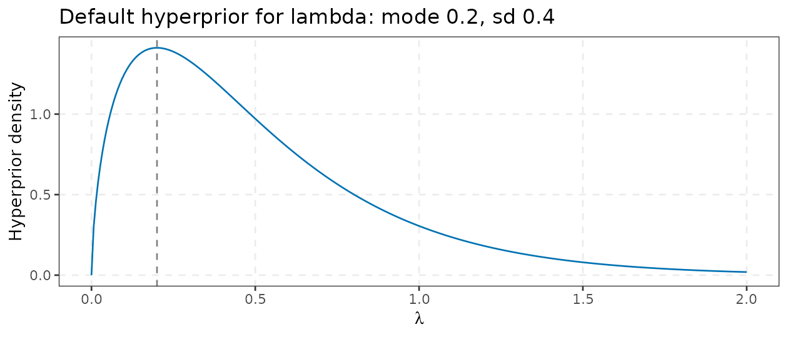
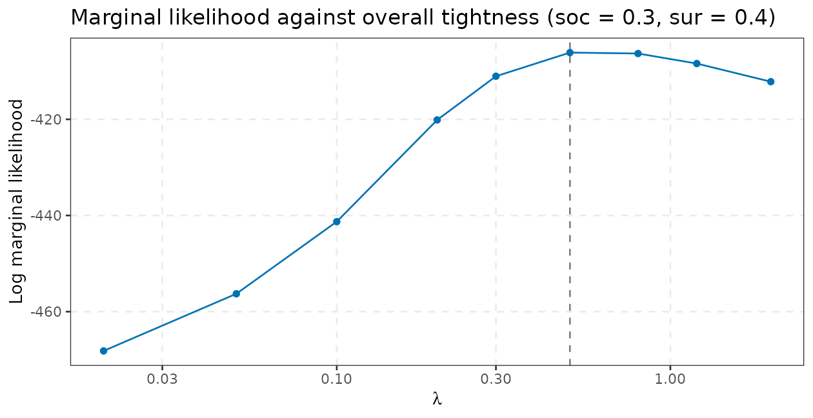
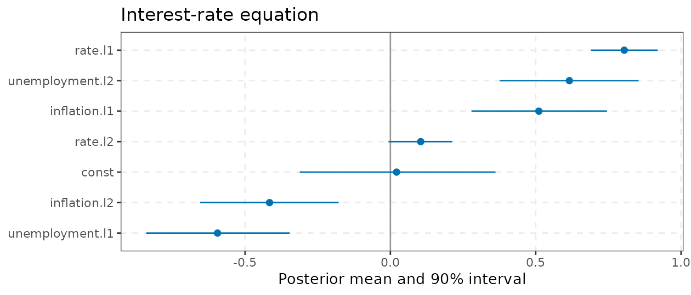
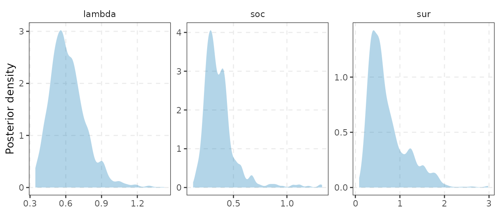
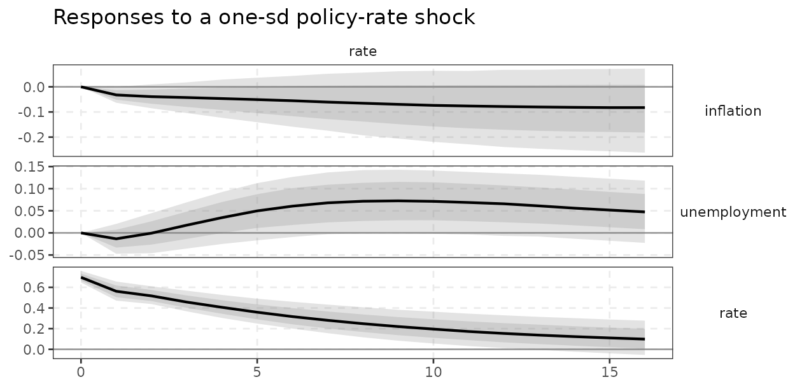
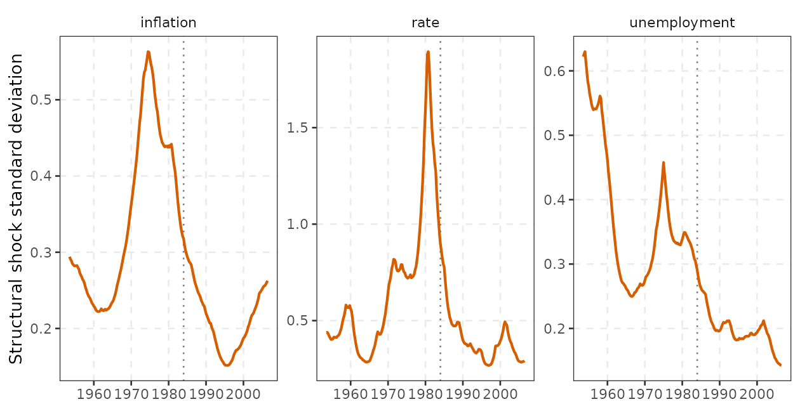
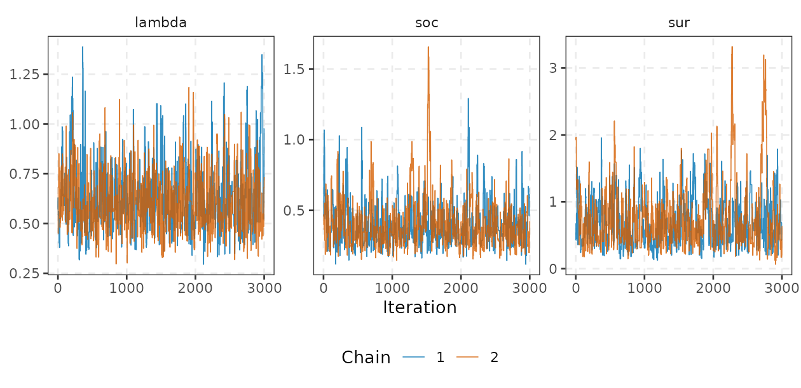
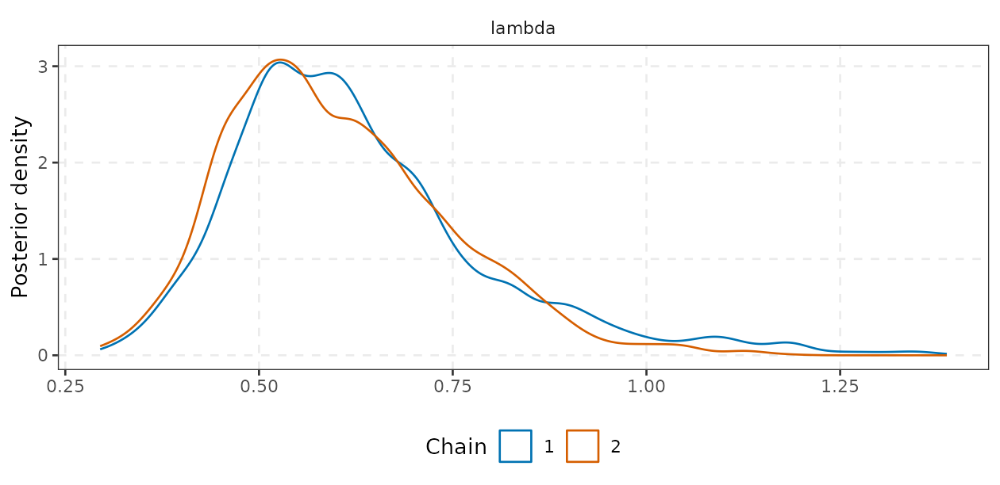
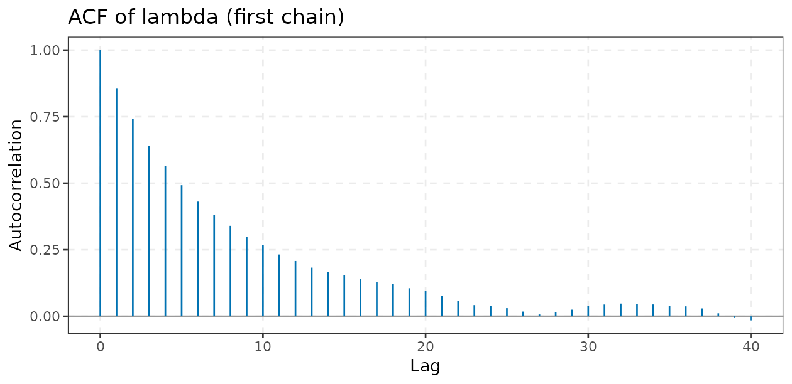
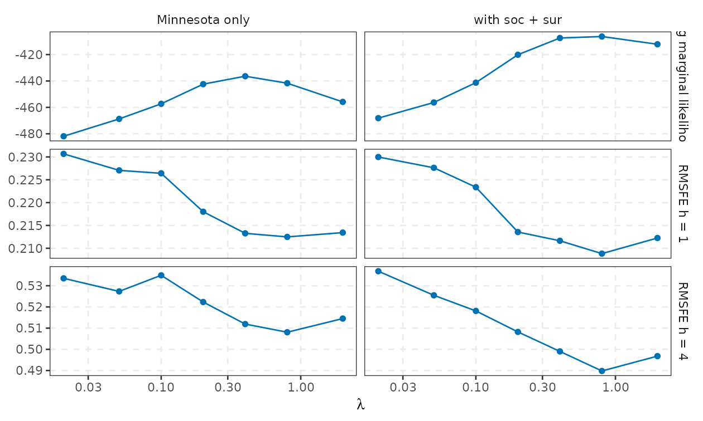

# Bayesian VARs: priors, samplers and diagnostics

[`bvarm()`](https://kvasilopoulos.github.io/varm/reference/bvarm.md)
fits Bayesian VARs with two families of samplers, selected by the
`prior` argument:

| `prior =` | model | sampler | cost |
|----|----|----|----|
| [`prior_minnesota()`](https://kvasilopoulos.github.io/varm/reference/prior_minnesota.md) | conjugate Normal-inverse-Wishart (NIW), Minnesota + sum-of-coefficients + single-unit-root | exact draws (fixed hyperparameters) or Metropolis for hyperparameters, then direct draws | tiny |
| [`prior_triangular()`](https://kvasilopoulos.github.io/varm/reference/prior_triangular.md) | triangular, equation-by-equation; Minnesota, SSVS or horseshoe; optional stochastic volatility | Gibbs | linear in $`K`$ per sweep (in the number of equations; each equation costs $`O((Kp)^3)`$) |

Both return a `bvarm` object whose `$draws` is a `varm_draws` container,
the same one produced by the bootstrap, so
[`irf()`](https://kvasilopoulos.github.io/varm/reference/dynamics.md),
[`fevd()`](https://kvasilopoulos.github.io/varm/reference/dynamics.md),
[`hd()`](https://kvasilopoulos.github.io/varm/reference/dynamics.md),
[`forecast()`](https://kvasilopoulos.github.io/varm/reference/dynamics.md)
and every identification scheme work unchanged (see
[`vignette("identification")`](https://kvasilopoulos.github.io/varm/articles/identification.md)).
Time-varying *coefficients* are a third model class with its own
function,
[`tvpvar()`](https://kvasilopoulos.github.io/varm/reference/tvpvar.md),
described in
[`vignette("tvp-var")`](https://kvasilopoulos.github.io/varm/articles/tvp-var.md).

This vignette is organised as: Bayes’ theorem for VARs (1), the
conjugate NIW posterior and its derivation (2), the Minnesota prior in
the exact parametrisation of the code (3), dummy-observation priors (4),
the marginal likelihood and the hierarchical Metropolis sampler (5), the
triangular sampler (6), shrinkage priors (7), stochastic volatility (8),
convergence diagnostics (9), a prior-sensitivity exercise (10), speed
(11) and a comparison with the `BVAR` package (12).

## 1. Bayes’ theorem for VARs

Let $`Y=(y_1,\dots,y_T)'`$ be the sample and $`\theta=(B,\Sigma)`$ the
VAR parameters, with the first $`p`$ observations treated as fixed
initial conditions. The VAR is $`y_t'=x_t'B+u_t'`$,
$`u_t\sim N(0,\Sigma)`$, with $`x_t=(y_{t-1}',\dots,y_{t-p}',1)'`$, so
that
``` math
p(Y\mid\theta)=\prod_{t=p+1}^T N\big(y_t;\,B'x_t,\ \Sigma\big).
```
Bayes’ theorem combines this with a prior $`p(\theta\mid\eta)`$ that
depends on hyperparameters $`\eta`$ (tightness, etc.):
``` math
p(\theta\mid Y,\eta)=\frac{p(Y\mid\theta)\,p(\theta\mid\eta)}{p(Y\mid\eta)},\qquad
p(Y\mid\eta)=\int p(Y\mid\theta)\,p(\theta\mid\eta)\,d\theta .
```
Three consequences organise everything below.

- **Everything is a function of draws.** Impulse responses, variance
  decompositions and forecasts are functions $`g(\theta)`$; their
  posterior is the push-forward of the posterior draws of $`\theta`$.
  This is why every sampler in `varm` only has to return `(B, Sigma)`
  draws (a `varm_draws` object):
  [`irf()`](https://kvasilopoulos.github.io/varm/reference/dynamics.md)
  maps each draw through the identification scheme and reports
  percentiles. Forecasts integrate over parameter uncertainty too:
  $`p(y_{T+h}\mid Y)=\int p(y_{T+h}\mid Y,\theta)\,p(\theta\mid Y)\,d\theta`$,
  which is what
  [`forecast()`](https://kvasilopoulos.github.io/varm/reference/dynamics.md)
  simulates (one future path per posterior draw).
- **The prior is a bias-variance device.** An unrestricted VAR has
  $`K(Kp+1)`$ coefficients (21 for the three-variable system with
  $`p=2`$, 1620 for $`K=20`$, $`p=4`$) estimated from $`T\cdot K`$
  numbers. The prior shrinks them towards a parsimonious benchmark; the
  amount of shrinkage is the hyperparameter $`\eta`$.
- **The marginal likelihood $`p(Y\mid\eta)`$ is the evidence for
  $`\eta`$.** It is the product of one-step-ahead predictive densities,
  $`p(Y\mid\eta)=\prod_t p(y_t\mid y_{1:t-1},\eta)`$, so a prior that
  maximises it is the one that forecast best, on average, in-sample
  *and* out of the information set at each date (the prior is updated
  recursively). It is automatically penalised for flexibility, with no
  need for a cross-validation loop. Giannone, Lenza and Primiceri (2015)
  turn this into a hierarchical model by putting a hyperprior on
  $`\eta`$ (section 5).

## 2. The conjugate NIW posterior

Write the VAR as $`Y=XB+U`$, with $`Y`$$`T\times M`$, $`X`$$`T\times k`$
($`k=Mp+d`$, $`d`$ deterministic terms), $`U`$ rows i.i.d.
$`N(0,\Sigma)`$ (here $`T`$ counts the effective sample, after the $`p`$
initial observations). With the conjugate prior
``` math
\mathrm{vec}(B)\mid\Sigma\sim N\big(\mathrm{vec}(b),\ \Sigma\otimes\Omega\big),\qquad
\Sigma\sim IW(\Psi,\,d),\quad d=M+2,
```
the posterior is of the same family:
``` math
\begin{align}
\mathrm{vec}(B)\mid\Sigma,Y&\sim N\big(\mathrm{vec}(\bar B),\ \Sigma\otimes\bar\Omega\big), &
\Sigma\mid Y&\sim IW(\bar\Psi,\ T+d),\\
\bar\Omega&=(X'X+\Omega^{-1})^{-1}, &
\bar B&=\bar\Omega\,(X'Y+\Omega^{-1}b),\\
\bar\Psi&=\Psi+(Y-X\bar B)'(Y-X\bar B)+(\bar B-b)'\Omega^{-1}(\bar B-b).
\end{align}
```

**Derivation.** Up to constants, with $`S(B)=(Y-XB)'(Y-XB)`$,
``` math
p(B,\Sigma\mid Y)\ \propto\ |\Sigma|^{-T/2}e^{-\frac12\mathrm{tr}\,\Sigma^{-1}S(B)}\cdot
|\Sigma|^{-k/2}e^{-\frac12\mathrm{tr}\,\Sigma^{-1}(B-b)'\Omega^{-1}(B-b)}\cdot
|\Sigma|^{-(d+M+1)/2}e^{-\frac12\mathrm{tr}\,\Sigma^{-1}\Psi},
```
where the first factor is the likelihood, the second the Normal prior
(the $`|\Sigma|^{-k/2}`$ comes from the Kronecker covariance
$`\Sigma\otimes\Omega`$) and the third the inverse-Wishart prior. The
two quadratic forms in $`B`$ combine by completing the square (the
matrix analogue of the ridge identity):
``` math
S(B)+(B-b)'\Omega^{-1}(B-b)=(B-\bar B)'\,\bar\Omega^{-1}(B-\bar B)+
\underbrace{S(\bar B)+(\bar B-b)'\Omega^{-1}(\bar B-b)}_{\bar\Psi-\Psi},
```
with $`\bar\Omega^{-1}=X'X+\Omega^{-1}`$ and
$`\bar B=\bar\Omega(X'Y+\Omega^{-1}b)`$. The first term is a Normal
kernel in $`B`$ with covariance $`\Sigma\otimes\bar\Omega`$. What
remains,
$`|\Sigma|^{-(T+d+M+1)/2}\exp\{-\tfrac12\mathrm{tr}\,\Sigma^{-1}\bar\Psi\}`$,
is an $`IW(\bar\Psi,T+d)`$ kernel once the $`|\Sigma|^{-k/2}`$ is
absorbed by the Normal integral (it is exactly the normalising constant
of the Normal conditional). So the posterior is NIW, and the marginal
posterior of $`B`$ is matrix-$`t`$ with
``` math
E[B\mid Y]=\bar B,\qquad E[\Sigma\mid Y]=\frac{\bar\Psi}{T+d-M-1}=\frac{\bar\Psi}{T+1},\qquad
\mathrm{Var}(\mathrm{vec}\,B\mid Y)=\frac{\bar\Psi}{T+d-M-1}\otimes\bar\Omega
```
(where the last two exist because $`d=M+2>M+1`$). $`\bar B`$ is a
matrix-ridge estimator: OLS shrunk towards the prior mean $`b`$ with
weights given by the ratio of the data information $`X'X`$ to the prior
precision $`\Omega^{-1}`$.

**Sampling.** Direct, with no MCMC and no burn-in: draw
$`\Sigma\sim IW(\bar\Psi,T+d)`$ through the Bartlett decomposition of
the Wishart $`W(T+d,\bar\Psi^{-1})`$, then
$`B=\bar B+\mathrm{chol}(\bar\Omega)\,Z\,\mathrm{chol}(\Sigma)'`$ with
$`Z`$ a $`k\times M`$ matrix of standard normals (this is `niw_draw()`
in `src/bvar_niw.cpp`). Draws for *fixed* hyperparameters are therefore
independent. The code below verifies the formulas against
[`bvarm()`](https://kvasilopoulos.github.io/varm/reference/bvarm.md) for
a Minnesota prior without dummy observations.

``` r

psi <- c(0.10, 0.12, 0.67)                                  # fixed IW scale, one per variable
pr0 <- prior_minnesota(lambda = 0.2, alpha = 2, soc = NULL, sur = NULL, psi = psi, hyper = character(0))
f0  <- bvarm(y, p = 2, prior = pr0, ndraw = 20000)
p <- 2; M <- 3
Z  <- embed(y, p + 1); Yd <- Z[, 1:M]; X <- cbind(Z[, -(1:M)], const = 1)
om <- c(rep(0.2^2 / (1:p)^2, each = M) / rep(psi, p), 1e7)  # prior variance of coef of lag l, variable j: lambda^2 / (l^alpha psi_j)
b0 <- matrix(0, ncol(X), M); diag(b0[1:M, ]) <- 1           # random-walk prior mean (delta = 1)
Obar <- solve(crossprod(X) + diag(1 / om))
Bbar <- Obar %*% (crossprod(X, Yd) + diag(1 / om) %*% b0)
S    <- diag(psi) + crossprod(Yd - X %*% Bbar) + t(Bbar - b0) %*% diag(1 / om) %*% (Bbar - b0)
max(abs(coef(f0) - Bbar))                                   # posterior mean of B: Monte Carlo error only
#> [1] 0.0007741886
max(abs(summary(f0)$Sigma - S / (nrow(X) + 1)))             # E[Sigma|Y] = S/(nu - M - 1), nu = T + M + 2
#> [1] 0.0002869025
```

**The prior as extra data.** Because $`\bar B`$ and $`\bar\Psi`$ have
the form of a regression on stacked data, any prior with diagonal
$`\Omega`$ is equivalent to *dummy observations* $`(Y_d,X_d)`$ with
$`X_d'X_d=\Omega^{-1}`$ and $`X_d'Y_d=\Omega^{-1}b`$: the posterior mean
is OLS on $`(Y;Y_d)`$ on $`(X;X_d)`$. For example $`X_d=\Omega^{-1/2}`$,
$`Y_d=\Omega^{-1/2}b`$ (the constant gets a negligible row, as its prior
variance is $`10^7`$). Check:

``` r

Xd <- diag(1 / sqrt(om)); Yd0 <- Xd %*% b0
Xa <- rbind(Xd, X); Ya <- rbind(Yd0, Yd)
max(abs(solve(crossprod(Xa), crossprod(Xa, Ya)) - Bbar))     # OLS on the augmented sample = posterior mean
#> [1] 5.084821e-14
```

This is the way the Minnesota prior was originally implemented
(Litterman, 1986; Doan, Litterman and Sims, 1984) and the way `varm`
implements the sum-of-coefficients and single-unit-root priors (section
4). It also gives the economics: a prior is a statement about what the
economy would have looked like in a hypothetical earlier sample.

## 3. The Minnesota prior in the code’s parametrisation

In
[`prior_minnesota()`](https://kvasilopoulos.github.io/varm/reference/prior_minnesota.md)
the prior is the Giannone, Lenza and Primiceri (2015) (GLP) prior, with
$`M`$ variables, $`k=Mp+d`$ regressors, $`d_{IW}=M+2`$ and:

- **Prior mean** $`b`$ ($`k\times M`$): zero except $`b_{ii}=\delta_i`$
  for the first own lag (`delta = 1`: random walk, for levels;
  `delta = 0`: white noise, for growth rates).
- **Prior covariance** $`\Omega=\mathrm{diag}(\omega)`$, with, for the
  coefficient on lag $`l`$ of variable $`j`$ (regressor index
  $`(l-1)M+j`$) and for deterministic terms,
  ``` math
  \omega_{(l,j)}=\frac{\lambda^2}{l^{\alpha}\,\psi_j},\qquad \omega_{\text{det}}=10^{7}\ (\texttt{var}).
  ```
- **Inverse-Wishart scale** $`\Psi=\mathrm{diag}(\psi_1,\dots,\psi_M)`$
  with $`d_{IW}=M+2`$, so that $`E[\Sigma]=\Psi/(d_{IW}-M-1)=\Psi`$. By
  default $`\psi_j`$ is the residual *variance* of an AR($`p`$) for
  variable $`j`$ (`NULL` in `prior_minnesota(psi = )`; variance units,
  not standard deviations; see the comparison with `BVAR` in section
  12).

Because $`\mathrm{Var}(\mathrm{vec}B\mid\Sigma)=\Sigma\otimes\Omega`$,
the prior variance of the coefficient on lag $`l`$ of variable $`j`$ in
equation $`i`$ is
``` math
\mathrm{Var}\big(\beta^{(l)}_{ij}\mid\Sigma\big)=\Sigma_{ii}\ \frac{\lambda^2}{l^{\alpha}\,\psi_j},
\qquad\text{so, at } \Sigma_{ii}=\psi_i,\qquad
\mathrm{sd}\big(\beta^{(l)}_{ij}\big)=\lambda\,\frac{\sigma_i}{\sigma_j}\,l^{-\alpha/2},
```
with $`\sigma_j^2=\psi_j`$. Read this as: the coefficient on a lag of
variable $`j`$ is allowed to be $`\lambda`$ times the ratio of residual
standard deviations (this makes the prior invariant to the units of each
variable), and the prior sd falls like $`l^{-\alpha/2}`$ with the lag
(with the default $`\alpha=2`$, like $`1/l`$). Equivalently, for the
$`l=1`$ block the dummy-observation form (Bańbura, Giannone and
Reichlin, 2010) is
``` math
Y_d=\mathrm{diag}(\delta_1\sigma_1,\dots,\delta_M\sigma_M)/\lambda,\qquad
X_d=\big(\mathrm{diag}(1,2^{\alpha/2},\dots,p^{\alpha/2})\otimes\mathrm{diag}(\sigma)/\lambda\ \ \ 0\big),
```
and the inverse-Wishart prior itself can be written as $`M`$ more dummy
observations $`\mathrm{diag}(\sqrt{\psi})`$ with zero regressors.

**Hyperpriors.** Each hyperparameter ($`\lambda,\alpha,\mu,\theta`$, and
$`\psi_j`$) is specified as `c(mode, sd, min, max)`: a gamma density
with that mode and standard deviation, truncated to `[min, max]` (for
$`\psi_j`$, an inverse-gamma with shape and scale $`0.004`$, as in GLP,
truncated to $`[\psi_j/100,\ 100\,\psi_j]`$). Writing
$`r=\text{mode}^2/\text{sd}^2`$, the shape is
$`k=\big(2+r+\sqrt{(4+r)r}\big)/2`$ and the scale
$`\sqrt{\text{sd}^2/k}`$, which has the stated mode,
$`(k-1)\times\text{scale}`$:

``` r

gam <- function(mode, sd) { r <- mode^2 / sd^2; k <- (2 + r + sqrt((4 + r) * r)) / 2; c(shape = k, scale = sqrt(sd^2 / k)) }
g_l <- gam(0.2, 0.4)                                   # default for lambda
c(g_l, mode = unname((g_l[1] - 1) * g_l[2]), sd = unname(sqrt(g_l[1]) * g_l[2]))
#>     shape     scale      mode        sd 
#> 1.6403882 0.3123106 0.2000000 0.4000000
ggplot() +
  geom_function(fun = dgamma, args = list(shape = g_l[[1]], scale = g_l[[2]]), n = 300,
                colour = varm_palette(1)) +
  geom_vline(xintercept = 0.2, linetype = 2, colour = "grey50") +
  xlim(0, 2) +
  labs(x = expression(lambda), y = "Hyperprior density",
       title = "Default hyperprior for lambda: mode 0.2, sd 0.4") +
  theme_varm()
```



The default is deliberately loose (sd twice the mode): it says “tight,
but I am open to being wrong by a lot”. Defaults of the
dummy-observation hyperpriors are `c(1, 1, 1e-4, 50)` (mode 1, sd 1).

### Economic intuition / how to use it

$`\lambda`$ is the prior standard deviation of the first-lag coefficient
on *other* variables, in units of the ratio of residual standard
deviations. In words: with $`\lambda\to 0`$ every variable is a random
walk (prior mean $`\delta=1`$) and the data are ignored;
$`\lambda\to\infty`$ is OLS. A value around $`0.2`$ says “I believe each
variable is mostly a random walk with small spillovers, and spillovers
die out like $`l^{-\alpha/2}`$”. Large $`\lambda`$ (say 1) is what macro
data with a few variables usually prefer in the hierarchical estimate
below: with $`K=3`$ variables, an unrestricted VAR(2) has 21
coefficients for 213 observations each, so little shrinkage is needed.
Use `delta = 0` for series in growth rates (prior mean white noise, not
random walk), since a random-walk prior mean on a stationary series
pulls the first lag the wrong way.

``` r

ols <- coef(varm(y, p = 2))
lams <- c(0.01, 0.1, 0.2, 1, 10)
fits <- lapply(lams, function(l)
  bvarm(y, 2, prior_minnesota(lambda = l, soc = NULL, sur = NULL, hyper = character(0)), ndraw = 500))
res <- sapply(fits, function(f) c(own = coef(f)["rate.l1", "rate"], cross = coef(f)["inflation.l1", "rate"]))
colnames(res) <- paste0("lambda=", lams)
round(cbind(res, OLS = c(own = ols["rate.l1", "rate"], cross = ols["inflation.l1", "rate"])), 3)
#>       lambda=0.01 lambda=0.1 lambda=0.2 lambda=1 lambda=10   OLS
#> own         0.991      0.920      0.872    0.791     0.774 0.777
#> cross       0.010      0.218      0.375    0.525     0.543 0.546
```

The first row is the own first lag in the interest-rate equation, the
second the coefficient on lagged inflation: as $`\lambda`$ grows the
former moves from 1 (the prior mean) to the OLS value, and the latter
from 0 to OLS.

## 4. Sum-of-coefficients and single-unit-root dummy observations

Two further dummy-observation priors, with $`\bar y`$ the mean of the
first $`p`$ rows of the *regression sample*, \$\bar
y=\frac1p\sum\_{t=1}^p y_t^{\rm reg}\$ (the code uses the first $`p`$
rows of the effective sample, that is, data points $`p+1,\dots,2p`$ of
the raw data; the `BVAR` package gives the same marginal likelihood, see
section 12), encode beliefs about *persistence and cointegration*:

- **Sum of coefficients** (Doan, Litterman and Sims, 1984), tightness
  $`\mu`$ (`soc`): $`M`$ rows $`y_d=\mathrm{diag}(\bar y)/\mu`$,
  $`x_d=\big(\mathbf 1_p'\otimes \mathrm{diag}(\bar y)/\mu,\ 0\big)`$.
  It says that if the average of the lags of *all* variables is
  constant, the variable stays at that level: a prior for unit roots in
  each variable and for no cointegration. $`\mu\to 0`$ is a VAR in
  differences.
- **Single unit root / dummy initial observation** (Sims, 1993),
  tightness $`\theta`$ (`sur`): one row $`y_d=\bar y'/\theta`$,
  $`x_d=\big(\mathbf 1_p'\otimes\bar y'/\theta,\ 1/\theta\big)`$. It
  says that the initial level is a good forecast of every variable: it
  allows cointegration, with a common stochastic trend, and shrinks
  towards it. It needs a constant (it is ignored if `const = FALSE`).

Pass `soc = NULL`/`sur = NULL` to drop either. In the sampler the dummy
rows are appended to $`(Y,X)`$ and the posterior is computed on the
augmented sample; the marginal likelihood of the real data divides out
that of the dummies alone (next section).

### Economic intuition / how to use it

Unit-root priors help with macro data in levels at long horizons: the
OLS VAR is biased towards stationarity (for persistent series the sum of
the AR coefficients is biased below one), so its forecasts mean-revert
too fast, and Minnesota shrinkage alone does not correct that because it
shrinks each coefficient separately, not their *sum*. They are least
useful for variables in growth rates. The two priors are alternatives
about the long run: `soc` says “no cointegration”, `sur` says
“cointegration or stationarity around a common level is fine”. Whether
the data want them can be read from the marginal likelihood (next
section).

## 5. Marginal likelihood and the hierarchical sampler

Given the NIW prior, the marginal likelihood of $`Y`$ is available in
closed form (a ratio of normalising constants; evaluate
$`p(Y|B,\Sigma)p(B|\Sigma)p(\Sigma)/p(B,\Sigma|Y)`$ at any point and the
$`B,\Sigma`$-dependence cancels). With
$`\hat S=(Y-X\bar B)'(Y-X\bar B)+(\bar B-b)'\Omega^{-1}(\bar B-b)`$,
``` math
\ln p(Y\mid\eta)=-\frac{MT}{2}\ln\pi+\sum_{j=0}^{M-1}\ln\frac{\Gamma\big(\tfrac{T+d-j}{2}\big)}{\Gamma\big(\tfrac{d-j}{2}\big)}
-\frac{M}{2}\ln\big|I+\Omega^{1/2}X'X\,\Omega^{1/2}\big|+\frac d2\ln|\Psi|-\frac{T+d}{2}\ln\big|\Psi+\hat S\big|,
```
with $`d=M+2`$ and $`\eta=(\lambda,\alpha,\mu,\theta,\psi)`$. The code
evaluates the two log-determinants through eigenvalues of
$`\Omega^{1/2}X'X\Omega^{1/2}`$ and of $`\Psi^{-1/2}\hat S\Psi^{-1/2}`$
(so that $`|\Psi+\hat S|=|\Psi|\prod(1+\text{eig})`$), at cost
$`O(k^3)`$ per evaluation. When dummy observations are present, the
likelihood of the *real* data is obtained, as in Giannone et al. (2015),
by dividing the marginal likelihood of the augmented sample by that of
the dummies alone. The result is returned as `$logml`. Note that for a
hierarchical fit `$logml` is evaluated **at the posterior mode of the
hyperparameters** (without the hyperprior), not integrated over them: it
is a profile quantity, comparable across fits that estimate the same
hyperparameters on the same sample.

``` r

grid <- c(0.02, 0.05, 0.1, 0.2, 0.3, 0.5, 0.8, 1.2, 2)
lml <- sapply(grid, function(l) bvarm(y, 2, prior_minnesota(lambda = l, soc = 0.3, sur = 0.4, hyper = character(0)),
                                      ndraw = 10)$logml)
ggplot(data.frame(lambda = grid, logml = lml), aes(lambda, logml)) +
  geom_vline(xintercept = grid[which.max(lml)], linetype = 2, colour = "grey50") +
  geom_line(colour = varm_palette(1)) +
  geom_point(colour = varm_palette(1)) +
  scale_x_log10() +
  labs(x = expression(lambda), y = "Log marginal likelihood",
       title = "Marginal likelihood against overall tightness (soc = 0.3, sur = 0.4)") +
  theme_varm()
```



### The hierarchical Metropolis sampler

Following GLP, the hyperparameters in `hyper` (default
`c("lambda", "soc", "sur")`; `"full"` adds `alpha` and `psi`) get the
hyperpriors of section 3 and are estimated by
``` math
p(\eta\mid Y)\propto p(Y\mid\eta)\,p(\eta),
```
and then $`(B,\Sigma)`$ is drawn *directly* from the NIW posterior at
each retained $`\eta`$, so that $`(\eta,B,\Sigma)`$ is an exact draw
from the joint posterior when the $`\eta`$ chain is. Steps in
`cpp_niw_hier()`:

1.  **Mode.** [`optim()`](https://rdrr.io/r/stats/optim.html) (L-BFGS-B,
    with the bounds `min`/`max`) maximises
    $`\ln p(Y\mid\eta)+\ln p(\eta)`$ over the free hyperparameters and
    returns the numerical Hessian $`H`$ at the mode.
2.  **Proposal.** Random-walk Metropolis with Gaussian steps
    $`\eta^*=\eta+s\,\mathrm{chol}(\Sigma_q)z`$, $`z\sim N(0,I)`$, with
    covariance $`\Sigma_q=(-H)^{-1}`$ (the Laplace approximation to the
    posterior covariance; if $`-H`$ is not invertible or not positive
    definite the code falls back to a diagonal
    $`\mathrm{diag}\big(0.01\max(|\hat\eta|,10^{-3})^2\big)`$). The
    chain starts at the mode. Proposals outside `[min, max]` have zero
    density and are rejected.
3.  **Acceptance.** Accept with probability
    $`\min\{1,\ p(\eta^*\mid Y)/p(\eta\mid Y)\}`$: each evaluation is
    one closed-form marginal likelihood plus the hyperprior densities.
    At an accepted point the NIW posterior moments are refreshed.
4.  **Scale adaptation.** $`s`$ starts at `scale = 0.5`. If
    `adapt = TRUE`, in every block of 50 *burn-in* iterations $`s`$ is
    multiplied by $`0.9`$ if the block acceptance rate is below $`0.25`$
    and by $`1.1`$ if it is above $`0.45`$. The scale is frozen after
    burn-in, so the retained chain is a standard (non-adaptive)
    Metropolis chain with a valid stationary distribution. `$accept` is
    the acceptance rate over the retained draws.
5.  **Direct draw.** At every retained $`\eta`$, one $`(B,\Sigma)`$ draw
    from the NIW posterior (section 2).

For a Gaussian target the optimal random-walk scale is about
$`2.38/\sqrt{n}`$ times the target covariance factor, with an acceptance
rate of 0.44 for $`n=1`$ falling to 0.234 as $`n\to\infty`$; the 25-45%
window brackets both. The efficiency of the sampler is measured by the
**effective sample size** (ESS): for $`N`$ retained draws with
autocorrelations $`\rho_k`$,
``` math
\mathrm{ESS}=\frac{N}{1+2\sum_{k\ge1}\rho_k},
```
the number of independent draws with the same Monte Carlo variance for
the posterior mean. Section 9 reports it with
[`mcmc_diagnostics()`](https://kvasilopoulos.github.io/varm/reference/mcmc_diagnostics.md).

``` r

fit <- bvarm(y, p = 2, ndraw = 2000, nburn = 1000)
fit
#> <bvarm> niw-minnesota BVAR(2), K = 3, 2000 posterior draws
#> log marginal likelihood: -405.92827
#> hyperparameters (posterior mean [5%, 95%]); MH acceptance 0.32
#>          mean     5%    95%
#> lambda 0.6192 0.4145 0.9035
#> soc    0.3702 0.2060 0.6621
#> sur    0.7128 0.2576 1.5915
#> 
#> posterior mean of B:
#>                 inflation unemployment    rate
#> inflation.l1       1.5225       0.0192  0.5109
#> unemployment.l1   -0.2558       1.3317 -0.5947
#> rate.l1           -0.0456      -0.0191  0.8047
#> inflation.l2      -0.5275       0.0033 -0.4157
#> unemployment.l2    0.2183      -0.4075  0.6159
#> rate.l2            0.0457       0.0412  0.1043
#> const              0.2363       0.2475  0.0214
glance(fit)      # logml (at the hyperparameter mode), accept (Metropolis rate), posterior-mean hyperparameters
#> # A tibble: 1 × 10
#>       K     p  nobs ndraw method        logml accept lambda   soc   sur
#>   <int> <int> <int> <int> <chr>         <dbl>  <dbl>  <dbl> <dbl> <dbl>
#> 1     3     2   213  2000 niw-minnesota -406.   0.32  0.619 0.370 0.713
```

[`tidy()`](https://generics.r-lib.org/reference/tidy.html) returns the
posterior of every coefficient as a tibble (mean, sd and equal-tailed
90% interval), which is all you need to build your own plots;
`autoplot(fit)` draws the same intervals, and `autoplot(fit, "hyper")`
the posterior densities of the hyperparameters. For example, the
coefficients of the interest-rate equation:

``` r

tidy(fit) |>
  subset(response == "rate") |>
  ggplot(aes(estimate, reorder(term, estimate))) +
  geom_vline(xintercept = 0, colour = "grey60") +
  geom_pointrange(aes(xmin = conf.low, xmax = conf.high), colour = varm_palette(1), size = 0.3) +
  labs(x = "Posterior mean and 90% interval", y = NULL, title = "Interest-rate equation") +
  theme_varm()
```



``` r

autoplot(fit, "hyper")
```



**Which prior does the data prefer?** The marginal likelihood compares
priors for the same data and the same $`p`$ (it is *not* comparable
across $`p`$: each $`p`$ drops a different number of initial
observations, so the data being explained differ).

Maximising over a grid of $`\lambda`$ (with $`\mu=0.3`$, $`\theta=0.4`$
when included):

``` r

cfg <- list(`Minnesota only`     = list(soc = NULL, sur = NULL),
            `+ sum-of-coefs`     = list(soc = 0.3, sur = NULL),
            `+ single unit root` = list(soc = NULL, sur = 0.4),
            `both`               = list(soc = 0.3, sur = 0.4))
# best log marginal likelihood over a lambda grid, hyperparameters otherwise fixed
ml <- sapply(cfg, function(a) max(sapply(grid, function(l)
  bvarm(y, 2, do.call(prior_minnesota, c(list(lambda = l, hyper = character(0)), a)), ndraw = 10)$logml)))
round(ml, 1)
#>     Minnesota only     + sum-of-coefs + single unit root               both 
#>             -437.2             -429.3             -413.8             -406.1
```

Both dummy-observation priors raise the marginal likelihood, and the
size of the gain is the evidence for them: the interest rate and
unemployment are highly persistent and the sample has few effective
turning points. Since the marginal likelihood is a one-step-ahead
predictive density summed over the sample (the “Bayesian forecast-based”
interpretation), a large gain for a prior means it forecasts better *on
average* over the sample, not that it is true.

### Posterior summaries, IRFs and forecasts

``` r

s <- summary(fit)
round(s$mean[1:3, ], 3)       # posterior means of the first-lag matrix
#>                 inflation unemployment   rate
#> inflation.l1        1.523        0.019  0.511
#> unemployment.l1    -0.256        1.332 -0.595
#> rate.l1            -0.046       -0.019  0.805
max(stability(fit))           # largest eigenvalue modulus across draws
#> [1] 1.014554
ir <- irf(fit, id = id_chol(), horizon = 16)
ir
#> <varm IRF> K = 3, horizon 0..16, id = chol, bands: 68%/90%
```

``` r

autoplot(ir, shocks = rate) + labs(title = "Responses to a one-sd policy-rate shock")
```



The bands are *posterior credible intervals* (percentiles of the draws),
not confidence intervals. Compare with the bootstrap bands of the OLS
VAR in
[`vignette("var-theory")`](https://kvasilopoulos.github.io/varm/articles/var-theory.md):
the Bayesian responses to the policy shock decay more slowly and the
bands are tighter because the prior shrinks the persistence parameters
towards one.

``` r

fc <- forecast(fit, h = 8)
round(fc$mean, 2)
#>      inflation unemployment rate
#> [1,]      2.71         4.89 4.62
#> [2,]      2.65         4.99 4.46
#> [3,]      2.63         5.06 4.35
#> [4,]      2.65         5.12 4.30
#> [5,]      2.67         5.17 4.24
#> [6,]      2.70         5.18 4.22
#> [7,]      2.75         5.20 4.24
#> [8,]      2.81         5.20 4.27
```

## 6. The triangular sampler and why its equations decouple

The conjugate prior ties the prior covariance of the coefficients in
every equation to $`\Sigma`$ (the Kronecker structure
$`\Sigma\otimes\Omega`$), which forces a cross-equation structure (and a
symmetric treatment of variables) and rules out stochastic volatility
and equation-specific shrinkage. The alternative (Cogley and Sargent,
2005; Carriero, Clark and Marcellino, 2019; the
[`prior_triangular()`](https://kvasilopoulos.github.io/varm/reference/prior_triangular.md)
family) orthogonalises the system:
``` math
A\,y_t=\Pi'x_t+\Lambda_t^{1/2}\varepsilon_t,\qquad
\varepsilon_t\sim N(0,I),\ \ \Lambda_t=\mathrm{diag}\big(e^{h_{1t}},\dots,e^{h_{Kt}}\big),
```
with $`A`$ unit lower triangular ($`a_{ij}`$, $`j<i`$, free),
$`x_t=(y_{t-1}',\dots,y_{t-p}',1)'`$ and $`\Pi`$ the $`m\times K`$
matrix with column $`\pi_i`$ ($`m=Kp+d`$). The reduced form is
$`B=\Pi A^{-\prime}`$ and $`\Sigma_t=A^{-1}\Lambda_tA^{-\prime}`$ (code:
`Pi %*% t(Ainv)`). These draws are stored as reduced-form $`(B,\Sigma)`$
pairs (with $`\Sigma=\Sigma_T`$, the last-period covariance, when there
is SV) and mapped through the same identification code.

**Why equations decouple.** Row $`i`$ of
$`Ay_t=\Pi'x_t+\Lambda_t^{1/2}\varepsilon_t`$ reads
``` math
y_{it}=x_t'\pi_i-\sum_{j<i}a_{ij}\,y_{jt}+e^{h_{it}/2}\varepsilon_{it},
```
a regression of $`y_{it}`$ on
$`z_{it}=(x_t',-y_{1t},\dots,-y_{i-1,t})'`$ with coefficient
$`\gamma_i=(\pi_i',a_{i1},\dots,a_{i,i-1})'`$. Since $`|A|=1`$ the
Jacobian of $`y_t\mapsto\varepsilon_t`$ is one and the likelihood
factorises:
``` math
p(Y\mid\Pi,A,h)=\prod_{i=1}^K\ \prod_{t}N\big(y_{it};\ z_{it}'\gamma_i,\ e^{h_{it}}\big).
```
Factor $`i`$ depends only on $`(\gamma_i,h_{i\cdot})`$. All three priors
below are independent across equations, so given the volatilities the
posterior is a product:
``` math
\gamma_i\mid h_i,Y\sim N\big(\bar\gamma_i,\ V_i^{post}\big),\quad
(V_i^{post})^{-1}=Z_i'\,\mathrm{diag}(e^{-h_{i\cdot}})\,Z_i+V_i^{-1},\quad
\bar\gamma_i=V_i^{post}\big(Z_i'\mathrm{diag}(e^{-h_{i\cdot}})\,y_i+V_i^{-1}g_i\big),
```
with $`g_i`$ the prior mean ($`\delta_i`$ for the own first lag, zero
elsewhere) and $`V_i=\mathrm{diag}(v_i)`$ the prior variances. One sweep
draws each $`\gamma_i`$, then updates its shrinkage state and volatility
given the new residual $`e_i=y_i-Z_i\gamma_i`$. **Cost.** Equation $`i`$
needs one Cholesky of order $`m+i-1`$ (plus a Gram matrix:
$`O(T(Kp)^2)`$ with SV, where the weights differ across equations, and
precomputed for constant variances), so a sweep costs
$`\sum_i O\big((Kp+i)^3\big)\approx O(K(Kp)^3)`$, against
$`O((K^2p)^3)=O(K^3(Kp)^3)`$ for a joint draw of all coefficients: the
equation-by-equation scheme saves a factor $`K^2`$, which is the whole
reason large VARs (Carriero et al., 2019) are feasible.

**Prior variances.** With $`s_i`$ the AR residual standard deviation,
the base variance of the coefficient on lag $`l`$ of variable $`j`$ in
equation $`i`$ is $`s_i^2/(s_j^2\,l^{\alpha})`$, multiplied by

- `type = "minnesota"`: $`\lambda_1^2`$ for own lags and
  $`\lambda_1^2\lambda_2^2`$ for other variables (cross-variable
  shrinkage); fixed, no hyperparameter estimation;
- `type = "ssvs"`: slab/spike mixture (section 7);
- `type = "horseshoe"`: global-local scales (section 7).

The contemporaneous coefficients $`a_{ij}`$ get prior variance
$`\lambda_5^2s_i^2/s_j^2`$ (prior mean zero) and the constants
$`(\lambda_3s_i)^2`$. Without SV, the equation variance is
$`\sigma_i^2\sim IG(a_0,b_0s_i^2)`$, `hom = c(a0, b0) = c(3, 2)`,
updated as $`IG(a_0+T/2,\ b_0s_i^2+e_i'e_i/2)`$. Unlike the NIW case the
prior is on the *structural* coefficients: it is not scaled by
$`\Sigma`$ (the $`s_i^2/s_j^2`$ factor takes care of units).

``` r

fm <- bvarm(y, p = 4, prior = prior_triangular("minnesota"), ndraw = 1000, nburn = 500)
fs <- bvarm(y, p = 4, prior = prior_triangular("ssvs"),      ndraw = 1000, nburn = 500)
fh <- bvarm(y, p = 4, prior = prior_triangular("horseshoe"), ndraw = 1000, nburn = 500)
fm
#> <bvarm> triangular-minnesota BVAR(4), K = 3, 1000 posterior draws
#> 
#> posterior mean of B:
#>                 inflation unemployment    rate
#> inflation.l1       1.3288       0.0029  0.3312
#> unemployment.l1   -0.1372       1.1911 -0.4938
#> rate.l1           -0.0071      -0.0085  0.8002
#> inflation.l2      -0.2371       0.0061 -0.1515
#> unemployment.l2    0.0349      -0.2116  0.3167
#> rate.l2            0.0067       0.0128 -0.0028
#> inflation.l3      -0.0849       0.0054 -0.0219
#> unemployment.l3    0.0296      -0.0955  0.1123
#> rate.l3            0.0001       0.0175  0.0927
#> inflation.l4      -0.0152       0.0150 -0.0492
#> unemployment.l4    0.0254       0.0044  0.0593
#> rate.l4           -0.0020       0.0050  0.0147
#> const              0.3212       0.4085  0.1569
```

### Ordering caveat

The *likelihood* is invariant to the ordering of the variables (it is
the same Gaussian VAR, with $`\Sigma=A^{-1}\Lambda A^{-\prime}`$ the
Cholesky decomposition in some order). The *prior* is not: shrinkage on
$`\Pi`$ and on $`A`$ is shrinkage in a rotated system, and the implied
prior on the reduced-form $`B=\Pi A^{-\prime}`$ differs across
orderings. (With stochastic volatility the *model* also changes, because
$`\Sigma_t=A^{-1}\Lambda_tA^{-\prime}`$ allows the log-volatilities of
the orthogonalised shocks, not of the variables, to move independently.)
The conjugate NIW prior has no such problem, since it treats all
equations symmetrically. The demonstration reverses the ordering of the
variables (rate first) and compares posterior means of $`B`$ in units of
the posterior standard deviation:

``` r

f1 <- bvarm(y,        p = 4, prior = prior_triangular("minnesota"), ndraw = 1000, nburn = 500)
f2 <- bvarm(y[, 3:1], p = 4, prior = prior_triangular("minnesota"), ndraw = 1000, nburn = 500)
b1 <- coef(f1); b2 <- coef(f2)[rownames(b1), colnames(b1)]
z_tri <- abs(b1 - b2) / summary(f1)$sd                       # |difference| in posterior-sd units
# the same experiment with the conjugate prior: only Monte Carlo noise should remain
g1 <- bvarm(y,        p = 4, prior = prior_minnesota(hyper = character(0)), ndraw = 4000)
g2 <- bvarm(y[, 3:1], p = 4, prior = prior_minnesota(hyper = character(0)), ndraw = 4000)
z_niw <- abs(coef(g1) - coef(g2)[rownames(b1), colnames(b1)]) / summary(g1)$sd
round(rbind(triangular = quantile(z_tri, c(0.5, 0.9, 1)), `NIW (conjugate)` = quantile(z_niw, c(0.5, 0.9, 1))), 2)
#>                  50%  90% 100%
#> triangular      0.24 0.95 1.92
#> NIW (conjugate) 0.02 0.04 0.05
round((b1 - b2)[1:6, ], 2)
#>                 inflation unemployment  rate
#> inflation.l1         0.01        -0.02  0.09
#> unemployment.l1      0.01         0.03 -0.22
#> rate.l1             -0.01         0.03 -0.06
#> inflation.l2        -0.01         0.01 -0.06
#> unemployment.l2     -0.01        -0.02  0.16
#> rate.l2              0.00        -0.02  0.01
```

The top rows show the median, 90th percentile and maximum of
$`|\Delta\bar B|/\mathrm{sd}`$: with the triangular prior the ordering
moves coefficients by up to 1.9 posterior standard deviations (26% of
coefficients move by more than half an sd), while for the NIW prior the
same experiment gives 0.05 at most, i.e. only Monte Carlo noise. The
posterior sd is large, so the differences are not alarming for any one
coefficient, but they are not negligible either. Order the variables as
in a recursive identification (slowest-moving first), which is also what
the triangular sampler is naturally suited to, and check the sensitivity
of whatever you report by reordering, as above.

## 7. SSVS and horseshoe: full conditionals as implemented

Both shrinkage priors act on the *lag block* of each equation (the first
$`Kp`$ coefficients; constants and contemporaneous $`a_{ij}`$ keep their
fixed Normal priors). Let $`x_{ij}=\gamma_{ij}-g_{ij}`$ be the deviation
from the prior mean and $`\kappa_{ij}=s_i^2/(s_j^2l^\alpha)`$ the base
variance of section 6.

**SSVS** (George, Sun and Ni, 2008). Each coefficient has a
two-component prior
``` math
x_{ij}\mid\delta_{ij}\sim N\big(0,\ \kappa_{ij}\lambda_1^2\,[\delta_{ij}+(1-\delta_{ij})\rho^2]\big),\qquad
\delta_{ij}\sim\mathrm{Bernoulli}(\pi),
```
with `rho` $`=\rho`$ the spike-to-slab sd ratio (default 0.1) and
`inclusion` $`=\pi`$ (default 0.5). Given $`\gamma`$, the indicators are
independent Bernoulli:
``` math
\Pr(\delta_{ij}=1\mid x_{ij})=\frac{\pi\,N(x_{ij};0,v_1)}{\pi\,N(x_{ij};0,v_1)+(1-\pi)\,N(x_{ij};0,\rho^2v_1)},\qquad v_1=\kappa_{ij}\lambda_1^2 ,
```
and given $`\delta`$ the coefficients are drawn from the Gaussian
conditional of section 6 with prior variance $`v_1`$ or $`\rho^2v_1`$.
The reported `$inclusion` is the average of $`\delta_{ij}`$ over
retained draws (posterior inclusion probability, PIP). A PIP near 0
means “the data are consistent with the spike”, not that the coefficient
is exactly zero.

**Horseshoe** (Carvalho, Polson and Scott, 2010) in the Makalic and
Schmidt (2016) inverse-gamma representation. With the equation-specific
global scale $`\tau_i^2`$ and local scales $`\lambda_{ij}^2`$,
``` math
x_{ij}\sim N\big(0,\ \kappa_{ij}\,\tau_i^2\,\lambda_{ij}^2\big),
```
and the conditionals sampled in the code are
``` math
\begin{align}
\lambda_{ij}^2\mid\cdot&\sim IG\Big(1,\ \frac1{\nu_{ij}}+\frac{x_{ij}^2}{2\kappa_{ij}\tau_i^2}\Big), &
\nu_{ij}\mid\cdot&\sim IG\Big(1,\ 1+\frac1{\lambda_{ij}^2}\Big),\\
\tau_i^2\mid\cdot&\sim IG\Big(\frac{Kp+1}2,\ \frac1{\xi_i}+\frac12\sum_j\frac{x_{ij}^2}{\kappa_{ij}\lambda_{ij}^2}\Big), &
\xi_i\mid\cdot&\sim IG\Big(1,\ 1+\frac1{\tau_i^2}\Big),
\end{align}
```
where $`IG(a,b)`$ has shape $`a`$ and scale $`b`$. The auxiliary
variables $`\nu,\xi`$ make the half-Cauchy priors on
$`\lambda_{ij},\tau_i`$ conditionally conjugate. Note that (i) the prior
is on the *equation’s* coefficients, scaled by the Minnesota factor
$`\kappa_{ij}`$ (so lag decay and unit adjustment are kept), (ii)
`lambda1` and `lambda2` have no role in the horseshoe other than
initialising $`\tau_i^2=\lambda_1^2`$: the global scale is learned,
which is the point of the prior, and (iii) the stored `$tau` is
$`\tau_i`$ per draw and equation.

``` r

inc <- fs$inclusion
dimnames(inc) <- list(rownames(coef(fs))[1:12], colnames(y))
round(inc[1:6, ], 2)             # lags 1 and 2
#>                 inflation unemployment rate
#> inflation.l1         1.00         0.32 0.35
#> unemployment.l1      0.99         0.97 0.94
#> rate.l1              0.24         0.28 0.99
#> inflation.l2         1.00         0.34 0.48
#> unemployment.l2      0.68         0.97 0.62
#> rate.l2              0.34         0.38 0.40
```

`$inclusion` holds the posterior probability that each lag coefficient
belongs to the slab. Rows are the regressors in the same order as
[`coef()`](https://rdrr.io/r/stats/coef.html) (lag 1 of each variable,
lag 2, …), columns the equations. Coefficients that matter (typically
the own first lags and the persistence of unemployment and the interest
rate) have inclusion probabilities near 1; many cross-variable and
higher-lag coefficients end up near or below the prior value of 0.5,
i.e. the data do not support keeping them. Shrinkage priors earn their
keep when the lag length $`p`$ or the number of variables $`K`$ is
large. Posterior mean coefficients across the three priors (equation
`rate`, second lag block):

``` r

round(cbind(minnesota = coef(fm)[5:7, "rate"], ssvs = coef(fs)[5:7, "rate"],
            horseshoe = coef(fh)[5:7, "rate"]), 3)
#>                 minnesota   ssvs horseshoe
#> unemployment.l2     0.317  0.336     0.479
#> rate.l2            -0.003  0.001    -0.009
#> inflation.l3       -0.022 -0.013     0.045
dim(fh$tau)                      # horseshoe global scale per equation, per draw
#> [1] 1000    3
round(colMeans(fh$tau), 3)       # posterior mean of tau_i
#> [1] 0.221 0.195 0.204
```

### Economic intuition / how to use it

*Why large VARs need shrinkage.* The number of coefficients grows with
$`K^2p`$ while the sample grows with $`T`$: a 20-variable VAR(4) on
quarterly data has 1620 coefficients for 20 series of 200-250
observations each. OLS is not even defined when $`K p+1>T`$ and is
hugely noisy before. The Minnesota prior encodes a *dense* belief
(everything is small, own lags matter most), SSVS a *sparse* one (a few
coefficients matter, the rest are zero), the horseshoe a
*sparse-with-big-signals* belief (heavy tails: noise is shrunk hard,
large effects are barely shrunk). With three variables and 215
observations the three give similar answers, as the table above shows;
the choice matters when $`K\ge 10`$ (Bańbura et al., 2010; Carriero et
al., 2019).

## 8. Stochastic volatility

With `sv = TRUE` each structural-equation log-variance follows a random
walk, $`h_{it}=h_{i,t-1}+\nu_{it}`$,
$`\nu_{it}\sim N(0,\sigma^2_{h,i})`$, with initial value
$`h_{i0}\sim N(\ln s_i^2,V_0)`$ and an inverse-gamma$`(a,b)`$ prior on
$`\sigma_{h,i}^2`$ (`sv_prior = c(a = 5, b = 0.04, V0 = 10)`). Writing
$`\tilde y_{it}=\ln(e_{it}^2+c)=h_{it}+\ln\varepsilon_{it}^2`$ with
$`e_{it}=y_{it}-z_{it}'\gamma_i`$ the equation residual and
$`c=10^{-4}`$ an offset that avoids $`\ln 0`$, the model is linear in
$`h_{it}`$ with a non-Gaussian $`\ln\chi^2_1`$ error. Kim, Shephard and
Chib (1998) approximated its density by a seven-component Gaussian
mixture; the code uses the refined **10-component mixture of Omori,
Chib, Shephard and Nakajima (2007)**,
$`\ln\varepsilon^2\approx\sum_{k=1}^{10}\pi_k N(m_k,v_k^2)`$ (a table of
the fixed $`\pi_k,m_k,v_k^2`$ is in `src/bvar_tri.cpp`; the mixture mean
is $`-1.27=E\ln\chi^2_1`$). One sweep for equation $`i`$:

1.  **Mixture indicators.** $`s_t\mid h_t,\tilde y_t`$ with
    $`\Pr(s_t=k)\propto\pi_k\,N(\tilde y_t-h_t-m_k;\,0,\,v_k^2)`$.
2.  **Volatility path** (FFBS; Carter and Kohn, 1994;
    Frühwirth-Schnatter, 1994). Given the indicators the model is a
    Gaussian local-level state-space model,
    $`\tilde y_t-m_{s_t}=h_t+\epsilon_t`$,
    $`\epsilon_t\sim N(0,v^2_{s_t})`$, $`h_t=h_{t-1}+\nu_t`$. The Kalman
    filter (initialised at $`h_0\sim N(\ln s_i^2,V_0)`$) gives the
    filtered moments $`(a_t,P_t)`$; the path is then drawn backward from
    $`h_T\sim N(a_T,P_T)`$ and
    $`h_t\mid h_{t+1}\sim N\big(a_t+\tfrac{P_t}{P_t+\sigma_h^2}(h_{t+1}-a_t),\ \tfrac{P_t\sigma_h^2}{P_t+\sigma_h^2}\big)`$,
    which draws the whole path jointly (and $`h_0`$ too).
3.  **Innovation variance.**
    $`\sigma_{h,i}^2\mid h\sim IG\big(a+T/2,\ b+\tfrac12\sum_t(h_t-h_{t-1})^2\big)`$.

### What the innovation-variance prior means

$`\sigma_h`$ is the one-quarter standard deviation of the
log-*variance*, so $`\sigma_h/2`$ is the proportional change in the
shock standard deviation per quarter. The $`IG(5,0.04)`$ prior has mean
$`b/(a-1)=0.01`$ and:

``` r

q <- c(0.05, 0.5, 0.95)
sig_h <- sqrt(1 / qgamma(q, 5, 0.04))                  # quantiles of sigma_h from the IG(5, 0.04) prior
Tn <- nrow(y) - 2
round(rbind(`sigma_h (log-variance sd per quarter)` = sig_h,
            `sd of change in log shock-sd over the sample` = sig_h * sqrt(Tn) / 2), 2)
#>                                              [,1] [,2] [,3]
#> sigma_h (log-variance sd per quarter)        0.14 0.09 0.07
#> sd of change in log shock-sd over the sample 1.04 0.68 0.48
```

so the prior median says that the shock sd moves by about 4-5% a quarter
(4.6%) and typically by a factor of 2 (one sd) over the sample. Two
things to know. (i) The prior is *informative*: it puts negligible mass
below $`\sigma_h\approx0.07`$, so it pulls away from constant variance,
but with $`T=213`$ the likelihood about $`\sigma_h^2`$ is informative
enough for volatility to be learned. Constant variance is nested but
sits at the edge of the prior. (ii) A larger $`b`$ lets volatility move
faster and makes estimated volatility noisier, a smaller $`b`$ makes it
smoother and, in the limit, constant. If you doubt the volatility paths,
rerun with `sv_prior = c(5, 0.01, 10)` and `c(5, 0.16, 10)`. `$sigma_h`
holds the draws of $`\sigma_h`$ (and `store_h = TRUE` the full paths).

``` r

t_sv <- system.time(fsv <- bvarm(y, p = 2, prior = prior_triangular("minnesota"), ndraw = 1000, nburn = 1000, sv = TRUE))
v <- volatility(fsv)                       # posterior-mean standard deviation of each structural shock
yrv <- yr[-(1:2)]
vol <- data.frame(year = rep(yrv, 3), variable = rep(colnames(y), each = length(yrv)), sd = as.vector(v))
ggplot(vol, aes(year, sd)) +
  geom_vline(xintercept = 1984, linetype = 3, colour = "grey50") +
  geom_line(colour = varm_palette(2)[2], linewidth = 0.8) +
  facet_wrap(~variable, scales = "free_y") +
  labs(x = NULL, y = "Structural shock standard deviation") +
  theme_varm()
```



``` r

vv <- cbind(`pre-1984` = colMeans(v[yrv < 1984, ]), `post-1984` = colMeans(v[yrv >= 1984, ]))
round(vv, 3)
#>              pre-1984 post-1984
#> inflation       0.347     0.215
#> unemployment    0.374     0.200
#> rate            0.690     0.411
```

### Economic intuition / how to use it

- **When SV matters.** The Great Moderation after the early 1980s
  lowered the volatility of the series (the dotted line marks 1984; the
  post-1984 average standard deviation of the structural shocks is 38%,
  47%, 40% lower for inflation, unemployment and the interest rate). A
  constant-variance VAR averages two regimes: it overstates uncertainty
  in the moderation and understates it before. Density forecasts and the
  *scale* of IRFs change; the *shape* of the IRFs (the dynamics) is
  unchanged here because $`B`$ is constant. SV is therefore mainly a
  gain for predictive densities and for correct structural scaling. If
  you suspect that the *propagation* also changed (not only the size of
  shocks), you need time-varying coefficients
  ([`vignette("tvp-var")`](https://kvasilopoulos.github.io/varm/articles/tvp-var.md)).
- **2020.** The Covid episode in 2020 has outliers hundreds of times
  larger than usual. A random-walk volatility absorbs them only slowly
  and leaves volatility elevated for years, so predictive intervals
  after 2020 are too wide for too long (Lenza and Primiceri, 2022). The
  sample here ends in 2006 and the current release has no outlier-robust
  (e.g. $`t`$ or outlier-mixture) variants: for 2020-21 data, drop or
  dummy the pandemic quarters, or treat results with caution.
- **IRFs under SV.** The reduced-form covariance varies in time.
  [`irf()`](https://kvasilopoulos.github.io/varm/reference/dynamics.md)
  uses by default `vol = "last"`, the covariance
  $`A^{-1}\Lambda_TA^{-\prime}`$ at the end of the sample (a
  low-volatility date here), whereas `vol = "mean"` uses
  $`A^{-1}\bar\Lambda A^{-\prime}`$ with $`\bar\Lambda`$ the average of
  $`\Lambda_t`$ over the sample (computed draw by draw): the size of the
  shock differs.

``` r

i_last <- irf(fsv, horizon = 12, vol = "last")
i_mean <- irf(fsv, horizon = 12, vol = "mean")
round(c(last = i_last$estimate["rate", "rate", 1], mean = i_mean$estimate["rate", "rate", 1]), 3)
#>  last  mean 
#> 0.292 0.686
```

Normalise with
`normalise = list(shock = "rate", variable = "rate", size = 1)` to
compare shapes across volatility dates.

### Forecasting with SV

Forecasts from an SV fit simulate the log-volatility forward as a random
walk (`cpp_forecast_sv()`): for each posterior draw,
$`h_{T+s}=h_{T+s-1}+\sigma_h\,\xi`$, then
$`u_{T+s}=A^{-1}\Lambda_{T+s}^{1/2}\varepsilon`$, and the path is
propagated with that draw’s $`B`$. Two consequences: the intervals
reflect the volatility *at the end of the sample* (not its sample
average), and they widen with the horizon even when the VAR is
stationary because volatility itself is uncertain. Compare with the
constant-variance triangular model (width of the 68% predictive
interval):

``` r

fcv <- bvarm(y, p = 2, prior = prior_triangular("minnesota"), ndraw = 1000, nburn = 1000)
width <- function(f) { fo <- forecast(f, h = 8, level = 0.68); fo$bands[, , "0.84"] - fo$bands[, , "0.16"] }
round(rbind(`constant variance` = width(fcv)[c(1, 4, 8), "rate"], `SV` = width(fsv)[c(1, 4, 8), "rate"]), 2)
#>                   [,1] [,2] [,3]
#> constant variance 1.49 2.94 3.60
#> SV                0.62 1.46 2.02
```

(columns are $`h=1,4,8`$ for the interest rate.) The sample ends in a
calm period, so the SV intervals are narrower than the constant-variance
ones that average high- and low-volatility episodes. Neither is “right”:
this is what the two models say, and it is why SV should be assessed
through log predictive scores rather than point forecasts.

## 9. Convergence diagnostics with `mcmc_diagnostics()`

The conjugate sampler at fixed hyperparameters needs no diagnostics
(draws are i.i.d.). Everything else is MCMC.
[`mcmc_diagnostics()`](https://kvasilopoulos.github.io/varm/reference/mcmc_diagnostics.md)
reports, for each parameter, the posterior mean and sd, the **effective
sample size** (Geyer’s initial monotone positive sequence on the
multi-chain autocovariances, Vehtari et al. 2021), the **split
$`\hat R`$** (each chain is cut in two halves, so it works with one
chain; values above about 1.01 signal non-convergence) and the **Geweke
z-score** (first 10% against last 50% of each chain, with variances
inflated by the autocorrelation time; $`|z|>2`$ suggests
non-stationarity). Passing a `bvarm` gives the hyperparameter draws if
hierarchical and the coefficients otherwise; a list of matrices (one per
chain) gives multi-chain diagnostics.

``` r

set.seed(11); c1 <- bvarm(y, p = 2, ndraw = 3000, nburn = 1000)
set.seed(12); c2 <- bvarm(y, p = 2, ndraw = 3000, nburn = 1000)
c(accept1 = glance(c1)$accept, accept2 = glance(c2)$accept)
#>   accept1   accept2 
#> 0.3310000 0.3356667
mcmc_diagnostics(c1)                               # one chain, hyperparameters
#>    term estimate std.error ess rhat geweke_z
#>  lambda    0.628     0.167 202 1.00    0.563
#>     soc    0.398     0.156 208 1.00    1.112
#>     sur    0.695     0.347 160 1.01   -0.941
dg <- mcmc_diagnostics(list(c1$hyper, c2$hyper))   # two chains
dg
#>    term estimate std.error ess rhat geweke_z
#>  lambda    0.615     0.155 473 1.01    1.686
#>     soc    0.402     0.167 246 1.00    1.130
#>     sur    0.730     0.433 168 1.02   -0.846
```

### An honest look at the hierarchical hyperparameters

The $`(B,\Sigma)`$ draws are exact *given* $`\eta`$, but the $`\eta`$
chain is a random-walk Metropolis sampler and mixes slowly. In this run
the acceptance rates (0.33 and 0.34) are inside the target window, yet
the effective sample size of the retained hyperparameters is only about
168-473 out of 6000 draws, that is 2.8-7.9%. Reasons: a plain random
walk on $`n=3`$ hyperparameters makes small, correlated moves (a 30-40%
acceptance rate means most accepted steps are a fraction of a posterior
standard deviation), and the posterior of $`\theta`$ (`sur`) is wide and
right-skewed. The Hessian-based proposal is not the culprit here: the
posterior correlations among the three hyperparameters are weak (largest
absolute correlation 0.13), so slow mixing is simply the price of a
random-walk sampler with only a few thousand draws. Practical
consequences:

- the posterior *means* of $`\lambda`$, $`\mu`$ and $`\theta`$ are
  accurate to a few percent with a few thousand draws, but their *tail*
  quantiles (the 5% and 95% in `print(fit)`) need far more: take `ndraw`
  of 20000 or more when you need credible intervals for hyperparameters
  (the whole run costs about one second for $`K=3`$);
- the IRFs and forecasts average over the hyperparameters, so they
  inherit the autocorrelation of $`\eta`$ but their Monte Carlo error is
  usually small relative to the posterior spread;
- always compare two chains (`R-hat`) and look at the traces:

``` r

autoplot(dg, "trace")                      # two chains, one panel per hyperparameter
```



``` r

autoplot(dg, "density", params = lambda)   # `params` takes tidyselect, like every variable argument
```



``` r

ac <- acf(c1$hyper[, "lambda"], lag.max = 40, plot = FALSE)
ggplot(data.frame(lag = drop(ac$lag), acf = drop(ac$acf)), aes(lag, acf)) +
  geom_hline(yintercept = 0, colour = "grey60") +
  geom_segment(aes(xend = lag, yend = 0), colour = varm_palette(1)) +
  labs(x = "Lag", y = "Autocorrelation", title = "ACF of lambda (first chain)") +
  theme_varm()
```



Mixing improves if the hyperparameter dimension is reduced (e.g.
`hyper = "lambda"`) and degrades with `hyper = "full"` (which adds
$`\alpha`$ and the $`M`$ scales $`\psi_j`$): see for yourself with
`mcmc_diagnostics(bvarm(y, 2, prior_minnesota(hyper = "full"), ndraw = 5000))`.

For the triangular sampler, `thin` reduces storage but not the work. The
sampler has no hyperparameters in the Minnesota case, but the
coefficient draws are autocorrelated, and the SV and shrinkage
hyperparameters ($`\sigma_h`$, $`\tau`$) are the slowest mixing, so use
a longer `nburn` for them. Diagnostics on the coefficients (stored in
`$draws$B`) and on $`\sigma_h`$ with two chains:

``` r

bmat <- function(f) { B <- f$draws$B; m <- t(matrix(B, dim(B)[1] * dim(B)[2]))
  colnames(m) <- as.vector(outer(rownames(B), colnames(B), paste, sep = ":")); m }
ch <- lapply(1:2, function(k) {
  set.seed(20 + k)
  f <- bvarm(y, p = 2, prior = prior_triangular("minnesota"), ndraw = 1500, nburn = 1000, sv = TRUE)
  list(B = bmat(f), sh = `colnames<-`(f$sigma_h, paste0("sigma_h.", colnames(y))))
})
dB <- mcmc_diagnostics(lapply(ch, `[[`, "B"))
round(c(min_ess = min(dB$ess), median_ess = median(dB$ess), max_rhat = max(dB$rhat)), 2)   # 21 coefficients
#>    min_ess median_ess   max_rhat 
#>    1085.18    1751.92       1.00
mcmc_diagnostics(lapply(ch, `[[`, "sh"))
#>                  term estimate std.error  ess rhat geweke_z
#>     sigma_h.inflation    0.132    0.0244 76.9 1.03   -1.236
#>  sigma_h.unemployment    0.141    0.0356 66.7 1.01   -0.155
#>          sigma_h.rate    0.242    0.0533 68.2 1.02   -0.278
```

The VAR coefficients mix well (they are drawn jointly, given the
volatilities); $`\sigma_h`$ mixes much more slowly and has the lowest
ESS. If you use SV for inference on volatility, run 10000+ sweeps and
check $`\hat R`$ for $`\sigma_h`$.

## 10. Prior sensitivity: marginal likelihood against forecast accuracy

How much does the overall tightness matter, and does the marginal
likelihood choose the same $`\lambda`$ as a forecasting loss? The
exercise below fits a fixed-hyperparameter Minnesota BVAR(2) for a grid
of $`\lambda`$ (a) on the full sample, recording `$logml`, and (b)
recursively from 1977 onwards (an expanding window, origins every other
quarter), recording the root mean squared forecast error (RMSFE) of the
posterior-mean forecast at horizons 1 and 4, averaged across the three
variables after dividing each by the standard deviation of its series.
Two versions of the prior: Minnesota only, and with the dummy priors
($`\mu=0.3,\theta=0.4`$).

``` r

n <- nrow(y); lams <- c(0.02, 0.05, 0.1, 0.2, 0.4, 0.8, 2); orig <- seq(100, n - 4, by = 2)
sdy <- apply(y, 2, sd)
sens <- function(soc, sur) t(sapply(lams, function(l) {
  pr <- prior_minnesota(lambda = l, soc = soc, sur = sur, hyper = character(0))
  e1 <- e4 <- matrix(0, length(orig), 3)
  for (k in seq_along(orig)) {
    fm <- forecast(bvarm(y[1:orig[k], ], 2, pr, ndraw = 400), h = 4)$mean
    e1[k, ] <- y[orig[k] + 1, ] - fm[1, ]; e4[k, ] <- y[orig[k] + 4, ] - fm[4, ]
  }
  c(logml = bvarm(y, 2, pr, ndraw = 10)$logml,
    rmsfe1 = mean(sqrt(colMeans(e1^2)) / sdy), rmsfe4 = mean(sqrt(colMeans(e4^2)) / sdy))
}))
s_mn <- sens(NULL, NULL); s_du <- sens(0.3, 0.4)
rownames(s_mn) <- rownames(s_du) <- paste0("lambda=", lams)
round(s_mn, 3)
#>                logml rmsfe1 rmsfe4
#> lambda=0.02 -481.887  0.231  0.533
#> lambda=0.05 -468.741  0.227  0.527
#> lambda=0.1  -457.314  0.226  0.535
#> lambda=0.2  -442.403  0.218  0.522
#> lambda=0.4  -436.391  0.213  0.512
#> lambda=0.8  -441.687  0.212  0.508
#> lambda=2    -455.851  0.213  0.515
round(s_du, 3)
#>                logml rmsfe1 rmsfe4
#> lambda=0.02 -468.161  0.230  0.537
#> lambda=0.05 -456.282  0.228  0.525
#> lambda=0.1  -441.277  0.223  0.518
#> lambda=0.2  -420.128  0.214  0.508
#> lambda=0.4  -407.446  0.212  0.499
#> lambda=0.8  -406.317  0.209  0.490
#> lambda=2    -412.173  0.212  0.497
```

``` r

to_long <- function(s, prior) data.frame(prior = prior, lambda = rep(lams, 3),
  measure = rep(c("Log marginal likelihood", "RMSFE h = 1", "RMSFE h = 4"), each = length(lams)),
  value = c(s[, "logml"], s[, "rmsfe1"], s[, "rmsfe4"]))
rbind(to_long(s_mn, "Minnesota only"), to_long(s_du, "with soc + sur")) |>
  ggplot(aes(lambda, value)) +
  geom_line(colour = varm_palette(1)) +
  geom_point(colour = varm_palette(1)) +
  scale_x_log10() +
  facet_grid(measure ~ prior, scales = "free_y") +
  labs(x = expression(lambda), y = NULL) +
  theme_varm()
```



What to read from it. The marginal likelihood is sharply peaked: it
falls by 45 log points when $`\lambda`$ goes from its best value
($`\lambda=`$ 0.4) to 0.02, and by 19 at $`\lambda=2`$, which is
decisive in Bayes-factor terms (more than 10 log points is
overwhelming). The RMSFE varies far less: about 5% at $`h=4`$ between
the worst and best $`\lambda`$ on the grid, and it is flat over a broad
region. Both criteria agree on the qualitative message (very tight
priors, $`\lambda\le0.05`$, are bad; moderate values around 0.4-0.8 are
good), but their minimisers need not coincide: here the marginal
likelihood is best at $`\lambda=`$ 0.4 and the RMSFE at $`h=4`$ at 0.8
(Minnesota only). The reason is that the marginal likelihood scores
one-step-ahead *densities* over the whole sample (including the volatile
1950s-70s, with the prior updated recursively from the start), while the
exercise scores 1- and 4-step *point* forecasts after 1977, for which
the posterior mean barely moves with $`\lambda`$ once $`T`$ is large.
The practical message is that (i) a clearly too tight prior is
detectable in both criteria; (ii) among sensible values the choice
matters little for point forecasts of small systems, so do not
over-interpret the exact marginal-likelihood maximiser; (iii) the
marginal-likelihood curve is the right tool for *choosing* a prior in a
single sample, since it needs no pseudo-out-of-sample split, but check
it against a forecasting criterion at the horizons you care about. The
RMSFE is noisy (56 overlapping origins), and it ignores forecast
uncertainty: a log predictive score would be the density counterpart.

## 11. Speed

All sampling loops are compiled. Wall-clock time (seconds, your machine
will differ) for a `K = 3`, `p = 4` model on the real data:

``` r

tm <- function(expr) unname(system.time(expr)[["elapsed"]])
tab <- c(
  `NIW, fixed hyperparameters (5000 draws)`      = tm(bvarm(y, 4, prior_minnesota(hyper = character(0)), ndraw = 5000)),
  `NIW, hierarchical (3000 draws + 1000 burn-in)` = tm(bvarm(y, 4, ndraw = 3000, nburn = 1000)),
  `triangular Minnesota (2000 sweeps)`           = tm(bvarm(y, 4, prior_triangular("minnesota"), ndraw = 1500, nburn = 500)),
  `triangular SSVS (2000 sweeps)`                = tm(bvarm(y, 4, prior_triangular("ssvs"), ndraw = 1500, nburn = 500)),
  `triangular horseshoe (2000 sweeps)`           = tm(bvarm(y, 4, prior_triangular("horseshoe"), ndraw = 1500, nburn = 500)),
  `triangular + SV (2000 sweeps)`                = tm(bvarm(y, 4, prior_triangular("minnesota"), ndraw = 1500, nburn = 500, sv = TRUE)))
round(tab, 2)
#>       NIW, fixed hyperparameters (5000 draws) 
#>                                          0.02 
#> NIW, hierarchical (3000 draws + 1000 burn-in) 
#>                                          0.26 
#>            triangular Minnesota (2000 sweeps) 
#>                                          0.07 
#>                 triangular SSVS (2000 sweeps) 
#>                                          0.07 
#>            triangular horseshoe (2000 sweeps) 
#>                                          0.08 
#>                 triangular + SV (2000 sweeps) 
#>                                          0.44
```

How the cost scales with the number of variables is measured by the
package’s benchmark script (`validation/bayes.R`, section `s8`):
simulated stationary VAR data, $`T=250`$, $`p=4`$, 1000 retained draws
(burn-in 500 for the hierarchical NIW sampler, 200 for the triangular
ones); `BVAR` estimates the hierarchical $`\lambda`$ only. Seconds per
1000 draws, best of three on an Apple M4 Pro with an otherwise idle
machine and `OMP_NUM_THREADS=1` (static numbers, not re-run when the
vignette is built; the triangular samplers were run without burn-in):

| engine | $`K=3`$ | $`K=7`$ | $`K=20`$ |
|----|---:|---:|---:|
| `varm` conjugate, fixed hyperparameters | 0.003 | 0.010 | 0.061 |
| `varm` conjugate, hierarchical ($`\lambda,\mu,\theta`$; optimiser + Metropolis) | 0.054 | 0.177 | 1.271 |
| `varm` triangular Minnesota, constant variance | 0.019 | 0.110 | 1.312 |
| `varm` triangular Minnesota + SV | 0.112 | 0.382 | 2.979 |
| [`BVAR::bvar`](https://rdrr.io/pkg/BVAR/man/bvar.html), hierarchical $`\lambda`$ | 0.157 | 0.259 | 0.899 |

Reading the table honestly. The exact (fixed-hyperparameter) sampler is
in a class of its own. For the hierarchical NIW sampler `varm` is faster
for small systems but **`BVAR` is faster at $`K=20`$** in this
benchmark; the comparison is not like-for-like, since `varm` samples
three hyperparameters and appends two sets of dummy rows, but it means
that the speed advantage of compiled code does not extend to large
systems for this sampler, where the cost is dominated by the $`O(k^3)`$
eigen-decompositions per marginal-likelihood evaluation, $`k=Kp+1=81`$.
For $`K=20`$ with non-conjugate priors (triangular), a draw costs about
1.3 ms (3 ms with SV): 10000 draws take 13 to 30 seconds, feasible for
large-VAR work. From $`K=7`$ to $`K=20`$ the time grows by a factor of 7
to 12 depending on the sampler (a local exponent between about 1.6 and
2.2), below the asymptotic $`K^4`$ of section 6 presumably because
lower-order terms (such as the $`O(T(Kp)^2)`$ Gram matrices) are still
important at these sizes, and far below the $`K^6`$ of a joint draw.

## 12. Comparison with the BVAR package

The `BVAR` package (Kuschnig and Vashold, 2021) implements the same
hierarchical Minnesota/SOC/SUR prior. A like-for-like comparison needs
one caveat: **the default scale $`\Psi`$ differs, and by more than a
modelling choice**. `varm` sets $`\psi_j`$ to the residual *variance* of
an AR($`p`$) for variable $`j`$ (the scale of an inverse-Wishart is a
variance matrix). `BVAR`’s `"auto"` rule sets `psi` to
`sqrt(arima(x, order = c(p, 0, 0))$sigma2)`, the residual standard
*deviation*, and then uses it as the diagonal of $`\Psi`$. The two
differ by the factor $`1/\sigma_j`$: about 3 for inflation and
unemployment (whose residual sd is about 0.3) and 1.2 for the interest
rate (sd of about 0.8). The prior on $`\Sigma`$ is thus about three
times larger for two of the three variables, which changes the posterior
of $`\lambda`$. Passing `BVAR`’s `psi` to `varm` (as variance units)
reproduces the `BVAR` prior exactly, which can be checked on the
marginal likelihood at fixed hyperparameters. `BVAR`’s `$ml` is the
marginal likelihood *plus* the log hyperprior density of the
hyperparameters, so we subtract that:

``` r

psi_ar <- vapply(1:3, function(j) unname(arima(y[, j], order = c(2, 0, 0))$sigma2), 0)
psi_b <- sqrt(psi_ar)                                        # what BVAR's "auto" rule uses as the diagonal of Psi
rbind(`varm default psi (AR(2) residual variance)` = varm:::ar_resid_var(y, 2), `BVAR default psi (sqrt of arima sigma2)` = psi_b)
#>                                                 [,1]      [,2]      [,3]
#> varm default psi (AR(2) residual variance) 0.1015348 0.1171988 0.6724052
#> BVAR default psi (sqrt of arima sigma2)    0.3179683 0.3443454 0.8186681
fixed_bvar <- function(lam, soc = NULL, sur = NULL, psi) {   # BVAR with every hyperparameter pinned to its mode
  dm <- c(if (!is.null(soc)) list(soc = BVAR::bv_soc(mode = soc)), if (!is.null(sur)) list(sur = BVAR::bv_sur(mode = sur)))
  pri <- do.call(BVAR::bv_priors, c(list(hyper = "lambda", mn = BVAR::bv_mn(
    lambda = BVAR::bv_lambda(mode = lam, min = lam - 1e-9, max = lam + 1e-9), psi = BVAR::bv_psi(mode = psi))), dm))
  b <- BVAR::bvar(y, lags = 2, n_draw = 20, n_burn = 0, verbose = FALSE, priors = pri)
  g <- gam(lam, 0.4)                                          # BVAR's lambda hyperprior at its mode
  b$ml[1] - dgamma(lam, g[1], scale = g[2], log = TRUE)
}
cases <- list(list(0.2, NULL, NULL), list(0.5, NULL, NULL), list(0.2, 0.5, NULL), list(0.2, NULL, 0.5), list(0.2, 0.5, 0.5))
out <- t(sapply(cases, function(a) c(
  BVAR = fixed_bvar(a[[1]], a[[2]], a[[3]], psi_b),
  varm = bvarm(y, 2, prior_minnesota(lambda = a[[1]], soc = a[[2]], sur = a[[3]], psi = psi_b, hyper = character(0)), ndraw = 10)$logml)))
rownames(out) <- c("lambda=.2", "lambda=.5", "+ soc", "+ sur", "+ soc + sur")
round(cbind(out, difference = out[, 1] - out[, 2]), 6)
#>                  BVAR      varm difference
#> lambda=.2   -450.9564 -450.9564   0.000000
#> lambda=.5   -435.7802 -435.7802   0.000000
#> + soc       -452.2670 -451.4720  -0.794980
#> + sur       -426.7760 -427.0214   0.245399
#> + soc + sur -428.8114 -428.2265  -0.584914
```

The two marginal likelihoods agree to the displayed precision
(differences of order $`10^{-6}`$ or below) for the plain Minnesota
prior and with either or both dummy priors. With the same $`\Psi`$, the
same posterior is computed; the hierarchical comparison then only tests
the samplers.

``` r

b <- BVAR::bvar(y, lags = 2, n_draw = 12000, n_burn = 3000, n_thin = 4L, verbose = FALSE,
                priors = BVAR::bv_priors(hyper = c("lambda", "soc", "sur"),
                                         mn = BVAR::bv_mn(lambda = BVAR::bv_lambda(mode = 0.2, sd = 0.4, min = 1e-4, max = 5)),
                                         soc = BVAR::bv_soc(), sur = BVAR::bv_sur()))
psi_b <- b$priors$psi$mode                                # BVAR's own default scale
f_def <- bvarm(y, 2, ndraw = 3000, nburn = 1000)           # varm default scale (AR(p) variances)
f_eq  <- bvarm(y, 2, prior_minnesota(psi = psi_b), ndraw = 3000, nburn = 1000)
t_v <- tm(bvarm(y, 2, prior_minnesota(psi = psi_b), ndraw = 3000, nburn = 1000))
t_b <- tm(BVAR::bvar(y, lags = 2, n_draw = 4000, n_burn = 1000, verbose = FALSE))
hy <- rbind(`varm, default psi`   = colMeans(f_def$hyper),
            `varm, BVAR psi`      = colMeans(f_eq$hyper),
            `BVAR`                = colMeans(b$hyper[, c("lambda", "soc", "sur")]))
round(hy, 3)
#>                   lambda   soc   sur
#> varm, default psi  0.641 0.381 0.650
#> varm, BVAR psi     0.989 0.386 0.735
#> BVAR               0.974 0.396 0.666
```

``` r

ib <- BVAR::irf(b, BVAR::bv_irf(horizon = 17, identification = TRUE), n_thin = 1L)
mb <- apply(ib$irf, c(2, 3, 4), median)                   # [response, horizon, shock]
iv <- irf(f_eq, horizon = 16)
cmp <- rbind(varm = iv$estimate["unemployment", "rate", c(1, 5, 9, 17)],
             BVAR = mb[2, c(1, 5, 9, 17), 3])
colnames(cmp) <- paste0("h=", c(0, 4, 8, 16))
round(cmp, 3)                                            # same Cholesky ordering, one-sd shock
#>      h=0   h=4  h=8  h=16
#> varm   0 0.033 0.07 0.047
#> BVAR   0 0.034 0.07 0.046
round(c(`varm seconds` = t_v, `BVAR seconds` = t_b), 2)
#> varm seconds BVAR seconds 
#>         0.17         0.99
```

What to take from this comparison. (i) With the same prior inputs the
two implementations compute the same marginal likelihood, and the same
posterior for the hyperparameters (up to Monte Carlo error) and IRFs.
(ii) The default $`\psi`$ is a *modelling* choice with a visible effect
on $`\lambda`$; check it before comparing numbers across packages, and
when you port a `BVAR` analysis pass `psi =` (variance units!)
explicitly. (iii) For $`K=3`$`varm` is faster in wall-clock time
(compiled sampler, and an adaptive proposal); see the table in section
11 for large $`K`$, where this reverses for the hierarchical sampler.
Compare effective sample sizes, not nominal draws. (iv) `BVAR` offers
features not (yet) in `varm`, such as conditional forecasts and a richer
set of hyperparameters (see
[`vignette("choosing-a-method")`](https://kvasilopoulos.github.io/varm/articles/choosing-a-method.md)).

## References

- Bańbura, M., Giannone, D. and Reichlin, L. (2010). Large Bayesian
  vector auto regressions. *Journal of Applied Econometrics*, 25(1),
  71-92.
- Carriero, A., Clark, T. E. and Marcellino, M. (2019). Large Bayesian
  vector autoregressions with stochastic volatility and non-conjugate
  priors. *Journal of Econometrics*, 212(1), 137-154.
- Carter, C. K. and Kohn, R. (1994). On Gibbs sampling for state space
  models. *Biometrika*, 81(3), 541-553.
- Carvalho, C. M., Polson, N. G. and Scott, J. G. (2010). The horseshoe
  estimator for sparse signals. *Biometrika*, 97(2), 465-480.
- Cogley, T. and Sargent, T. J. (2005). Drifts and volatilities:
  monetary policies and outcomes in the post WWII US. *Review of
  Economic Dynamics*, 8(2), 262-302.
- Doan, T., Litterman, R. and Sims, C. (1984). Forecasting and
  conditional projection using realistic prior distributions.
  *Econometric Reviews*, 3(1), 1-100.
- Frühwirth-Schnatter, S. (1994). Data augmentation and dynamic linear
  models. *Journal of Time Series Analysis*, 15(2), 183-202.
- George, E. I., Sun, D. and Ni, S. (2008). Bayesian stochastic search
  for VAR model restrictions. *Journal of Econometrics*, 142(1),
  553-580.
- Geweke, J. (1992). Evaluating the accuracy of sampling-based
  approaches to the calculation of posterior moments. In *Bayesian
  Statistics 4*, Oxford University Press, 169-193.
- Giannone, D., Lenza, M. and Primiceri, G. E. (2015). Prior selection
  for vector autoregressions. *Review of Economics and Statistics*,
  97(2), 436-451.
- Kim, S., Shephard, N. and Chib, S. (1998). Stochastic volatility:
  likelihood inference and comparison with ARCH models. *Review of
  Economic Studies*, 65(3), 361-393.
- Kuschnig, N. and Vashold, L. (2021). BVAR: Bayesian vector
  autoregressions with hierarchical prior selection in R. *Journal of
  Statistical Software*, 100(14), 1-27.
- Lenza, M. and Primiceri, G. E. (2022). How to estimate a VAR after
  March 2020. *Journal of Applied Econometrics*, 37(4), 688-699.
- Litterman, R. B. (1986). Forecasting with Bayesian vector
  autoregressions: five years of experience. *Journal of Business &
  Economic Statistics*, 4(1), 25-38.
- Makalic, E. and Schmidt, D. F. (2016). A simple sampler for the
  horseshoe estimator. *IEEE Signal Processing Letters*, 23(1), 179-182.
- Omori, Y., Chib, S., Shephard, N. and Nakajima, J. (2007). Stochastic
  volatility with leverage: fast and efficient likelihood inference.
  *Journal of Econometrics*, 140(2), 425-449.
- Sims, C. A. (1993). A nine-variable probabilistic macroeconomic
  forecasting model. In *Business Cycles, Indicators and Forecasting*,
  NBER, 179-212.
- Vehtari, A., Gelman, A., Simpson, D., Carpenter, B. and Bürkner, P.-C.
  (2021). Rank-normalization, folding, and localization: an improved
  $`\hat R`$ for assessing convergence of MCMC. *Bayesian Analysis*,
  16(2), 667-718.
