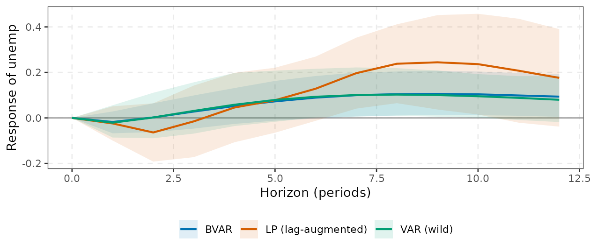

# Choosing a method, and where varm sits in the VAR ecosystem

This vignette is a decision guide. It maps *what you want to learn* to
*which estimator* and then to the `varm` function, and places `varm`
among the other R (and non-R) tools for VARs and local projections,
using the curated list
[awesome-var](https://github.com/kvasilopoulos/awesome-var). The
detailed theory is in
[`vignette("var-theory")`](https://kvasilopoulos.github.io/varm/articles/var-theory.md),
[`vignette("identification")`](https://kvasilopoulos.github.io/varm/articles/identification.md),
[`vignette("bayesian-var")`](https://kvasilopoulos.github.io/varm/articles/bayesian-var.md)
and
[`vignette("local-projections")`](https://kvasilopoulos.github.io/varm/articles/local-projections.md).

## 1. Decision tables

### 1.1 By situation

| Your situation | Recommended | `varm` call | Why |
|----|----|----|----|
| Small system ($`K\le 5`$), moderate lags, long sample, structural IRFs | OLS VAR + bootstrap (wild if volatility changes) | [`varm()`](https://kvasilopoulos.github.io/varm/reference/varm.md), `irf(ci = "wild")` | simple, efficient, transparent |
| Small system, short sample or persistent data in levels | BVAR with Minnesota + unit-root priors | [`bvarm()`](https://kvasilopoulos.github.io/varm/reference/bvarm.md) (default prior) | shrinkage removes the downward bias in persistence and stabilises forecasts |
| Many variables or many lags ($`K\gtrsim 8`$, or $`Kp`$ large relative to $`T`$) | BVAR; sparse/shrinkage priors | `bvarm(prior = prior_triangular("ssvs"/"horseshoe"))` | OLS is infeasible or noisy; cost is linear in $`K`$ per sweep |
| Time-varying volatility (Great Moderation, 2008, 2020) | BVAR with stochastic volatility | `bvarm(prior = prior_triangular(), sv = TRUE)` | correct predictive densities and shock scaling |
| Drifting coefficients and volatility | TVP-VAR-SV | [`tvpvar()`](https://kvasilopoulos.github.io/varm/reference/tvpvar.md), [`irf()`](https://kvasilopoulos.github.io/varm/reference/dynamics.md), [`irf_path()`](https://kvasilopoulos.github.io/varm/reference/irf_path.md) | local (frozen-parameter) IRFs at each date; sensitive to the prior |
| Short horizon (up to about a year) | VAR or BVAR | [`irf()`](https://kvasilopoulos.github.io/varm/reference/dynamics.md) | efficient |
| Long horizon (many years), possibly misspecified dynamics | LP, lag-augmented | `lp(lag_augment = TRUE)` | no extrapolation of short-run dynamics; inference valid without stationarity |
| A noisy LP path and you want a smooth one | smooth LP | [`lp_smooth()`](https://kvasilopoulos.github.io/varm/reference/lp_smooth.md) | pools horizons, MSE about two thirds of raw LP in simulation; bands optimistic |
| Nonlinearity, state dependence (recession vs expansion) | state-dependent LP | [`lp_state()`](https://kvasilopoulos.github.io/varm/reference/lp_state.md) | each horizon is a regression; calibrated transition |
| Many units (countries, states, firms) | panel LP | [`lp_panel()`](https://kvasilopoulos.github.io/varm/reference/lp_panel.md) | fixed effects, clustered errors |
| Claim about the whole response path | joint covariance and sup-t bands | [`lp_joint()`](https://kvasilopoulos.github.io/varm/reference/lp_joint.md), [`lp_supt()`](https://kvasilopoulos.github.io/varm/reference/lp_supt.md) | pointwise bands do not support path-wide claims; finite-sample coverage is below nominal |
| Recursive timing assumption is credible | Cholesky | `id_chol(order)` | exactly identified, no extra data |
| Theory on long-run neutrality | Blanchard-Quah | [`id_longrun()`](https://kvasilopoulos.github.io/varm/reference/identification.md) | needs stationary (differenced) data; near-integrated data are a problem |
| A mix of zero restrictions (short or long run) | zero-restriction or ARRW-style identification | [`id_restrictions()`](https://kvasilopoulos.github.io/varm/reference/id_restrictions.md) | exact zeros, closed form, no optimiser |
| Only qualitative theory (signs) | Sign restrictions; report the identified set and Fry-Pagan | [`id_sign()`](https://kvasilopoulos.github.io/varm/reference/identification.md), [`irf_fry_pagan()`](https://kvasilopoulos.github.io/varm/reference/irf_fry_pagan.md) | set identification; the prior over rotations matters |
| Signs plus a few zeros | zero and sign restrictions | [`id_zerosign()`](https://kvasilopoulos.github.io/varm/reference/id_zerosign.md) | *unweighted* in `varm` (see section 6) |
| Two volatility regimes, no economic restrictions | identification through heteroskedasticity | [`id_hetero()`](https://kvasilopoulos.github.io/varm/reference/id_hetero.md) | statistical shocks that must be labelled; a point estimate without sampling uncertainty |
| An external instrument for one shock | Proxy-SVAR or LP-IV | [`varm_proxy()`](https://kvasilopoulos.github.io/varm/reference/varm_proxy.md), [`id_proxy()`](https://kvasilopoulos.github.io/varm/reference/id_proxy.md), `lp(iv = )` | needs a strong, exogenous instrument; check [`proxy_fstat()`](https://kvasilopoulos.github.io/varm/reference/proxy_fstat.md) |
| Weak instrument worry | AR-type confidence sets | [`varm_proxy_robust()`](https://kvasilopoulos.github.io/varm/reference/varm_proxy_robust.md) | Montiel Olea-Stock-Watson (2021) |
| Unconditional and density forecasts | BVAR (best), VAR | [`forecast()`](https://kvasilopoulos.github.io/varm/reference/dynamics.md) | uncertainty combines parameters and shocks |
| Direct multi-step forecasts, long sample, doubtful dynamics | LP forecast | [`lp_forecast()`](https://kvasilopoulos.github.io/varm/reference/lp_forecast.md) | robust to misspecification, noisier |
| Variance and historical decomposition | VAR/BVAR | [`fevd()`](https://kvasilopoulos.github.io/varm/reference/dynamics.md), [`hd()`](https://kvasilopoulos.github.io/varm/reference/dynamics.md) | LP does not give FEVD or HD directly |
| A tidy, plot-ready result for any estimator | every result class | [`tidy()`](https://generics.r-lib.org/reference/tidy.html), [`glance()`](https://generics.r-lib.org/reference/glance.html), [`autoplot()`](https://ggplot2.tidyverse.org/reference/autoplot.html) | every result has [`tidy()`](https://generics.r-lib.org/reference/tidy.html) (a tibble: `horizon`, `response`, `estimate`, `std.error`, `conf.low`, `conf.high`, …) and [`autoplot()`](https://ggplot2.tidyverse.org/reference/autoplot.html) (a `ggplot` you extend with `+`); [`glance()`](https://generics.r-lib.org/reference/glance.html) gives a one-row summary |

A rule that cuts across rows: **report more than one**. Compare VAR and
LP, Cholesky orderings, Minnesota tightness: the disagreement between
reasonable choices is itself a measure of what the data say.

### 1.2 By the questions you can answer

Walk through these in order. The first is usually decisive.

| Question | If the answer is… | Then |
|----|----|----|
| **1. What is the goal?** | forecasting | BVAR/VAR; [`lp_forecast()`](https://kvasilopoulos.github.io/varm/reference/lp_forecast.md) only at long horizons with long samples |
|  | a causal effect of a shock | continue with the questions below |
| **2. System size** ($`K`$, lags $`p`$) | $`Kp`$ small against $`T`$ | OLS VAR |
|  | $`Kp`$ comparable to $`T`$, or $`K\gtrsim 8`$ | BVAR with shrinkage (SSVS/horseshoe for sparsity) |
| **3. Horizon** | up to about 4 years of quarterly data | VAR/BVAR |
|  | beyond, or a doubtful lag order | LP (lag-augmented), VAR as a check |
| **4. Nonlinearity** | the effect depends on a state | [`lp_state()`](https://kvasilopoulos.github.io/varm/reference/lp_state.md) |
|  | the effect drifts over time | [`tvpvar()`](https://kvasilopoulos.github.io/varm/reference/tvpvar.md) |
|  | none | linear methods |
| **5. Identification** | recursive timing | [`id_chol()`](https://kvasilopoulos.github.io/varm/reference/identification.md) |
|  | long-run neutrality | [`id_longrun()`](https://kvasilopoulos.github.io/varm/reference/identification.md) |
|  | sign (plus zeros) | [`id_sign()`](https://kvasilopoulos.github.io/varm/reference/identification.md)/[`id_zerosign()`](https://kvasilopoulos.github.io/varm/reference/id_zerosign.md) with Fry-Pagan |
|  | external instrument | [`varm_proxy()`](https://kvasilopoulos.github.io/varm/reference/varm_proxy.md) or `lp(iv = )` |
|  | volatility regimes | [`id_hetero()`](https://kvasilopoulos.github.io/varm/reference/id_hetero.md) |
| **6. Sample size** | $`T<100`$ quarterly observations | prefer BVAR; do not trust long-horizon LP bands |
|  | $`T`$ large, panels available | LP and panel LP are comfortable |

### 1.3 A decision flow

    Goal?
     |-- forecasting
     |     |-- few variables, short lags, long sample ---> varm() / var_select()
     |     |-- otherwise ----------------------------------> bvarm()  [+ sv = TRUE if volatility moves]
     |     |-- long horizon, long sample, doubtful VAR ---> lp_forecast()
     |-- structural (causal) effect of a shock
           |-- identification available?
           |     |-- recursive timing ---------------------> id_chol()
           |     |-- long-run neutrality ------------------> id_longrun()
           |     |-- signs (+ zeros) ----------------------> id_sign() / id_zerosign()  (report the set; Fry-Pagan)
           |     |-- external instrument ------------------> varm_proxy() / lp(iv = )
           |     |-- two volatility regimes ---------------> id_hetero()
           |-- nonlinear or state-dependent? --------------> lp_state() / tvpvar()
           |-- panel of units? ----------------------------> lp_panel()
           |-- how many variables / how persistent / how long a horizon?
                 |-- small, short horizon -----------------> VAR + wild bootstrap
                 |-- persistent or short sample -----------> BVAR with unit-root priors
                 |-- long horizon or doubtful lag order ---> LP with lag augmentation (and the VAR as a check)
                 |-- whole-path statement -----------------> lp_joint() + lp_supt(), lag_augment = TRUE

### 1.4 Every function in `varm`

| Function | What it does | Use it when |
|----|----|----|
| [`varm()`](https://kvasilopoulos.github.io/varm/reference/varm.md) | OLS/ML reduced-form VAR | baseline estimate; input to bootstrap and proxy methods |
| [`var_select()`](https://kvasilopoulos.github.io/varm/reference/var_select.md) | AIC, HQ, SC, FPE lag selection | choosing $`p`$ (check residuals; consider a BVAR instead) |
| [`stability()`](https://kvasilopoulos.github.io/varm/reference/stability.md) | eigenvalue moduli of the companion matrix | checking for explosive or near-unit roots |
| [`lag_matrices()`](https://kvasilopoulos.github.io/varm/reference/lag_matrices.md) | extract the lag coefficient matrices | custom calculations |
| [`draws()`](https://kvasilopoulos.github.io/varm/reference/draws.md) | bootstrap, wild, or asymptotic draws of $`(B,\Sigma)`$ | one currency for uncertainty |
| [`irf()`](https://kvasilopoulos.github.io/varm/reference/dynamics.md), [`fevd()`](https://kvasilopoulos.github.io/varm/reference/dynamics.md), [`hd()`](https://kvasilopoulos.github.io/varm/reference/dynamics.md), [`forecast()`](https://kvasilopoulos.github.io/varm/reference/dynamics.md) | responses, variance and historical decompositions, forecasts | `varm` and `bvarm` fits (`tvpvar` supports `irf`, `fevd`, `forecast`, not `hd`) |
| [`id_chol()`](https://kvasilopoulos.github.io/varm/reference/identification.md), [`id_longrun()`](https://kvasilopoulos.github.io/varm/reference/identification.md), [`id_sign()`](https://kvasilopoulos.github.io/varm/reference/identification.md), [`id_given()`](https://kvasilopoulos.github.io/varm/reference/identification.md) | core identification schemes | recursive, long-run, sign, user-supplied $`P`$ |
| [`id_restrictions()`](https://kvasilopoulos.github.io/varm/reference/id_restrictions.md), [`id_zerosign()`](https://kvasilopoulos.github.io/varm/reference/id_zerosign.md), [`id_hetero()`](https://kvasilopoulos.github.io/varm/reference/id_hetero.md), [`id_proxy()`](https://kvasilopoulos.github.io/varm/reference/id_proxy.md) | zero patterns, zero+sign, heteroskedasticity, instrument | richer identification |
| [`irf_fry_pagan()`](https://kvasilopoulos.github.io/varm/reference/irf_fry_pagan.md) | one coherent draw from a set-identified IRF | after [`id_sign()`](https://kvasilopoulos.github.io/varm/reference/identification.md)/[`id_zerosign()`](https://kvasilopoulos.github.io/varm/reference/id_zerosign.md) |
| [`varm_proxy()`](https://kvasilopoulos.github.io/varm/reference/varm_proxy.md), [`proxy_draws()`](https://kvasilopoulos.github.io/varm/reference/proxy_draws.md), [`proxy_fstat()`](https://kvasilopoulos.github.io/varm/reference/proxy_fstat.md), [`varm_proxy_robust()`](https://kvasilopoulos.github.io/varm/reference/varm_proxy_robust.md), [`varm_proxy_bayes()`](https://kvasilopoulos.github.io/varm/reference/varm_proxy_bayes.md) | proxy-SVAR estimation, bootstrap, strength, robust sets, Bayesian version | external instruments |
| [`bvarm()`](https://kvasilopoulos.github.io/varm/reference/bvarm.md), [`prior_minnesota()`](https://kvasilopoulos.github.io/varm/reference/prior_minnesota.md), [`prior_triangular()`](https://kvasilopoulos.github.io/varm/reference/prior_triangular.md) | Bayesian VAR (conjugate, hierarchical, triangular, SV, SSVS, horseshoe) | short samples, large $`K`$, volatility |
| [`volatility()`](https://kvasilopoulos.github.io/varm/reference/volatility.md), [`mcmc_diagnostics()`](https://kvasilopoulos.github.io/varm/reference/mcmc_diagnostics.md) | posterior volatility paths; ESS, R-hat, Geweke | after `bvarm(sv = TRUE)` or any sampler |
| [`tvpvar()`](https://kvasilopoulos.github.io/varm/reference/tvpvar.md), [`tvp_prior()`](https://kvasilopoulos.github.io/varm/reference/tvp_prior.md), [`tvp_volatility()`](https://kvasilopoulos.github.io/varm/reference/tvp_volatility.md), [`irf_path()`](https://kvasilopoulos.github.io/varm/reference/irf_path.md) | TVP-VAR-SV, its prior, volatility paths, IRFs through time | drifting parameters |
| [`tidy()`](https://generics.r-lib.org/reference/tidy.html), [`glance()`](https://generics.r-lib.org/reference/glance.html), [`augment()`](https://generics.r-lib.org/reference/augment.html), [`autoplot()`](https://ggplot2.tidyverse.org/reference/autoplot.html) | tibbles and ggplot2 graphics for every result (`varm`, `irf`, `fevd`, `hd`, `forecast`, `bvarm`, `tvpvar`, `lp_*`) | any plot or table; `as.data.frame(tidy(x))` for base R |
| [`theme_varm()`](https://kvasilopoulos.github.io/varm/reference/theme_varm.md), [`varm_palette()`](https://kvasilopoulos.github.io/varm/reference/theme_varm.md) | the package ggplot2 theme and colour-blind-safe palette | your own plots in the same style |
| [`normalise_to()`](https://kvasilopoulos.github.io/varm/reference/normalise_to.md) | unit-impact normalisation for [`irf()`](https://kvasilopoulos.github.io/varm/reference/dynamics.md) | comparing with an LP (`irf(normalise = normalise_to("rate", "rate", 1))`) |
| [`lp()`](https://kvasilopoulos.github.io/varm/reference/lp.md) | LP, LP-IV, lag augmentation, cumulative (variables named with tidyselect) | linear LP; robustness check on a VAR |
| [`lp_joint()`](https://kvasilopoulos.github.io/varm/reference/lp_joint.md), [`lp_supt()`](https://kvasilopoulos.github.io/varm/reference/lp_supt.md) | cross-horizon covariance; sup-t bands | whole-path claims |
| [`lp_state()`](https://kvasilopoulos.github.io/varm/reference/lp_state.md) | state-dependent LP | regime-dependent responses |
| [`lp_smooth()`](https://kvasilopoulos.github.io/varm/reference/lp_smooth.md) | penalised B-spline LP | smooth point estimates |
| [`lp_panel()`](https://kvasilopoulos.github.io/varm/reference/lp_panel.md) | panel LP with fixed effects, clustering | panels |
| [`lp_forecast()`](https://kvasilopoulos.github.io/varm/reference/lp_forecast.md) | direct multi-step forecasts | long-horizon forecasts |
| [`compare_lp_var()`](https://kvasilopoulos.github.io/varm/reference/compare_lp_var.md) | LP versus Cholesky VAR, same lags and ordering; a tibble with `horizon`, `lp`, `lp_se`, `var`, `diff`, `z` | diagnosing VAR misspecification |

## 2. A recommended workflow on `yraw`

``` r

sel <- var_select(y, pmax = 8)$selection
sel
#> AIC  HQ  SC FPE 
#>   6   2   2   6
fit <- varm(y, p = 2)                       # parsimonious lag choice (SC/HQ)
round(max(stability(fit)), 3)               # closeness of the largest root to one
#> [1] 0.946
nm <- normalise_to("rate", "rate", size = 1)
ir_var <- irf(fit, horizon = 12, ci = "wild", nboot = 300, normalise = nm)
ir_bvar <- irf(bvarm(y, p = 2, ndraw = 1000, nburn = 500), horizon = 12, normalise = nm)
ir_lp <- lp(yraw, rate, horizon = 12, lags = 2, contemp = c(infl, unemp), lag_augment = TRUE)
# three estimates of the response of unemployment to a 1-point policy-rate shock
round(rbind(VAR  = ir_var$estimate["unemp", "rate", c(1, 5, 9, 13)],
            BVAR = ir_bvar$estimate["unemp", "rate", c(1, 5, 9, 13)],
            LP   = ir_lp$estimate[c(1, 5, 9, 13), "unemp"]), 3)
#>      0     4     8    12
#> VAR  0 0.058 0.103 0.080
#> BVAR 0 0.052 0.104 0.094
#> LP   0 0.046 0.238 0.176
```

If the three agree you can report any; here the LP differs at long
horizons, as expected
([`vignette("local-projections")`](https://kvasilopoulos.github.io/varm/articles/local-projections.md)).

Because every result has
[`tidy()`](https://generics.r-lib.org/reference/tidy.html), putting the
three on one ggplot2 figure is a few lines (here the 90% bands of the
unemployment response):

``` r

pick <- function(x, nm) {
  d <- tidy(x)
  d <- if ("shock" %in% names(d)) subset(d, shock == "rate" & response == "unemp") else subset(d, response == "unemp")
  cbind(method = nm, subset(d, level == 0.9, select = c(horizon, estimate, conf.low, conf.high)))
}
three <- rbind(pick(ir_var, "VAR (wild)"), pick(ir_bvar, "BVAR"), pick(ir_lp, "LP (lag-augmented)"))
ggplot(three, aes(horizon, estimate, colour = method, fill = method)) +
  geom_hline(yintercept = 0, colour = "grey60") +
  geom_ribbon(aes(ymin = conf.low, ymax = conf.high), alpha = 0.12, colour = NA) +
  geom_line(linewidth = 0.8) +
  scale_colour_manual(values = varm_palette(3), name = NULL) +
  scale_fill_manual(values = varm_palette(3), name = NULL) +
  labs(x = "Horizon (periods)", y = "Response of unemp") +
  theme_varm()
```



### Forecasting: does shrinkage pay?

A pseudo out-of-sample check (expanding window, origins 1990Q2-2005Q3,
up to 61 forecasts per horizon) comparing a random walk, OLS VARs with 2
and 6 lags and a BVAR with 6 lags (posterior-mean forecast):

``` r

orig <- 150:210; H <- 4
err <- array(NA_real_, c(length(orig), 4, 3, H), dimnames = list(NULL, c("RW", "VAR(2)", "VAR(6)", "BVAR(6)"), colnames(y), paste0("h", 1:H)))
for (i in seq_along(orig)) {
  Tn <- orig[i]; hh <- min(H, nrow(y) - Tn); if (hh < 1) next
  Yt <- y[1:Tn, ]; act <- y[Tn + seq_len(hh), , drop = FALSE]
  fc <- list(matrix(rep(Yt[Tn, ], each = hh), hh),
             forecast(varm(Yt, 2), h = hh, ci = "none")$mean,
             forecast(varm(Yt, 6), h = hh, ci = "none")$mean,
             forecast(bvarm(Yt, 6, ndraw = 200, nburn = 200), h = hh)$mean)
  for (m in 1:4) err[i, m, , seq_len(hh)] <- t(fc[[m]] - act)
}
rmse <- apply(err^2, c(2, 3, 4), function(z) sqrt(mean(z, na.rm = TRUE)))
round(rmse[, , "h1"], 3)
#>          infl unemp  rate
#> RW      0.209 0.228 0.474
#> VAR(2)  0.207 0.207 0.457
#> VAR(6)  0.185 0.209 0.476
#> BVAR(6) 0.197 0.206 0.471
round(rmse[, , "h4"], 3)
#>          infl unemp  rate
#> RW      0.551 0.662 1.469
#> VAR(2)  0.629 0.606 1.280
#> VAR(6)  0.606 0.642 1.231
#> BVAR(6) 0.577 0.611 1.252
```

The gains are modest and not uniform (a handful of overlapping origins
cannot support formal tests): the BVAR with six lags beats the OLS
VAR(6) at four quarters ahead for inflation and unemployment, is mixed
at one quarter ahead, and is roughly tied for the interest rate, while
the random walk is hard to beat at one quarter ahead. Compare density
forecasts and use longer evaluation samples before drawing conclusions.

## 3. Cross-checks against other packages

`varm` is validated by agreement with established implementations. The
reduced-form VAR coincides with `vars` to machine precision, including
information criteria:

``` r

v <- vars::VAR(y, p = 2, type = "const")
cb <- sapply(1:3, function(k) coef(v)[[k]][, 1])
max(abs(cb[1:6, ] - coef(fit)[1:6, ]))                     # slope coefficients
#> [1] 3.936296e-13
max(abs(vars::VARselect(y, lag.max = 8)$criteria[1:3, ] - t(var_select(y, 8)$criteria)[1:3, ]))   # AIC, HQ, SC
#> [1] 5.329071e-15
iv <- vars::irf(v, impulse = "rate", response = "infl", n.ahead = 8, ortho = TRUE, boot = FALSE)
a <- irf(fit, horizon = 8, ci = "none")
max(abs(iv$irf$rate[, 1] - a$estimate["infl", "rate", ]))   # orthogonalised IRF, same Cholesky ordering
#> [1] 3.42365e-14
```

For local projections the comparison with `lpirfs` is close but not
identical:

``` r

r <- lpirfs::lp_lin(as.data.frame(y), lags_endog_lin = 2, trend = 0, shock_type = 1, confint = 1.65,
                    hor = 8, use_nw = TRUE)
l8 <- lp(yraw, rate, horizon = 8, lags = 2, contemp = c(infl, unemp))
round(rbind(lpirfs = r$irf_lin_mean[1, , 3], varm = l8$estimate[, "infl"]), 3)
#>        0      1      2      3      4      5      6      7      8
#> lpirfs 0 -0.057 -0.062 -0.045 -0.035 -0.025 -0.037 -0.071 -0.104
#> varm   0 -0.059 -0.062 -0.032 -0.022 -0.008 -0.015 -0.043 -0.075
```

The two use the same recursive logic; the differences (up to about 0.03
at long horizons) come from sample alignment and the specification of
contemporaneous controls, and we have **not** reconciled them exactly.
The state-dependent LP, by contrast, matches
[`lpirfs::lp_nl()`](https://rdrr.io/pkg/lpirfs/man/lp_nl.html) closely
under its own timing convention
([`vignette("lp-advanced")`](https://kvasilopoulos.github.io/varm/articles/lp-advanced.md)).
For the Bayesian VAR, the comparison with `BVAR` is in
[`vignette("bayesian-var")`](https://kvasilopoulos.github.io/varm/articles/bayesian-var.md):
with the same inverse-Wishart scale the hyperparameter posteriors and
IRFs agree to Monte Carlo error.

### Validation summary

Numbers below come from the package’s validation scripts (`validation/`
in the source tree), not from code run when this vignette is built.
Speed figures are wall-clock seconds on the developer’s machine and will
differ on yours; use them for relative orders of magnitude.

| Check | Reference | Agreement |
|----|----|----|
| Reduced-form VAR coefficients, information criteria, orthogonalised IRFs | `vars` | about $`10^{-12}`$ |
| BVAR log posterior (hierarchical Minnesota) | `BVAR` | about $`10^{-13}`$ when $`\psi`$ is matched |
| LP point estimates and HAC/HC standard errors | `lm` + `sandwich` | about $`10^{-13}`$ |
| State-dependent LP (`timing = "lagged"`) | [`lpirfs::lp_nl`](https://rdrr.io/pkg/lpirfs/man/lp_nl.html) | about $`7\times10^{-13}`$ |
| Linear LP | [`lpirfs::lp_lin`](https://rdrr.io/pkg/lpirfs/man/lp_lin.html) | close but not identical: up to about 0.03 at long horizons |

Speed per 1000 posterior draws (seconds, $`p=4`$, Apple M4 Pro):

| Sampler | $`K=3`$ | $`K=7`$ | $`K=20`$ |
|----|----|----|----|
| conjugate, fixed hyperparameters | 0.003 | 0.010 | 0.061 |
| hierarchical (GLP) | 0.054 | 0.177 | 1.271 |
| triangular | 0.019 | 0.110 | 1.312 |
| triangular + stochastic volatility | 0.112 | 0.382 | 2.979 |
| [`BVAR::bvar`](https://rdrr.io/pkg/BVAR/man/bvar.html) (reference) | 0.157 | 0.259 | 0.899 |

The conjugate sampler with fixed hyperparameters (direct draws) is the
fastest by an order of magnitude or more.
[`BVAR::bvar`](https://rdrr.io/pkg/BVAR/man/bvar.html) is faster than
the hierarchical sampler at $`K=20`$ (0.90 s against 1.27 s); `varm` is
faster at $`K=3`$ and $`K=7`$. The comparison is not like-for-like: the
`varm` hierarchical sampler draws three hyperparameters, `BVAR` one. The
triangular samplers cost more per draw but scale to systems where the
conjugate structure is lost (SV, sparse priors). Other timings on the
same machine: the TVP-VAR-SV with 10000 draws plus 2000 burn-in at
$`T=215`$, $`K=3`$, $`p=2`$ takes about 8 s; a full three-response
[`lp()`](https://kvasilopoulos.github.io/varm/reference/lp.md) with
$`H=16`$ about 0.5 ms and the OLS
[`varm()`](https://kvasilopoulos.github.io/varm/reference/varm.md) about
0.05 ms.

## 4. Literature map and positioning

The entries are taken from the awesome-var list. The “relation to varm”
column says whether `varm` overlaps, complements or does not cover the
package.

| Area | Packages / tools | What they do | Relation to `varm` |
|----|----|----|----|
| Core frequentist VAR | `vars` (Pfaff, 2008), `svars`, `tsDyn` | VAR estimation, diagnostics, IRFs; SVAR identification incl. non-Gaussian and heteroskedasticity; threshold VAR/VECM | `varm` overlaps on estimation and recursive/long-run/sign IRFs and is faster (C++ bootstrap); lacks diagnostic test suites, VECM, threshold models. Use `vars` for tests and cointegration, `svars` for statistical identification |
| Hierarchical BVAR | `BVAR` (Kuschnig and Vashold, 2021), `bvartools`, `BVARverse` | GLP hierarchical Minnesota/SOC/SUR; utilities for Gibbs-sampled BVARs | `varm` implements the same GLP prior (same posterior with equal $`\psi`$; see [`vignette("bayesian-var")`](https://kvasilopoulos.github.io/varm/articles/bayesian-var.md)); `BVAR` has conditional forecasts and more hyperparameters; `varm` additionally offers triangular/SV/SSVS/horseshoe samplers |
| Bayesian SVAR | `bsvars`, `bsvarSIGNs` (Woźniak; Wang and Woźniak), `bpvars` | heteroskedastic and non-normal identification, sign/zero/narrative restrictions, panel VARs | complementary: `varm` has Cholesky, long-run, sign, zero+sign (unweighted), zero-pattern, proxy and two-regime heteroskedasticity identification; use `bsvars`/`bsvarSIGNs` for properly weighted zero+sign, narrative restrictions and Bayesian identification through heteroskedasticity |
| Time variation | `bvarsv`, `bvhar`, `mfbvar`, `bayesVAR_TVP`, `Large-TVP-VAR` | TVP-VAR-SV, VHAR forecasting, mixed-frequency BVAR | `varm` has stochastic volatility with constant coefficients (`bvarm(sv = TRUE)`) and a TVP-VAR-SV ([`tvpvar()`](https://kvasilopoulos.github.io/varm/reference/tvpvar.md)); no mixed frequency |
| High-dimensional / sparse | `BigVAR`, `bigtime`, `VARshrink`, `lbvar`, `LSVAR` | penalised (lasso, elastic net, hierarchical lag) VARs; large-scale BVAR | `varm` covers Bayesian shrinkage (SSVS, horseshoe, Minnesota) in the large-$`K`$ regime; frequentist penalised estimators are not implemented, use `BigVAR` |
| Panel and global VAR | `panelvar`, `pvars`, `BGVAR` | panel VAR, GVAR | `varm` has panel *local projections* ([`lp_panel()`](https://kvasilopoulos.github.io/varm/reference/lp_panel.md)) but no panel VAR or global VAR; use `panelvar`, `pvars`, `BGVAR` |
| Local projections | `lpirfs`, `sovereign`; `LocalProjections.jl`; Python `localprojections` | linear and nonlinear LP, state-dependent LP, smooth LP | `varm` covers linear LP, LP-IV, lag augmentation, HC/HAC inference, state-dependent LP ([`lp_state()`](https://kvasilopoulos.github.io/varm/reference/lp_state.md), matches `lp_nl` under its convention), smooth LP, panel LP, sup-t bands and direct forecasts; `lpirfs` has a richer plotting/utility layer and its own panel and instrumental options; `sovereign` offers state-dependent and threshold VAR/LP workflows `varm` lacks |
| External instruments | `varexternal`, Plagborg-Møller code, `proxy-svar-smc` | proxy-SVAR estimation | `lp(iv = )`, [`varm_proxy()`](https://kvasilopoulos.github.io/varm/reference/varm_proxy.md) (wild and moving-block bootstrap), [`varm_proxy_robust()`](https://kvasilopoulos.github.io/varm/reference/varm_proxy_robust.md) (Anderson-Rubin-type sets) and [`varm_proxy_bayes()`](https://kvasilopoulos.github.io/varm/reference/varm_proxy_bayes.md) (limited-information) |
| MATLAB toolboxes | VAR Toolbox, BEAR (ECB), BVAR\_ (Ferroni and Canova), Koop-Korobilis code, IRIS | broad structural/Bayesian VAR workflows | `varm` reproduces the Koop-Korobilis data set and a subset of these methods in R |
| Other | factor-augmented (`FAVAR`), fractional cointegration (`FCVAR`), smooth transition (`starvars`), Student-t (`StVAR`) | specialised models | not covered (FAVAR is not implemented) |

### Positioning

`varm` has one design idea: **one currency for uncertainty**. The
bootstrap, the asymptotic Monte Carlo and every Bayesian sampler return
a `varm_draws` container of reduced-form $`(B,\Sigma)`$ draws, and
[`irf()`](https://kvasilopoulos.github.io/varm/reference/dynamics.md),
[`fevd()`](https://kvasilopoulos.github.io/varm/reference/dynamics.md),
[`hd()`](https://kvasilopoulos.github.io/varm/reference/dynamics.md),
[`forecast()`](https://kvasilopoulos.github.io/varm/reference/dynamics.md)
and every identification scheme act on that container. A new sampler
therefore inherits all identification schemes, and a new identification
scheme works for every estimator. Everything inside the loops is
compiled (Rcpp/RcppArmadillo). What it is *not*: a diagnostic-testing
suite, a cointegration toolkit (VECM) or a panel/global VAR package;
combine it with `vars`, `svars`, `bsvars` or `lpirfs` for those.

## 5. Common mistakes this guide is meant to prevent

- Reading VAR coefficients as causal effects instead of IRFs.
- Using AIC with a large `pmax` and a short sample without checking
  residuals (and without a BVAR as an alternative).
- Reporting the pointwise median of sign-restricted IRFs as “the”
  response
  ([`vignette("identification")`](https://kvasilopoulos.github.io/varm/articles/identification.md)).
- Comparing marginal likelihoods across lag orders.
- Treating LP bands as comparable to VAR bands when the lag orders or
  horizons are very different, and ignoring that LP is far noisier at
  long horizons.
- Ignoring the volatility date when scaling IRFs from an SV model
  (`vol = "last"` versus `"mean"`).

## 6. Known limitations

These are properties of the current implementation and of the methods.
They are documented here so that you can decide whether `varm` is the
right tool, and mostly where they are tested (`validation/`) or
described in the help pages.

- **Zero plus sign restrictions are unweighted.**
  [`id_zerosign()`](https://kvasilopoulos.github.io/varm/reference/id_zerosign.md)
  implements the ARRW (2018) draw of the rotation but not the importance
  weights that make accepted draws uniform on the restricted set under
  the conjugate prior. Treat its output as a set of admissible models
  whose density is not the ARRW posterior; for properly weighted
  inference use `bsvarSIGNs`.
- **Bootstrap undercoverage under heteroskedasticity.** The residual
  (recursive-design) bootstrap assumes homoskedastic innovations; with
  stochastic volatility it undercovers. The wild bootstrap
  (`irf(ci = "wild")`) is more robust, but bootstrap percentile bands
  are still not guaranteed to reach nominal coverage in short,
  persistent samples.
- **Proxy wild bootstrap is invalid.** The Mertens-Ravn style wild
  bootstrap that multiplies residuals and proxy by a common Rademacher
  weight leaves $`T^{-1}\sum u_tz_t`$ unchanged, so the impact vector
  hardly varies and bands are far too narrow (Jentsch and Lunsford,
  2019).
  [`proxy_draws()`](https://kvasilopoulos.github.io/varm/reference/proxy_draws.md)
  documents this and its default is the moving-block bootstrap; use
  [`varm_proxy_robust()`](https://kvasilopoulos.github.io/varm/reference/varm_proxy_robust.md)
  when the instrument may be weak.
- **Slow Metropolis mixing.** The hierarchical-hyperparameter sampler
  uses an adaptive random-walk Metropolis step. Mixing can be slow;
  always run
  [`mcmc_diagnostics()`](https://kvasilopoulos.github.io/varm/reference/mcmc_diagnostics.md)
  (effective sample size, R-hat, Geweke) and lengthen the run if needed.
- **TVP prior sensitivity.** The TVP-VAR’s time variation is largely
  driven by the prior on the innovation covariances $`Q`$, $`S`$, $`W`$
  (the Primiceri training-sample calibration in
  [`tvp_prior()`](https://kvasilopoulos.github.io/varm/reference/tvp_prior.md)).
  Report results under alternative scalings before interpreting drift as
  a finding.
- **Sup-t bands and HAC inference at long horizons undercover.** With
  $`T=200`$ the whole-path coverage of 90% sup-t bands is about 0.78
  with Newey-West and 0.84 with lag augmentation
  ([`vignette("lp-advanced")`](https://kvasilopoulos.github.io/varm/articles/lp-advanced.md)).
  Smooth-LP bands ignore the selection of $`\lambda`$.
- **LP versus
  [`lpirfs::lp_lin`](https://rdrr.io/pkg/lpirfs/man/lp_lin.html) not
  reconciled**: differences up to about 0.03 at long horizons.
- **[`id_hetero()`](https://kvasilopoulos.github.io/varm/reference/id_hetero.md)
  is a point estimate**: all draws share one impact matrix, so no
  sampling uncertainty is propagated.
- **Not implemented**: narrative sign restrictions, factor-augmented VAR
  (FAVAR), Bayesian local projections (BLP), mixed-frequency, panel and
  global VARs, VECM/cointegration, and frequentist penalised (lasso)
  VARs.

## References

- Adämmer, P. (2019). lpirfs: an R package to estimate impulse response
  functions by local projections. *The R Journal*, 11(2), 421-438.
- Kuschnig, N. and Vashold, L. (2021). BVAR: Bayesian vector
  autoregressions with hierarchical prior selection in R. *Journal of
  Statistical Software*, 100(14), 1-27.
- Arias, J. E., Rubio-Ramírez, J. F. and Waggoner, D. F. (2018).
  Inference based on structural vector autoregressions identified with
  sign and zero restrictions: theory and applications. *Econometrica*,
  86(2), 685-720.
- Jentsch, C. and Lunsford, K. G. (2019). The dynamic effects of
  personal and corporate income tax changes in the United States:
  comment. *American Economic Review*, 109(7), 2655-2678.
- Pfaff, B. (2008). VAR, SVAR and SVEC models: implementation within R
  package vars. *Journal of Statistical Software*, 27(4), 1-32.
- Wang, X. and Woźniak, T. (2025). Bayesian analyses of structural
  vector autoregressions with sign, zero, and narrative restrictions
  using the R package bsvarSIGNs. arXiv:2501.16711.
- Woźniak, T. (2024). Fast and efficient Bayesian analysis of structural
  vector autoregressions using the R package bsvars. arXiv:2410.15090.
- Giannone, D., Lenza, M. and Primiceri, G. E. (2015). Prior selection
  for vector autoregressions. *Review of Economics and Statistics*,
  97(2), 436-451.
- See also the reference lists of the other vignettes: Giannone, Lenza
  and Primiceri (2015); Li, Plagborg-Møller and Wolf (2024);
  Plagborg-Møller and Wolf (2021); Montiel Olea and Plagborg-Møller
  (2021); Kilian and Lütkepohl (2017).
