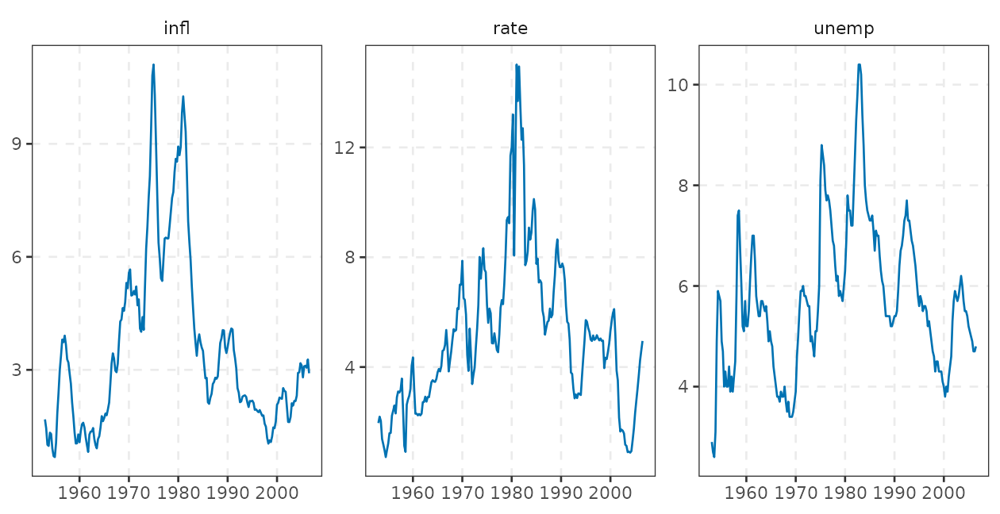
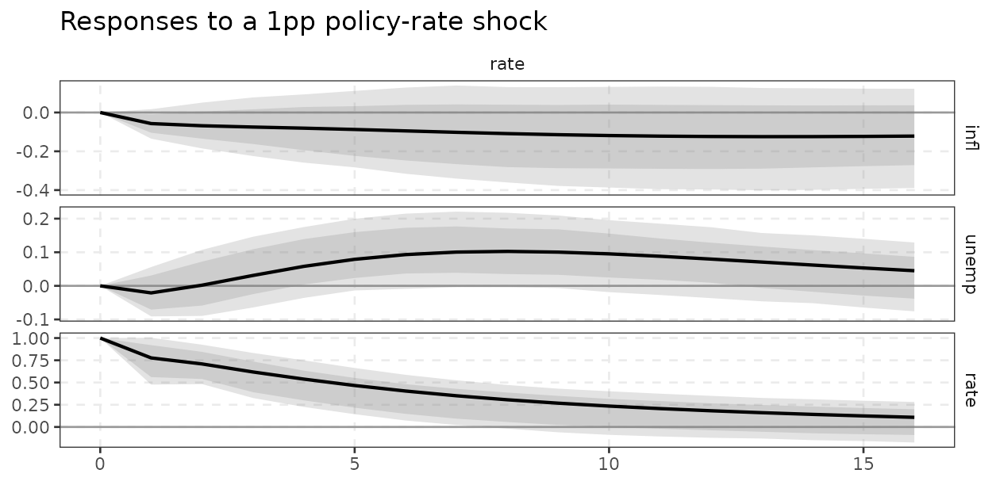
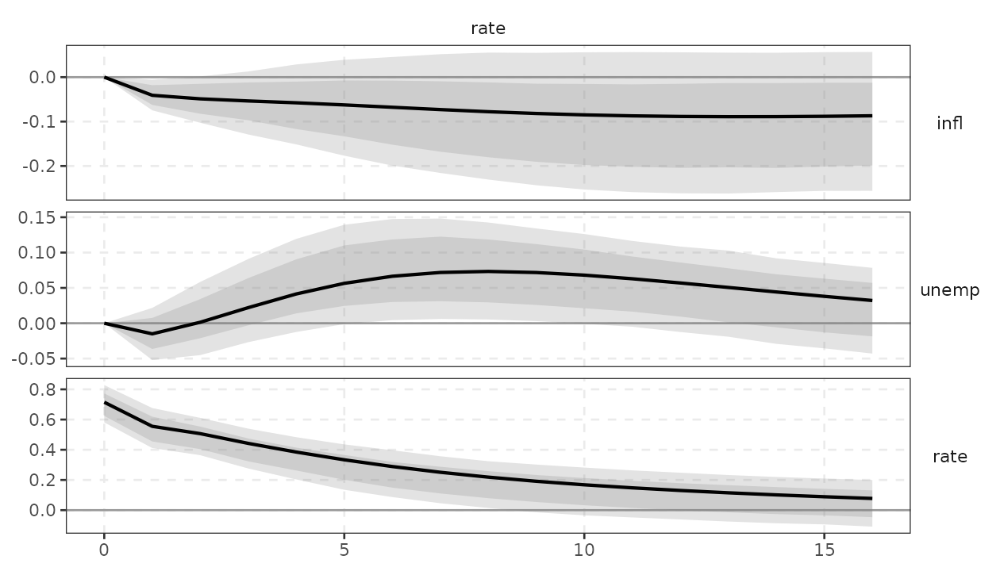
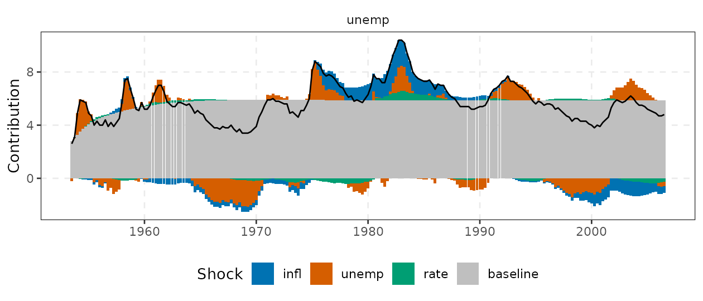
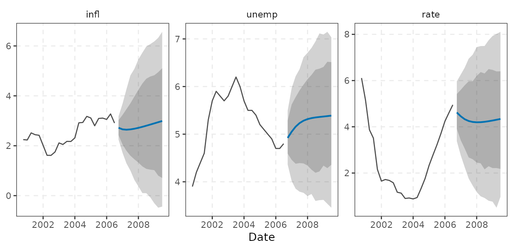
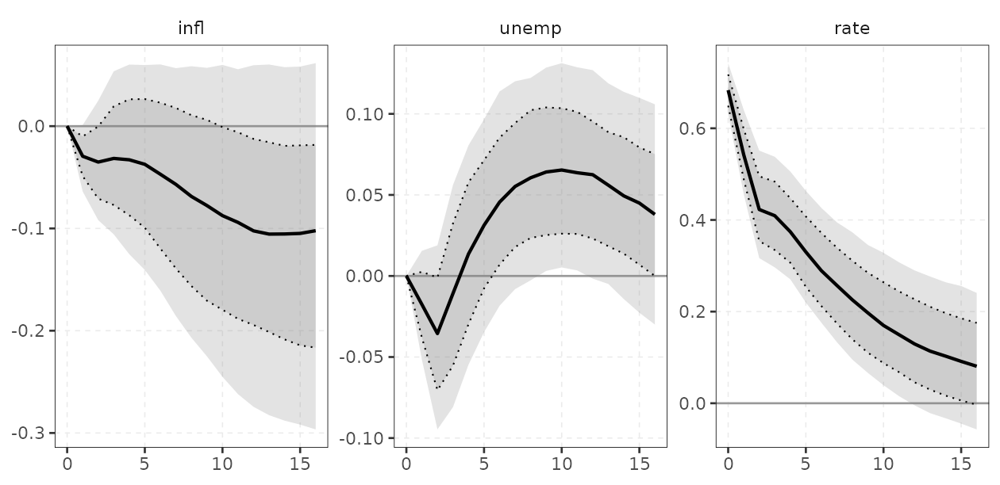
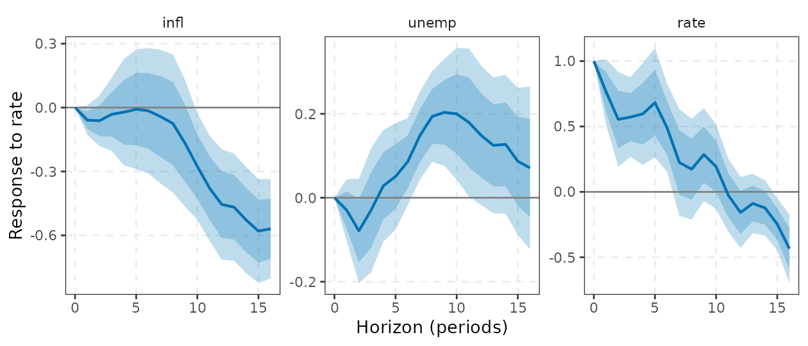
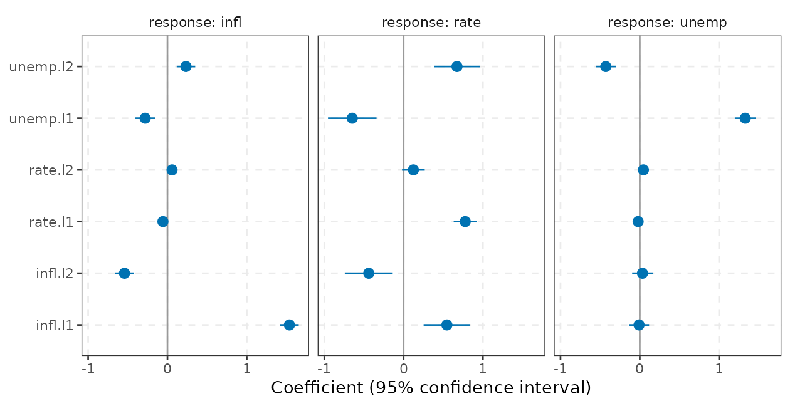
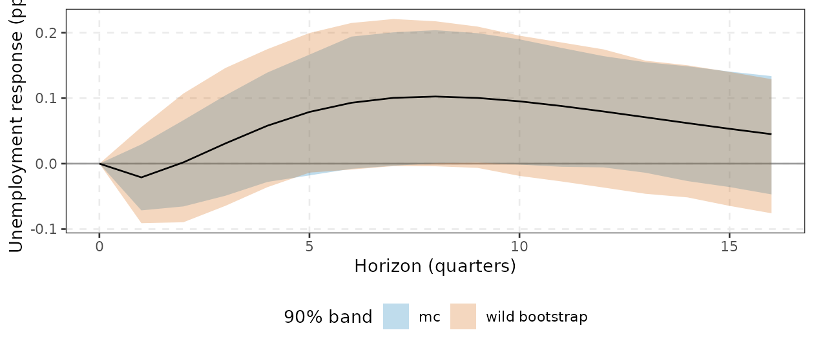

# Getting started with varm

`varm` estimates reduced-form and structural VARs, Bayesian VARs
(Minnesota, sum-of-coefficients, hierarchical, stochastic volatility,
shrinkage priors), time-varying-parameter VARs and local projections,
with a compiled (RcppArmadillo) engine. This tour takes about ten
minutes and follows the workflow of a typical applied project:

1.  data, 2. lag choice, 3. estimation, 4. stability, 5. impulse
    responses with bands, 6. variance decomposition, 7. historical
    decomposition, 8. forecasts,
2.  a Bayesian VAR in three lines, 10. a local projection in three
    lines,
3.  the tidy workflow: tibbles into `ggplot2`.

The API follows tidy-tools conventions. Variables are selected with
tidyselect (`vars = c(infl, rate)`, `shocks = rate`), results convert to
tibbles with [`tidy()`](https://generics.r-lib.org/reference/tidy.html),
[`glance()`](https://generics.r-lib.org/reference/glance.html) and
[`augment()`](https://generics.r-lib.org/reference/augment.html), and
every result has an
[`autoplot()`](https://ggplot2.tidyverse.org/reference/autoplot.html)
method that returns an ordinary `ggplot2` object you can extend with
`+ labs()`, `+ theme_varm()` or any other layer.

Every object returned by
[`irf()`](https://kvasilopoulos.github.io/varm/reference/dynamics.md),
[`fevd()`](https://kvasilopoulos.github.io/varm/reference/dynamics.md),
[`hd()`](https://kvasilopoulos.github.io/varm/reference/dynamics.md) and
[`forecast()`](https://kvasilopoulos.github.io/varm/reference/dynamics.md)
is built from the same currency, a set of reduced-form parameter draws
([`draws()`](https://kvasilopoulos.github.io/varm/reference/draws.md)),
so the frequentist (bootstrap) and Bayesian code paths share one
interface.

## 1. Data

`yraw` holds three quarterly US series from the Koop-Korobilis data set
(1953Q1 to 2006Q3): inflation (`infl`), the unemployment rate (`unemp`)
and a short-term interest rate (`rate`). We add a `Date` column.
[`varm()`](https://kvasilopoulos.github.io/varm/reference/varm.md) drops
non-numeric columns from the estimation but keeps a `Date` column as the
time axis of the plots.

``` r

y <- yraw
y$date <- seq(as.Date("1953-01-01"), by = "quarter", length.out = nrow(y))
dim(yraw)
#> [1] 215   3
long <- do.call(rbind, lapply(c("infl", "unemp", "rate"), function(v) {
  data.frame(date = y$date, variable = v, value = y[[v]])
}))
ggplot(long, aes(date, value)) +
  geom_line(colour = varm_palette(1)) +
  facet_wrap(vars(variable), scales = "free_y") +
  labs(x = NULL, y = NULL) +
  theme_varm()
```



[`varm()`](https://kvasilopoulos.github.io/varm/reference/varm.md)
accepts a data frame (preferred), a matrix or a `ts`. Use `vars =` to
pick the endogenous variables with tidyselect, for example
`varm(y, p = 2, vars = c(infl, rate))` for a bivariate system. All three
series are persistent levels; we keep them in levels, which is standard
for a VAR used for dynamics and forecasting (see
[`vignette("var-theory")`](https://kvasilopoulos.github.io/varm/articles/var-theory.md),
“Reduced-form VAR: theory, inference and use”, for when this is and is
not appropriate).

## 2. Lag choice

[`var_select()`](https://kvasilopoulos.github.io/varm/reference/var_select.md)
evaluates AIC, Hannan-Quinn (HQ), Schwarz (SC) and the (log) final
prediction error (FPE) for $`p=1,\dots,p_{\max}`$ on a common sample.

``` r

sel <- var_select(yraw, pmax = 8)
sel$selection
#> AIC  HQ  SC FPE 
#>   6   2   2   6
```

AIC and FPE favour long lags, HQ and SC pick $`p=2`$. We take two lags
as a parsimonious baseline.

## 3. Estimation

``` r

fit <- varm(y, p = 2)
fit
#> <varm> VAR(2) with 3 variables, 213 effective observations
#> logLik = -338.416; max |eigenvalue| = 0.946
#> 
#>             infl   unemp    rate
#> infl.l1   1.5378 -0.0095  0.5457
#> unemp.l1 -0.2809  1.3297 -0.6475
#> rate.l1  -0.0571 -0.0210  0.7766
#> infl.l2  -0.5418  0.0341 -0.4395
#> unemp.l2  0.2336 -0.4290  0.6730
#> rate.l2   0.0580  0.0457  0.1232
#> const     0.2872  0.3654  0.0052
```

The tibble summaries are the quickest way to read a fit:
[`tidy()`](https://generics.r-lib.org/reference/tidy.html) is the
coefficient table (one row per equation and regressor),
[`glance()`](https://generics.r-lib.org/reference/glance.html) the
one-row model summary and
[`augment()`](https://generics.r-lib.org/reference/augment.html) the
data with fitted values and residuals.

``` r

co <- tidy(fit, conf.int = TRUE)
co[co$response == "rate", ]
#> # A tibble: 7 × 8
#>   response term     estimate std.error statistic  p.value conf.low conf.high
#>   <chr>    <chr>       <dbl>     <dbl>     <dbl>    <dbl>    <dbl>     <dbl>
#> 1 rate     infl.l1   0.546      0.149     3.66   3.16e- 4   0.252      0.839
#> 2 rate     unemp.l1 -0.647      0.155    -4.17   4.47e- 5  -0.954     -0.341
#> 3 rate     rate.l1   0.777      0.0738   10.5    5.19e-21   0.631      0.922
#> 4 rate     infl.l2  -0.440      0.153    -2.87   4.52e- 3  -0.741     -0.138
#> 5 rate     unemp.l2  0.673      0.148     4.55   9.03e- 6   0.382      0.964
#> 6 rate     rate.l2   0.123      0.0726    1.70   9.10e- 2  -0.0198     0.266
#> 7 rate     const     0.00517    0.238     0.0217 9.83e- 1  -0.465      0.475
glance(fit)
#> # A tibble: 1 × 8
#>       K     p  nobs logLik   AIC   BIC    HQ max_root
#>   <int> <int> <int>  <dbl> <dbl> <dbl> <dbl>    <dbl>
#> 1     3     2   213  -338.  731.  822.  768.    0.946
augment(fit)
#> # A tibble: 215 × 10
#>    date        infl unemp  rate .fitted_infl .resid_infl .fitted_unemp
#>    <date>     <dbl> <dbl> <dbl>        <dbl>       <dbl>         <dbl>
#>  1 1953-01-01 1.69    2.9  1.96       NA         NA              NA   
#>  2 1953-04-01 1.45    2.7  2.19       NA         NA              NA   
#>  3 1953-07-01 1.01    2.6  2.04        1.51      -0.498           2.80
#>  4 1953-10-01 0.981   3.1  1.38        0.969      0.0114          2.76
#>  5 1954-01-01 1.33    4.9  1.18        1.02       0.309           3.46
#>  6 1954-04-01 1.30    5.9  0.97        1.17       0.131           5.61
#>  7 1954-07-01 0.909   5.8  0.72        1.06      -0.151           6.17
#>  8 1954-10-01 0.709   5.7  0.98        0.747     -0.0373          5.61
#>  9 1955-01-01 0.685   4.9  1.22        0.625      0.0593          5.49
#> 10 1955-04-01 1.06    4.7  1.59        0.898      0.165           4.47
#> # ℹ 205 more rows
#> # ℹ 3 more variables: .resid_unemp <dbl>, .fitted_rate <dbl>, .resid_rate <dbl>
```

`fit$B` is the $`(Kp+d)\times K`$ coefficient matrix (lags first, then
constant; one column per equation), `fit$Sigma` the residual covariance
(degrees-of-freedom corrected), `resid(fit)` the residuals, and
[`lag_matrices()`](https://kvasilopoulos.github.io/varm/reference/lag_matrices.md)
the $`K\times K\times p`$ array of lag matrices.

``` r

s <- summary(fit)
round(s$r.squared, 3)
#>  infl unemp  rate 
#> 0.983 0.949 0.928
round(lag_matrices(fit)[, , 1], 3)
#>         infl  unemp   rate
#> infl   1.538 -0.281 -0.057
#> unemp -0.010  1.330 -0.021
#> rate   0.546 -0.647  0.777
```

`summary(fit)` prints the full equation-by-equation tables. Standard
errors are OLS standard errors with covariance
$`\hat\Sigma\otimes(X'X)^{-1}`$. For Wald and Granger tests and residual
diagnostics (which start from `augment(fit)`), see Sections 4-5 of
[`vignette("var-theory")`](https://kvasilopoulos.github.io/varm/articles/var-theory.md).

## 4. Stability

A VAR is stationary if all eigenvalues of the companion matrix lie
inside the unit circle.
[`stability()`](https://kvasilopoulos.github.io/varm/reference/stability.md)
returns their moduli.

``` r

round(drop(stability(fit)), 3)
#> [1] 0.946 0.946 0.746 0.746 0.432 0.139
```

The largest modulus (0.95, also `max_root` in `glance(fit)`) is close to
one: typical for macro levels, and a reminder that long-horizon results
are sensitive to small changes in persistence.

## 5. Impulse responses with bands

[`irf()`](https://kvasilopoulos.github.io/varm/reference/dynamics.md)
defaults to a recursive (Cholesky) identification in the column order of
the data (`infl`, `unemp`, `rate`) and a residual bootstrap with 68% and
90% bands. The rate is ordered last, so it is the “monetary policy”
shock that responds to inflation and unemployment on impact but does not
affect them on impact. Other identification schemes (long-run, sign
restrictions, proxies, heteroskedasticity) are in
[`vignette("identification")`](https://kvasilopoulos.github.io/varm/articles/identification.md),
“Structural identification: from Cholesky to proxies and sign
restrictions”. To choose a different order, use tidyselect:
`id_chol(order = c(rate, infl, unemp))`.

``` r

ir <- irf(fit, horizon = 16, nboot = 500)      # bootstrap, Cholesky
ir
#> <varm IRF> K = 3, horizon 0..16, id = chol, bands: 68%/90%
```

The point estimate is in `$estimate` (response x shock x horizon,
horizon 0 = impact), bands in `$bands` (response x shock x horizon x
quantile), and
[`tidy()`](https://generics.r-lib.org/reference/tidy.html) gives the
same information as a tibble with columns `response`, `shock`,
`horizon`, `estimate` and, for each band, `level`, `conf.low` and
`conf.high`.
[`normalise_to()`](https://kvasilopoulos.github.io/varm/reference/normalise_to.md)
rescales a shock, for example to a one percentage point rise in the
rate, and `cumulative` accumulates responses of variables entered in
differences. Use `ci = "wild"` if residual volatility changes over time
(it does here: the Great Moderation), `"mc"` for fast asymptotic bands,
and `ci = "none"` for point estimates only.

``` r

ir1 <- irf(fit, horizon = 16, ci = "wild", nboot = 500,
           normalise = normalise_to(rate, rate, 1))
autoplot(ir1, shocks = rate) +
  labs(title = "Responses to a 1pp policy-rate shock") +
  theme_varm()
```



`autoplot(ir)` draws a response-by-shock grid as a `ggplot2` object
(rows: responding variable, columns: shock) and takes tidyselect
`shocks =` and `responses =` arguments to subset. `plot(ir)` is a thin
wrapper that prints the same plot.

``` r

autoplot(ir, shocks = rate)
```



The shaded areas are the 90% (light) and 68% (dark) pointwise bands:
after a policy-rate shock, the rate decays slowly (own-persistence of
about 0.9 per quarter), unemployment rises with a lag, and inflation
moves little and with wide uncertainty.

## 6. Forecast error variance decomposition

``` r

fv <- fevd(fit, horizon = 16, ci = "none")
round(fv$estimate[, , 17], 2)    # rows: variable, columns: shock, horizon 16
#>         shock
#> response infl unemp rate
#>    infl  0.82  0.16 0.02
#>    unemp 0.27  0.69 0.03
#>    rate  0.40  0.26 0.34
```

Each row sums to one. At horizon 16, about 80% of the forecast-error
variance of inflation comes from its own shock, whereas the rate is
explained roughly 40% by inflation shocks and 26% by unemployment
shocks. Bands for FEVDs (`fevd(fit)` with a bootstrap) are wide, since
they are ratios of squared IRFs.

## 7. Historical decomposition

[`hd()`](https://kvasilopoulos.github.io/varm/reference/dynamics.md)
splits the observed path into a baseline (deterministic part and initial
conditions) and the contributions of each structural shock.
[`autoplot()`](https://ggplot2.tidyverse.org/reference/autoplot.html)
stacks the contributions as columns and draws the actual series as a
line; [`tidy()`](https://generics.r-lib.org/reference/tidy.html) returns
the long table (`time`, `response`, `shock`, `contribution`, `actual`).

``` r

h <- hd(fit)
dim(h$contributions)             # time x variable x shock
#> [1] 213   3   3
max(abs(h$actual - h$baseline - apply(h$contributions, c(1, 2), sum)))   # exact identity
#> [1] 8.881784e-16
```

``` r

autoplot(h, responses = unemp)
```



## 8. Forecasts

[`forecast()`](https://kvasilopoulos.github.io/varm/reference/dynamics.md)
iterates the VAR forward. The default bands are predictive: they combine
parameter draws (asymptotic Monte Carlo) with simulated future shocks.

``` r

fc <- forecast(fit, h = 12, nboot = 500)
round(fc$mean[c(1, 4, 8, 12), ], 2)
#>      infl unemp rate
#> [1,] 2.72  4.92 4.62
#> [2,] 2.66  5.23 4.25
#> [3,] 2.80  5.35 4.22
#> [4,] 2.99  5.39 4.34
```

``` r

autoplot(fc, n_history = 24)
```



## 9. A Bayesian VAR in three lines

[`bvarm()`](https://kvasilopoulos.github.io/varm/reference/bvarm.md)
fits a conjugate Normal-inverse-Wishart VAR with a Minnesota prior
(shrinking towards a random walk in levels). The result plugs into the
same
[`irf()`](https://kvasilopoulos.github.io/varm/reference/dynamics.md),
[`fevd()`](https://kvasilopoulos.github.io/varm/reference/dynamics.md),
[`hd()`](https://kvasilopoulos.github.io/varm/reference/dynamics.md) and
[`forecast()`](https://kvasilopoulos.github.io/varm/reference/dynamics.md)
generics, now with posterior bands. The MCMC sizes below are
deliberately small to keep this document fast; use thousands of draws in
practice.

``` r

b <- bvarm(y, p = 4, prior = prior_minnesota(), ndraw = 500, nburn = 200)
ib <- irf(b, horizon = 16)
round(ib$estimate[, "rate", c(1, 5, 9, 17)], 3)
#>         h
#> response     0      4      8     16
#>    infl  0.000 -0.033 -0.069 -0.102
#>    unemp 0.000  0.014  0.061  0.038
#>    rate  0.683  0.374  0.225  0.081
```

``` r

autoplot(ib, shocks = rate)
```



Hierarchical priors (`prior_minnesota(hyper = "full")`), stochastic
volatility (`bvarm(sv = TRUE)`), triangular samplers
([`prior_triangular()`](https://kvasilopoulos.github.io/varm/reference/prior_triangular.md))
and are covered in
[`vignette("bayesian-var")`](https://kvasilopoulos.github.io/varm/articles/bayesian-var.md),
“Bayesian VARs: priors, samplers and diagnostics”.
Time-varying-parameter VARs
([`tvpvar()`](https://kvasilopoulos.github.io/varm/reference/tvpvar.md))
are in
[`vignette("tvp-var")`](https://kvasilopoulos.github.io/varm/articles/tvp-var.md),
“Time-varying-parameter VARs with stochastic volatility”.

## 10. A local projection in three lines

[`lp()`](https://kvasilopoulos.github.io/varm/reference/lp.md) estimates
the impulse response directly, with one regression per horizon and
Newey-West standard errors, with no dynamic model to get wrong.

``` r

l <- lp(y, shock = rate, horizon = 16, lags = 2, contemp = c(infl, unemp))
round(l$estimate[c(1, 5, 9, 17), ], 3)     # horizon x response; a unit shock to the rate
#>      infl unemp   rate
#> 0   0.000 0.000  1.000
#> 4  -0.022 0.028  0.596
#> 8  -0.075 0.194  0.174
#> 16 -0.569 0.071 -0.435
```

`l$estimate` is a horizon-by-response matrix for a one-unit shock to
`rate`, with `l$bands` and `l$se` alongside. With `contemp` equal to the
variables ordered before the shock, this is the local-projection
analogue of the Cholesky VAR response; compare it with
`irf(fit, normalise = normalise_to(rate, rate, 1))`. `autoplot(l)` plots
the projection and `tidy(l)` returns `horizon`, `response`, `estimate`,
`std.error` and band columns.

``` r

autoplot(l)
```



See
[`vignette("local-projections")`](https://kvasilopoulos.github.io/varm/articles/local-projections.md),
“Local projections and the LP versus VAR trade-off”, for
instrumental-variable LPs, simultaneous (sup-t) bands and the comparison
with VARs, and
[`vignette("lp-advanced")`](https://kvasilopoulos.github.io/varm/articles/lp-advanced.md),
“Advanced local projections: state dependence, smoothing, panels, joint
inference and forecasting”.

## 11. The tidy workflow

Everything above returns tibbles on request, so summaries and custom
graphics need no special tools. Two examples. First, a coefficient plot
from `tidy(fit)` with `ggplot2`, using the confidence limits that
`conf.int = TRUE` adds:

``` r

co <- co[co$term != "const", ]
ggplot(co, aes(estimate, term)) +
  geom_vline(xintercept = 0, colour = "grey60") +
  geom_pointrange(aes(xmin = conf.low, xmax = conf.high), colour = varm_palette(1)) +
  facet_wrap(vars(response), labeller = label_both) +
  labs(x = "Coefficient (95% confidence interval)", y = NULL) +
  theme_varm()
```



Second, `tidy(irf)` into a hand-built plot. The bands are stacked in
rows, one per `level`; the point estimate repeats on each of them. Here
we compare the wild bootstrap (`ir1` above) with the asymptotic bands
for the response of unemployment to the 1pp rate shock, and summarise
the peak response:

``` r

ir_mc <- irf(fit, horizon = 16, ci = "mc", nboot = 500,
             normalise = normalise_to(rate, rate, 1))
both <- rbind(
  cbind(tidy(ir1), method = "wild bootstrap"),
  cbind(tidy(ir_mc), method = "mc")
)
u <- both[both$response == "unemp" & both$shock == "rate" & both$level == 0.9, ]
ggplot(u, aes(horizon, estimate)) +
  geom_hline(yintercept = 0, colour = "grey60") +
  geom_ribbon(aes(ymin = conf.low, ymax = conf.high, fill = method), alpha = 0.25) +
  geom_line() +
  scale_fill_manual(values = varm_palette(2)) +
  labs(x = "Horizon (quarters)", y = "Unemployment response (pp)", fill = "90% band") +
  theme_varm()
```



``` r


# peak response and its horizon, from the same tibble
pk <- u[u$method == "wild bootstrap", ]
pk[which.max(pk$estimate), c("horizon", "estimate", "conf.low", "conf.high")]
#>    horizon  estimate     conf.low conf.high
#> 80       8 0.1025438 -0.004052864 0.2175228
```

The same pattern works for `tidy(fc)` (forecasts), `tidy(h)` (historical
decomposition), `tidy(l)` (local projections) and `tidy(b)` (Bayesian
posterior summaries);
[`glance()`](https://generics.r-lib.org/reference/glance.html) gives
one-row summaries (`glance(fit)`, `glance(b)`). The outputs are plain
tibbles, so base R
([`aggregate()`](https://rdrr.io/r/stats/aggregate.html),
[`split()`](https://rdrr.io/r/base/split.html)) and dplyr verbs work on
them directly.

## Where to go next

| You want to … | Read |
|----|----|
| understand the reduced-form VAR, tests, diagnostics, bootstrap and forecasting | [`vignette("var-theory")`](https://kvasilopoulos.github.io/varm/articles/var-theory.md): Reduced-form VAR: theory, inference and use |
| identify structural shocks: Cholesky, long-run, sign, zero/sign, proxy, heteroskedasticity | [`vignette("identification")`](https://kvasilopoulos.github.io/varm/articles/identification.md): Structural identification: from Cholesky to proxies and sign restrictions |
| use priors, hierarchical shrinkage, stochastic volatility | [`vignette("bayesian-var")`](https://kvasilopoulos.github.io/varm/articles/bayesian-var.md): Bayesian VARs: priors, samplers and diagnostics |
| let coefficients and volatilities drift over time | [`vignette("tvp-var")`](https://kvasilopoulos.github.io/varm/articles/tvp-var.md): Time-varying-parameter VARs with stochastic volatility |
| estimate responses without a VAR, with IV | [`vignette("local-projections")`](https://kvasilopoulos.github.io/varm/articles/local-projections.md): Local projections and the LP versus VAR trade-off |
| state dependence, smoothing, panels, joint inference, LP forecasts | [`vignette("lp-advanced")`](https://kvasilopoulos.github.io/varm/articles/lp-advanced.md): Advanced local projections: state dependence, smoothing, panels, joint inference and forecasting |
| decide which method fits your problem | [`vignette("choosing-a-method")`](https://kvasilopoulos.github.io/varm/articles/choosing-a-method.md): Choosing a method, and where varm sits in the VAR ecosystem |
| see how the code was checked against reference implementations | [`vignette("validation")`](https://kvasilopoulos.github.io/varm/articles/validation.md): Validation report |

## References

- Koop, G. and Korobilis, D. (2010). Bayesian multivariate time series
  methods for empirical macroeconomics. *Foundations and Trends in
  Econometrics*, 3(4), 267-358.
- Lütkepohl, H. (2005). *New Introduction to Multiple Time Series
  Analysis*. Springer.
- Kilian, L. and Lütkepohl, H. (2017). *Structural Vector Autoregressive
  Analysis*. Cambridge University Press.
- Jordà, Ò. (2005). Estimation and inference of impulse responses by
  local projections. *American Economic Review*, 95(1), 161-182.
- Sims, C. A. (1980). Macroeconomics and reality. *Econometrica*, 48(1),
  1-48.
