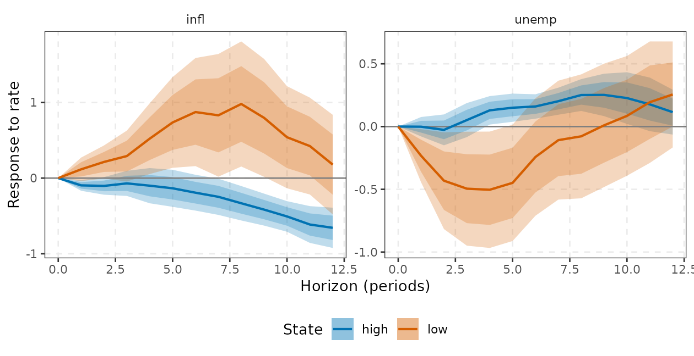
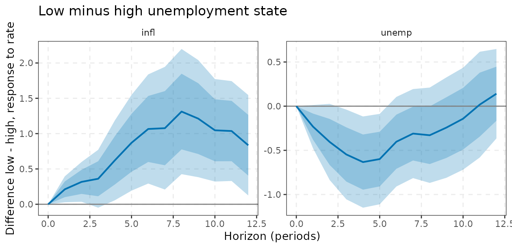
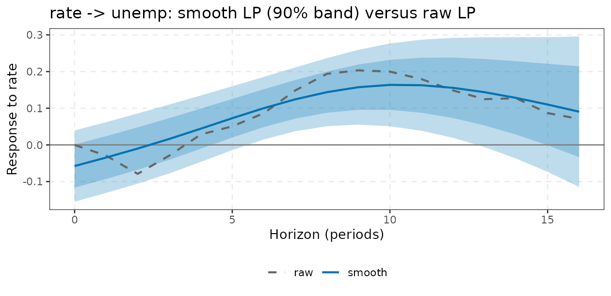
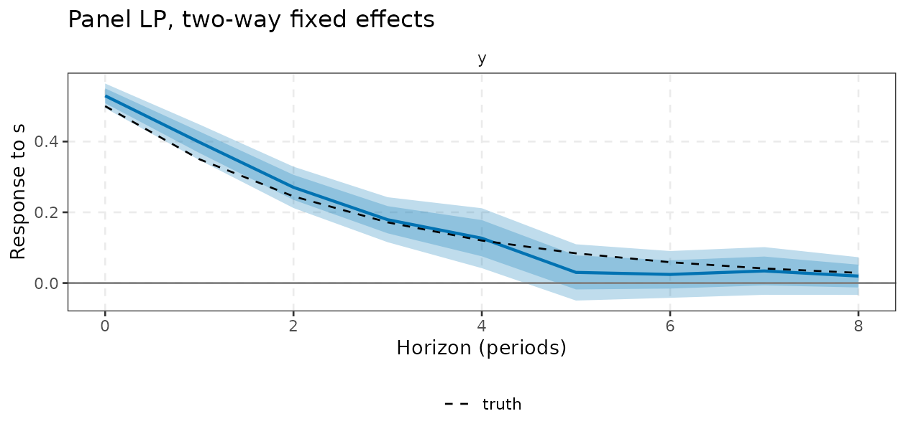
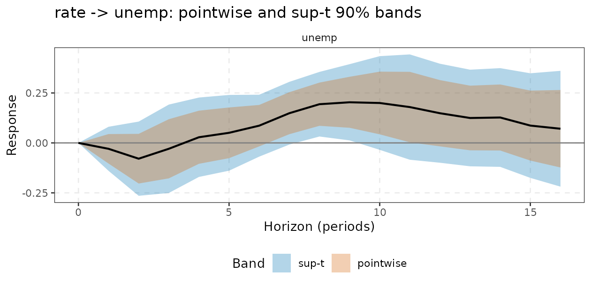
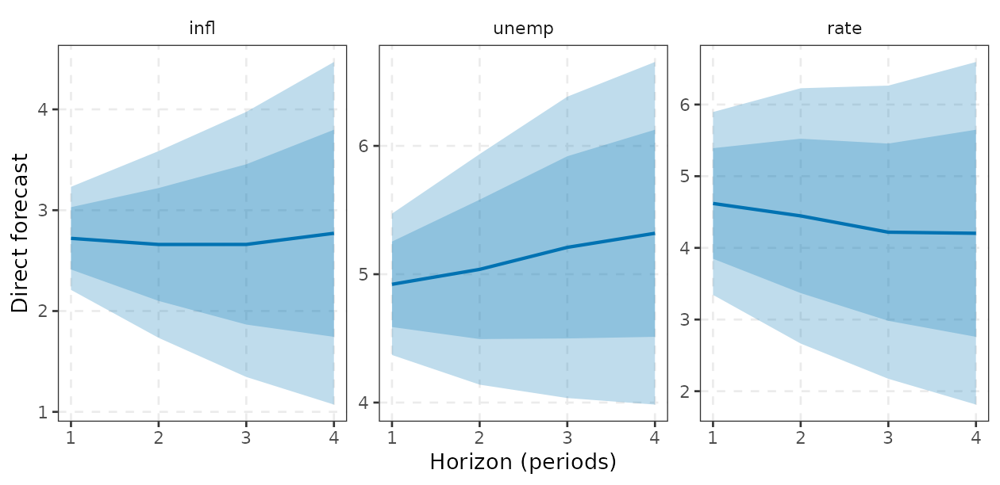

# Advanced local projections: state dependence, smoothing, panels, joint inference and forecasting

This vignette covers the extensions built on top of
[`lp()`](https://kvasilopoulos.github.io/varm/reference/lp.md), which is
defined in
[`vignette("local-projections")`](https://kvasilopoulos.github.io/varm/articles/local-projections.md):
state-dependent LP
([`lp_state()`](https://kvasilopoulos.github.io/varm/reference/lp_state.md)),
smooth LP
([`lp_smooth()`](https://kvasilopoulos.github.io/varm/reference/lp_smooth.md)),
panel LP
([`lp_panel()`](https://kvasilopoulos.github.io/varm/reference/lp_panel.md)),
joint cross-horizon inference with sup-t bands
([`lp_joint()`](https://kvasilopoulos.github.io/varm/reference/lp_joint.md),
[`lp_supt()`](https://kvasilopoulos.github.io/varm/reference/lp_supt.md))
and direct forecasts
([`lp_forecast()`](https://kvasilopoulos.github.io/varm/reference/lp_forecast.md)).
Every result has
[`tidy()`](https://generics.r-lib.org/reference/tidy.html) and
[`autoplot()`](https://ggplot2.tidyverse.org/reference/autoplot.html)
methods:
[`autoplot()`](https://ggplot2.tidyverse.org/reference/autoplot.html)
returns an ordinary `ggplot` (add layers with `+`) and
[`tidy()`](https://generics.r-lib.org/reference/tidy.html) returns a
tibble with the columns `horizon`, `response`, `estimate`, `std.error`,
`level`, `conf.low`, `conf.high` (plus `state` for
[`lp_state()`](https://kvasilopoulos.github.io/varm/reference/lp_state.md)),
ready for ggplot2 or dplyr. Variables are named with tidyselect syntax.
Each section gives a definition, the intuition, an example and the
pitfalls. Where a claim rests on simulation we run a small version of
the simulation in the vignette and say what it does and does not show.

## 1. State-dependent LP: `lp_state()`

### Definition

Let $`z_t`$ be a switching variable (the state), standardised to
$`\tilde z_t=(z_t-\bar z)/\mathrm{sd}(z)`$. Auerbach and Gorodnichenko
(2012, 2013) let every coefficient of the LP depend on the state at
$`t-1`$ through a transition function $`F`$:
``` math
y_{t+h}=F(\tilde z_{t-1})\big[\alpha^L_h+\beta^L_h s_t+\gamma^{L\prime}_h w_t\big]
+\big(1-F(\tilde z_{t-1})\big)\big[\alpha^H_h+\beta^H_h s_t+\gamma^{H\prime}_h w_t\big]+e_{t+h}.
```
Two transitions are available:

- `transition = "logistic"`:
  $`F(\tilde z)=1/(1+\exp\{\gamma(\tilde z-c)\})`$ with smoothness
  `gamma` and cutoff `cutoff` (or `low_share`). $`F\to 1`$ when $`z`$ is
  well below $`c`$, so “low” is the state in which the switching
  variable is low;
- `transition = "binary"`: $`F=1\{\tilde z_{t-1}<c\}`$.

The response is $`\beta^L_h`$ in the low state and $`\beta^H_h`$ in the
high state. The function estimates both in one regression per horizon
(C++ engine), reports $`\beta^L_h-\beta^H_h`$ (`diff = low - high`) with
a HAC $`t`$-test at each horizon and a joint Wald test over horizons.

**Calibration.** $`\gamma`$ and $`c`$ are *not estimated*. Auerbach and
Gorodnichenko use $`\gamma=1.5`$ and a cutoff such that the low state
has roughly 20% weight; `low_share = 0.2` sets $`c`$ to that quantile.
`hp_lambda = 1600` replaces the raw state by its Hodrick-Prescott cycle
(quarterly data).

**Timing.** The state enters lagged one period, $`F(\tilde z_{t-1})`$,
so that the shock cannot move the state it is being interacted with
within the same period. This matches Auerbach and Gorodnichenko; it is a
convention, and a state that responds to the shock with a lag still
contaminates the comparison at longer horizons.

### Intuition

Fiscal and monetary effects are often thought to differ across the
cycle. A nonlinear VAR would impose how the state evolves; the LP lets
the response at each horizon be state-specific and does not model state
transitions, so the state may change over the horizon. The price is
variance: each state uses only the observations weighted by $`F`$ or
$`1-F`$.

### Example

We ask whether the response to a one-point rate rise differs when
unemployment is low or high, using a smooth transition with 30% of the
weight in the low-unemployment state:

``` r

st <- lp_state(yraw, rate, unemp, horizon = 12, lags = 2, contemp = c(infl, unemp),
               gamma = 3, low_share = 0.3, responses = c(infl, unemp))
st
#> <lp_state> contemporaneous timing, logistic transition, shock 'rate', horizons 0..12; low-state share 0.29
#> Joint test of equal responses across states (Wald):
#>         stat df     p
#> infl  57.775 12 0.000
#> unemp 20.513 12 0.058
glance(st)                      # includes the cutoff and share_low
#> # A tibble: 1 × 9
#>   shock horizon  lags timing          transition cutoff share_low  nobs   wald_p
#>   <chr>   <int> <int> <chr>           <chr>       <dbl>     <dbl> <dbl>    <dbl>
#> 1 rate       12     2 contemporaneous logistic   -0.503     0.294   213  5.73e-8
h <- c(2, 5, 9, 13)                              # rows for horizons 1, 4, 8, 12
round(cbind(low = st$estimate[h, "infl", "low"], high = st$estimate[h, "infl", "high"],
            diff = st$estimate[h, "infl", "diff"], p = st$pvalue[h, "infl"]), 3)
#>      low   high  diff     p
#> 1  0.116 -0.096 0.212 0.058
#> 4  0.522 -0.100 0.622 0.070
#> 8  0.980 -0.332 1.312 0.015
#> 12 0.178 -0.657 0.835 0.053
```

``` r

autoplot(st)                    # low and high state overlaid
```



The difference between the two states, with its own bands, is
`autoplot(st, type = "diff")`:

``` r

autoplot(st, type = "diff") + labs(title = "Low minus high unemployment state")
```



The first panel of the plot (inflation) shows the “low unemployment”
response well above the “high unemployment” one at medium horizons, and
the Wald test rejects equality for inflation at conventional levels. For
unemployment the joint test is borderline. These are descriptive
findings from one sample, not evidence of a causal asymmetry: the state
is calibrated, the rate is identified only by the recursive ordering,
and the effective sample in the low state is small.

The calibration matters. The same specification with different
smoothness and low-state shares gives joint Wald $`p`$-values for
unemployment that range widely:

``` r

pv <- sapply(c(0.2, 0.5), function(q) sapply(c(1.5, 3, 10), function(g)
  lp_state(yraw, rate, unemp, 8, lags = 2, contemp = c(infl, unemp), gamma = g, low_share = q,
           responses = unemp)$wald[1, "p"]))
dimnames(pv) <- list(gamma = c(1.5, 3, 10), low_share = c(0.2, 0.5))
round(pv, 3)
#>      low_share
#> gamma   0.2   0.5
#>   1.5 0.274 0.119
#>   3   0.510 0.112
#>   10  0.403 0.026
```

A conclusion that flips between “reject” and “do not reject” across
reasonable calibrations should be reported as such.

### Convention check against `lpirfs::lp_nl`

With `timing = "lagged"` the function replicates the convention of
[`lpirfs::lp_nl()`](https://rdrr.io/pkg/lpirfs/man/lp_nl.html): the
regressors are lags of $`y`$ interacted with the state, no
contemporaneous terms, and the horizon-$`h`$ response is the coefficient
on $`y_{t-1}`$ in the equation for $`y_{t+h-1}`$ multiplied by a column
of the Cholesky impact matrix of a linear VAR (standard-deviation shock
for `shock_type = 0`). The impact response ($`h=0`$) is that column in
both states. Bands here are normal quantiles at `level`, whereas
`lpirfs` uses a user multiplier on the coefficient-wise standard errors,
and `lpirfs` uses a common constant, so set `state_const = FALSE` to
compare.

``` r

zz <- as.numeric(scale(yraw$unemp))
ref <- lpirfs::lp_nl(as.data.frame(yraw), lags_endog_lin = 2, lags_endog_nl = 2, trend = 0,
                     shock_type = 0, confint = 1, hor = 8, switching = zz, use_hp = 0,
                     lambda = 1600, gamma = 3, use_nw = TRUE, num_cores = 1)
me <- lp_state(yraw, shock = rate, state = unemp, horizon = 8, lags = 2, timing = "lagged",
               lags_lin = 2, shock_type = 0, gamma = 3, state_const = FALSE)
# lpirfs state 1 = high, state 2 = low (F -> 1 in the low state)
c(high = max(abs(me$estimate[, , "high"] - t(ref$irf_s1_mean[, , 3]))),
  low  = max(abs(me$estimate[, , "low"]  - t(ref$irf_s2_mean[, , 3]))))
#>         high          low 
#> 1.198208e-13 1.549871e-13
```

The point estimates agree to numerical precision. The
`"contemporaneous"` default is a different (shock-regression)
specification: do not compare its numbers with `lp_nl` directly.

### Pitfalls

- $`\gamma`$ and $`c`$ are calibrated, not estimated. Report sensitivity
  (above).
- With `transition = "binary"` one regime may have few observations;
  check `share_low`.
- The difference test has low power at long horizons with persistent
  states.
- The state must be (close to) exogenous to the shock beyond one lag.
- Not all options of
  [`lpirfs::lp_nl`](https://rdrr.io/pkg/lpirfs/man/lp_nl.html) carry
  over; see the comparison above.

## 2. Smooth LP: `lp_smooth()`

### Definition

Raw LP estimates are noisy and jagged because each horizon is a separate
regression. Barnichon and Brownlees (2019) impose that the response is a
smooth function of the horizon, $`\beta(h)=\sum_{j=1}^J\theta_jB_j(h)`$
with a B-spline basis (`nbasis`, default $`\min(H+1,8)`$; cubic by
default) and estimate all horizons jointly by penalised least squares:
``` math
\hat\theta=\arg\min_\theta\sum_{h=0}^{H}\sum_t\Big(\tilde y_{t+h}-\sum_j\theta_jB_j(h)\tilde s_{t,h}\Big)^2+\lambda\,\theta'D_r'D_r\theta,
```
where tildes denote residuals from the horizon-specific regression on
the controls (Frisch-Waugh) and $`D_r`$ is the $`r`$-th order difference
matrix (Eilers and Marx’s P-spline penalty, `penalty_order = 2`). As
$`\lambda\to\infty`$ the response tends to a polynomial of degree
$`r-1`$. The penalty $`\lambda`$ is chosen by $`K`$-fold
cross-validation over contiguous **blocks of time** (`nfolds`), so
serial dependence is not broken by random splits. Standard errors use
the HAC sandwich $`(A+\lambda P)^{-1}\hat\Omega(A+\lambda P)^{-1}`$ with
Newey-West truncation `H + 1` on the scores summed over horizons.

### Intuition

Theory suggests responses are smooth. Pooling neighbouring horizons
trades a small bias for a large variance reduction, which places smooth
LP between unrestricted LP and a parametric VAR in the bias-variance
trade-off of
[`vignette("local-projections")`](https://kvasilopoulos.github.io/varm/articles/local-projections.md).

### Example

``` r

sm <- lp_smooth(yraw, shock = rate, response = unemp, horizon = 16, lags = 2, contemp = c(infl, unemp))
c(lambda = sm$lambda, edf = sm$edf)
#>     lambda        edf 
#> 106.623109   3.271681
round(cbind(smooth = sm$estimate[, 1], raw = sm$lp, se_smooth = sm$se[, 1], se_raw = sm$lp_se)[c(2, 5, 9, 13, 17), ], 3)
#>    smooth    raw se_smooth se_raw
#> 1  -0.035 -0.030     0.059  0.045
#> 4   0.044  0.028     0.055  0.081
#> 8   0.144  0.194     0.056  0.066
#> 12  0.156  0.149     0.083  0.101
#> 16  0.091  0.071     0.125  0.118
```

``` r

autoplot(sm) + labs(title = "rate -> unemp: smooth LP (90% band) versus raw LP")
```



The CV choice of $`\lambda`$ is stored in `sm$cv` (a grid of 21 values
scaled by $`\mathrm{tr}(A)/J`$, from $`10^{-4}`$ to $`10^{4}`$); a CV
curve that is flat or minimised at an edge of the grid is a warning to
supply `lambda` and `nbasis` yourself.

### Monte Carlo evidence

A VAR(1) with $`T=200`$ and a recursive identification; we compare the
mean squared error of the response path of $`y`$ to a unit impulse in
$`x`$, for raw and smooth LP, and the pointwise coverage of the nominal
90% band (100 replications, so figures carry Monte Carlo error of a few
percentage points on coverage).

``` r

A <- matrix(c(0.6, 0.2, 0, 0.5), 2, 2); Pc <- t(chol(matrix(c(1, .3, .3, 1), 2)))
Ht <- 12
truth <- sapply(0:Ht, function(h) { M <- diag(2); for (i in seq_len(h)) M <- A %*% M; (M %*% Pc[, 1] / Pc[1, 1])[2] })
sim2 <- function(n = 250, burn = 50) {
  e <- matrix(rnorm(2 * n), n) %*% t(Pc); Y <- matrix(0, n, 2)
  for (t in 2:n) Y[t, ] <- A %*% Y[t - 1, ] + e[t, ]
  Y <- Y[-seq_len(burn), ]; colnames(Y) <- c("x", "y"); Y
}
R <- 100; out <- matrix(0, R, 4, dimnames = list(NULL, c("mse_raw", "mse_smooth", "cov_raw", "cov_smooth")))
for (r in seq_len(R)) {
  Y <- sim2()
  f <- lp(Y, x, Ht, lags = 2, responses = y); s <- lp_smooth(Y, x, y, Ht, lags = 2)
  out[r, ] <- c(mean((f$estimate[, 1] - truth)^2), mean((s$estimate[, 1] - truth)^2),
                mean(truth >= f$bands[, 1, 1] & truth <= f$bands[, 1, 4]),
                mean(truth >= s$bands[, 1, 1] & truth <= s$bands[, 1, 4]))
}
m <- colMeans(out)
round(c(m, mse_ratio = unname(m["mse_smooth"] / m["mse_raw"])), 3)
#>    mse_raw mse_smooth    cov_raw cov_smooth  mse_ratio 
#>      0.008      0.005      0.872      0.772      0.651
```

Smoothing reduces the mean squared error of the response path to roughly
two thirds of the raw LP’s (a ratio of about 0.65 to 0.67 in this run
and in larger ones). The coverage columns show the limitation: the
smooth LP’s pointwise bands cover **less** than the raw LP’s. They are
conditional on the selected $`\lambda`$ and ignore both the smoothing
bias and the uncertainty from choosing $`\lambda`$ by cross-validation.
Use smooth LP for point estimates and shape, and treat its bands as
optimistic.

### Pitfalls

- Sharp features (an impact jump, a sudden reversal) are smoothed away;
  the horizon-0 value is part of the smooth curve, not pinned at its
  known value.
- One response at a time (`response`); `cumulative = TRUE` cumulates the
  response.
- Bands ignore the selection of $`\lambda`$ (see above). `sm$vcov` is
  compatible with
  [`lp_supt()`](https://kvasilopoulos.github.io/varm/reference/lp_supt.md),
  with the same caveat.
- The default basis has at most 8 functions; with a long horizon
  increase `nbasis`.

## 3. Panel LP: `lp_panel()`

### Definition

For a panel $`(i,t)`$ and each horizon,
``` math
y_{i,t+h}=\alpha_{i,h}+\delta_{t,h}+\beta_hs_{it}+\sum_{l=1}^{L}\big(\phi_{l,h}y_{i,t-l}+\psi_{l,h}s_{i,t-l}\big)+\kappa_h'x_{it}+e_{i,t+h}.
```
`fe` chooses unit effects $`\alpha_i`$, time effects $`\delta_t`$, both
(`"twoway"`, default) or none. Estimation is by within transformation
(alternating projections for unbalanced two-way panels, so no dummy
matrix is built) and standard errors cluster on the unit
(`cluster = "unit"`) or on time, with the Stata-type small-sample factor
$`\frac{G}{G-1}\frac{n-1}{n-k}`$, $`k`$ counting the regressors and the
absorbed effects. Clustering is what allows for the MA($`h`$) serial
correlation of the residuals within a unit. The cross-horizon cluster
covariance is returned in `$vcov` for
[`lp_supt()`](https://kvasilopoulos.github.io/varm/reference/lp_supt.md).

### Intuition

Panels provide identification and power. Unit effects remove
time-invariant heterogeneity; time effects remove shocks common to all
units, so $`\beta_h`$ is identified from cross-sectional differences in
exposure to $`s`$. The cost is interpretation: with time effects the
estimate is a *relative* effect (units with more of the shock versus
fewer) and the aggregate effect is absorbed.

### Example: a simulated panel

Forty units, 50 periods. The shock has a unit-specific mean and a common
component, and the outcome has unit effects and a common time shock, so
pooled OLS is biased. The true response is $`0.5\times0.7^h`$.

``` r

set.seed(5); N <- 40; Tn <- 50
ft <- rnorm(Tn); mu <- rnorm(N)                       # common time shock; unit effects
d <- expand.grid(t = 1:Tn, id = 1:N)
d$s <- 0.5 * mu[d$id] + 0.5 * ft[d$t] + rnorm(nrow(d))
d$y <- 0
for (i in 1:N) {
  ix <- which(d$id == i); yy <- 0
  for (k in seq_along(ix)) { yy <- 0.7 * yy + 0.5 * d$s[ix[k]] + mu[i] + ft[k] + rnorm(1); d$y[ix[k]] <- yy }
}
hs <- c(0, 2, 4, 8)
res <- sapply(c(none = "none", unit = "unit", time = "time", twoway = "twoway"),
              function(f) lp_panel(d, y, s, id, t, horizon = 8, lags = 1, fe = f)$estimate[hs + 1])
round(cbind(res, truth = 0.5 * 0.7^hs), 3)
#>       none  unit  time twoway truth
#> [1,] 1.007 0.949 0.603  0.529 0.500
#> [2,] 0.841 0.581 0.472  0.271 0.245
#> [3,] 0.515 0.141 0.406  0.127 0.120
#> [4,] 0.403 0.057 0.336  0.020 0.029
```

Only the two-way specification recovers the truth; omitting either
effect leaves bias at every horizon. Now the two-way fit with its bands:

``` r

pn <- lp_panel(d, y, s, id, t, horizon = 8, lags = 1)
pn$nclusters[1]
#> [1] 40
round(cbind(estimate = pn$estimate[, 1], se = pn$se[, 1], truth = 0.5 * 0.7^(0:8))[c(1, 3, 5, 9), ], 3)
#>   estimate    se truth
#> 0    0.529 0.021 0.500
#> 2    0.271 0.036 0.245
#> 4    0.127 0.051 0.120
#> 8    0.020 0.032 0.029
autoplot(pn) +
  geom_line(aes(y = truth, linetype = "truth"), data = data.frame(horizon = 0:8, truth = 0.5 * 0.7^(0:8))) +
  scale_linetype_manual(values = "dashed", name = NULL) +
  labs(title = "Panel LP, two-way fixed effects")
```



The estimates are within about one standard error of the truth at the
horizons shown. Note the small shortfall at $`h=8`$: with unit effects
and lagged outcomes among the controls the within transformation brings
in a small-$`T`$ (Nickell-type) bias of order $`1/T`$ times the
cumulated response, which is why the pitfall below recommends long
panels.

### Pitfalls

- Fixed effects with lagged dependent variables give Nickell bias when
  $`T`$ is small; use long panels or drop the `y` lags.
- With few clusters (fewer than about 30) cluster-robust bands are too
  narrow.
- With time effects the estimate is relative; heterogeneous responses
  are averaged with variance weights.
- `time` must be regularly spaced; duplicated (unit, time) pairs are an
  error.

## 4. Joint inference and sup-t bands: `lp_joint()`, `lp_supt()`

### Definition

LP estimates at neighbouring horizons are built from overlapping data
and are strongly correlated, so a pointwise band says little about the
whole path.
[`lp_joint()`](https://kvasilopoulos.github.io/varm/reference/lp_joint.md)
runs the same regressions as
[`lp()`](https://kvasilopoulos.github.io/varm/reference/lp.md) and in
addition returns, for each response, the $`(H+1)\times(H+1)`$ covariance
matrix of $`(\hat\beta_0,\dots,\hat\beta_H)'`$:
``` math
\widehat{\mathrm{Cov}}(\hat\beta_h,\hat\beta_{h'})=\sum_{l=-L}^{L}w_l\sum_t q_{t,h}\hat e_{t+h}\,q_{t-l,h'}\hat e_{t-l+h'},\qquad w_l=1-\frac{|l|}{L+1},
```
with $`L=\max(h,h')+1`$ or a common `nw_lag`. Its diagonal reproduces
the standard errors of
[`lp()`](https://kvasilopoulos.github.io/varm/reference/lp.md).
[`lp_supt()`](https://kvasilopoulos.github.io/varm/reference/lp_supt.md)
then builds the sup-t band of Montiel Olea and Plagborg-Møller (2019):
$`\hat\beta_h\pm\hat c_{1-\alpha}\hat\sigma_h`$ with
$`\hat c_{1-\alpha}`$ the $`(1-\alpha)`$-quantile of $`\max_h|z_h|`$,
$`z\sim N(0,\hat R)`$, where $`\hat R`$ is the correlation matrix
implied by the joint covariance (simulated, `nsim` draws). It covers the
whole path with probability $`1-\alpha`$ asymptotically, is narrower
than Bonferroni and is never narrower than the pointwise band.

### Example

``` r

j <- lp_joint(yraw, shock = rate, horizon = 16, lags = 2, contemp = c(infl, unemp), responses = unemp)
max(abs(sqrt(diag(j$vcov[[1]])) - j$se[, 1]))      # diagonal = lp() standard errors
#> [1] 6.938894e-17
b <- lp_supt(j, level = 0.9, seed = 1)
attr(b, "crit")                                    # sup-t critical value (pointwise: 1.645)
#>    unemp 
#> 2.458333
b[c(2, 5, 9, 13, 17), c("horizon", "estimate", "pw_low", "pw_high", "conf.low", "conf.high")] |>
  as.data.frame() |> round(3)
#>   horizon estimate pw_low pw_high conf.low conf.high
#> 1       1   -0.030 -0.103   0.044   -0.140     0.081
#> 2       4    0.028 -0.105   0.161   -0.170     0.227
#> 3       8    0.194  0.086   0.302    0.032     0.355
#> 4      12    0.149 -0.017   0.314   -0.099     0.396
#> 5      16    0.071 -0.123   0.265   -0.219     0.361
```

[`lp_supt()`](https://kvasilopoulos.github.io/varm/reference/lp_supt.md)
returns a tibble with columns `response`, `horizon`, `estimate`,
`std.error`, `pw_low`, `pw_high` (pointwise) and `conf.low`, `conf.high`
(sup-t).
[`autoplot()`](https://ggplot2.tidyverse.org/reference/autoplot.html)
draws both bands, and
[`tidy()`](https://generics.r-lib.org/reference/tidy.html) stacks them
(a `band` column) for your own plots:

``` r

autoplot(b) + labs(title = "rate -> unemp: pointwise and sup-t 90% bands")
```



The sup-t critical value is about 2.5, between the pointwise 1.645 and
the Bonferroni value of roughly 3 for 17 horizons. Horizons with zero
variance (the normalised impact response) are ignored. You can also use
the joint covariance for a Wald test that the whole response is zero.

### How reliable are sup-t bands in finite samples? (honest answer: not very)

The sup-t result is asymptotic and relies on a good joint covariance. We
simulate the VAR(1) of the previous section with $`T=200`$ and measure
the share of replications in which the *entire* true path
($`h=0,\dots,12`$) lies inside a nominal 90% band. Two estimators: the
default Newey-West covariance with two lags, and lag augmentation (one
lag plus an extra lag, HC covariance). 300 replications; coverage
carries Monte Carlo error of about $`\pm0.02`$.

``` r

cover_path <- function(la, lg, R = 300) {
  set.seed(42); hit <- matrix(0, R, 2, dimnames = list(NULL, c("pointwise", "sup-t")))
  for (r in seq_len(R)) {
    Y <- sim2()
    bb <- lp_supt(lp_joint(Y, x, Ht, lags = lg, responses = y, lag_augment = la), 0.9, nsim = 2000, seed = r)
    hit[r, ] <- c(all(truth >= bb$pw_low & truth <= bb$pw_high), all(truth >= bb$conf.low & truth <= bb$conf.high))
  }
  colMeans(hit)
}
round(rbind(`Newey-West (lags = 2)` = cover_path(FALSE, 2), `lag-augmented (lags = 1 + 1)` = cover_path(TRUE, 1)), 2)
#>                              pointwise sup-t
#> Newey-West (lags = 2)             0.24  0.78
#> lag-augmented (lags = 1 + 1)      0.33  0.84
```

Pointwise bands cover the whole path in only a quarter to a third of the
replications, which is what one expects from 13 correlated 90%
intervals. Sup-t bands do much better but **fall short of the 0.90
target**: about 0.78 with Newey-West and about 0.84 with lag
augmentation. The HAC covariance is estimated imprecisely at long
horizons in a sample of 200, so the critical value is too small. The
shortfall is a finite-sample property of HAC and HC inference for LP and
is not specific to
[`lp_supt()`](https://kvasilopoulos.github.io/varm/reference/lp_supt.md).

**Recommendation.** Lag augmentation (`lag_augment = TRUE`) helps
somewhat (0.84 against 0.78 at a nominal 0.90) but does not close the
gap; for pointwise coverage at long horizons it is not a visible
improvement
([`vignette("local-projections")`](https://kvasilopoulos.github.io/varm/articles/local-projections.md)).
Treat sup-t coverage as approximate, and do not read “the band excludes
zero at every horizon” as a 90% statement.

### Pitfalls

- With the default horizon-specific bandwidth the joint covariance is
  not guaranteed positive semi-definite:

``` r

c(default = min(eigen(j$vcov[[1]])$values),
  common_nw_lag = min(eigen(lp_joint(yraw, rate, 16, lags = 2, contemp = c(infl, unemp), responses = unemp,
                                     nw_lag = 17)$vcov[[1]])$values))
#>       default common_nw_lag 
#> -8.774400e-05  9.003126e-28
```

The default has a (slightly) negative smallest eigenvalue; with a common
`nw_lag` the matrix is positive semi-definite (the remaining zero
eigenvalue belongs to the normalised horizon 0). Pass a common `nw_lag`
if you need to invert it. \*
[`lp_supt()`](https://kvasilopoulos.github.io/varm/reference/lp_supt.md)
also accepts
[`lp_smooth()`](https://kvasilopoulos.github.io/varm/reference/lp_smooth.md)
and
[`lp_panel()`](https://kvasilopoulos.github.io/varm/reference/lp_panel.md)
objects (each has `$vcov`), with the caveats of their own sections. \*
Highly persistent data make HAC covariances unreliable at long horizons.

## 5. Direct multi-step forecasts: `lp_forecast()`

### Definition

For each $`h=1,\dots,H`$ regress $`y_{t+h}`$ on
$`x_t=(1,y_t',\dots,y_{t-p+1}')'`$ and forecast
$`\hat y_{T+h}=x_T'\hat B_h`$. The forecast standard error is
$`\hat\sigma_h\sqrt{1+x_T'(X_h'X_h)^{-1}x_T}`$ (the unconditional
residual variance, which is what matters for the forecast error even
though the residual is MA($`h-1`$)). Bands are normal quantiles at
`level`.

### Intuition

Iterated (VAR) forecasts are efficient if the VAR is correctly specified
but compound misspecification with the horizon; direct forecasts
estimate each horizon’s conditional mean separately, which is robust to
misspecification but noisier (Marcellino, Stock and Watson, 2006). At
$`h=1`$ the two coincide exactly.

### Example

``` r

fl <- lp_forecast(yraw, horizon = 4, lags = 2)
fv <- forecast(varm(yraw, 2), h = 4, ci = "none")
round(rbind(`direct h=1` = fl$mean[1, ], `iterated h=1` = fv$mean[1, ],
            `direct h=4` = fl$mean[4, ], `iterated h=4` = fv$mean[4, ]), 3)
#>               infl unemp  rate
#> direct h=1   2.721 4.921 4.620
#> iterated h=1 2.721 4.921 4.620
#> direct h=4   2.771 5.319 4.204
#> iterated h=4 2.656 5.232 4.251
round(fl$se, 3)
#>    infl unemp  rate
#> 1 0.311 0.335 0.776
#> 2 0.563 0.546 1.083
#> 3 0.799 0.714 1.244
#> 4 1.033 0.811 1.453
```

``` r

autoplot(fl)
```



The direct and iterated forecasts coincide at $`h=1`$ and differ
slightly at $`h=4`$. The standard errors grow with the horizon. They are
*plug-in* errors that ignore any serial correlation across horizons.

### Pitfalls

- Forecasts at different horizons are not constrained to be consistent
  with each other and can be jagged.
- Direct forecasts need a long sample; for a short sample or many
  variables use a BVAR
  ([`vignette("bayesian-var")`](https://kvasilopoulos.github.io/varm/articles/bayesian-var.md)).
- Bands are Gaussian; there is no density forecast.

## References

- Auerbach, A. J. and Gorodnichenko, Y. (2012). Measuring the output
  responses to fiscal policy. *American Economic Journal: Economic
  Policy*, 4(2), 1-27.
- Auerbach, A. J. and Gorodnichenko, Y. (2013). Fiscal multipliers in
  recession and expansion. In Alesina and Giavazzi (eds), *Fiscal Policy
  after the Financial Crisis*, University of Chicago Press, 63-98.
- Barnichon, R. and Brownlees, C. (2019). Impulse response estimation by
  smooth local projections. *Review of Economics and Statistics*,
  101(3), 522-530.
- Eilers, P. H. C. and Marx, B. D. (1996). Flexible smoothing with
  B-splines and penalties. *Statistical Science*, 11(2), 89-121.
- Jordà, Ò. (2005). Estimation and inference of impulse responses by
  local projections. *American Economic Review*, 95(1), 161-182.
- Marcellino, M., Stock, J. H. and Watson, M. W. (2006). A comparison of
  direct and iterated multistep AR methods for forecasting macroeconomic
  time series. *Journal of Econometrics*, 135(1-2), 499-526.
- Montiel Olea, J. L. and Plagborg-Møller, M. (2019). Simultaneous
  confidence bands: theory, implementation, and an application to SVARs.
  *Journal of Applied Econometrics*, 34(1), 1-17.
- Montiel Olea, J. L. and Plagborg-Møller, M. (2021). Local projection
  inference is simpler and more robust than you think. *Econometrica*,
  89(4), 1789-1823.
- Nickell, S. (1981). Biases in dynamic models with fixed effects.
  *Econometrica*, 49(6), 1417-1426.
