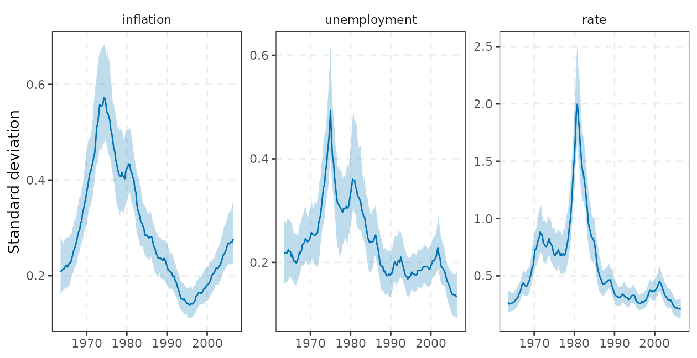
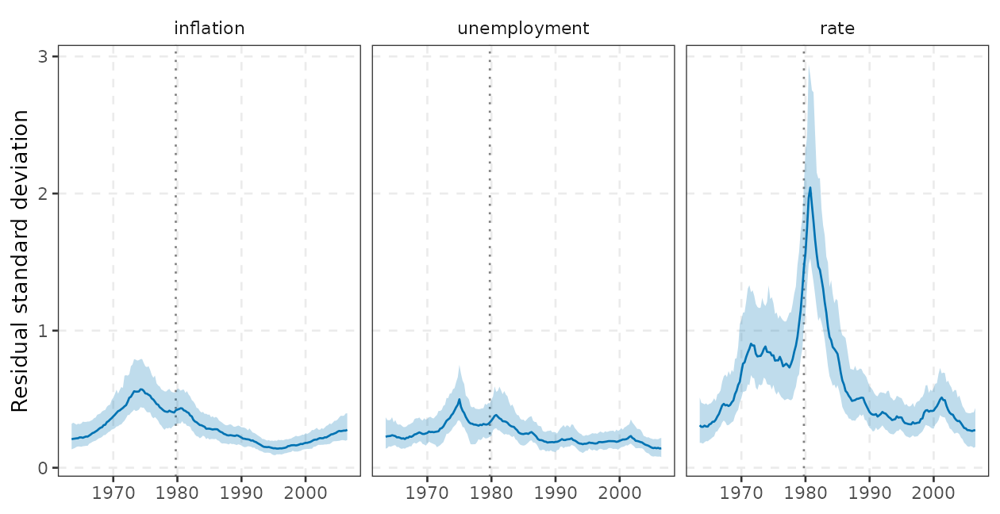
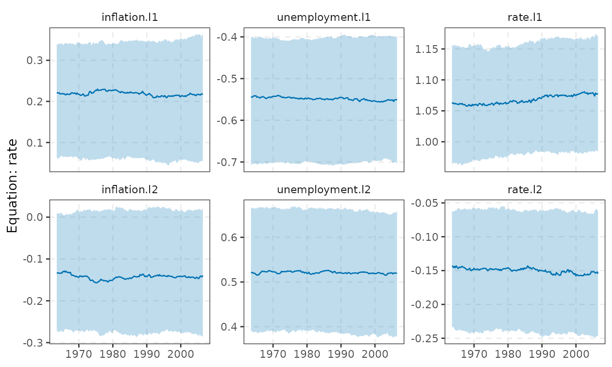
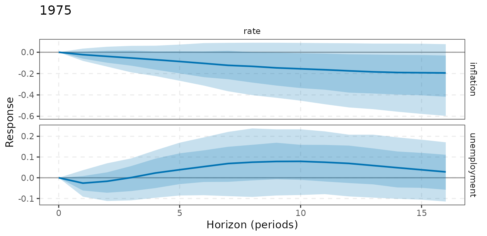
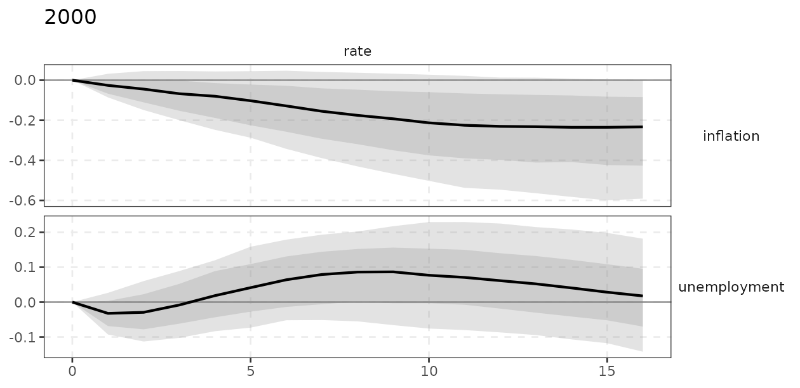
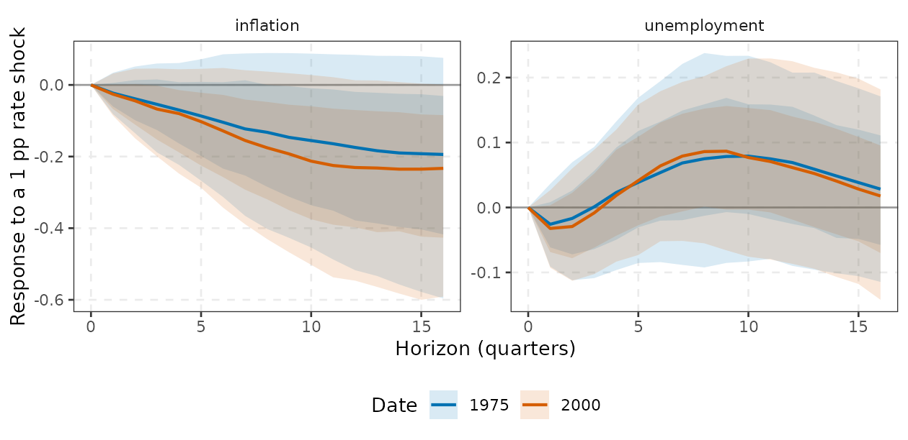
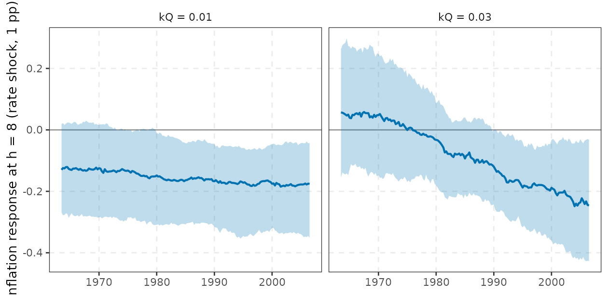

# Time-varying-parameter VARs with stochastic volatility

[`tvpvar()`](https://kvasilopoulos.github.io/varm/reference/tvpvar.md)
estimates a VAR whose coefficients, contemporaneous (impact) matrix and
shock volatilities all drift over time (Cogley and Sargent, 2005;
Primiceri, 2005), using the Gibbs-sampler ordering of Del Negro and
Primiceri (2015). It answers the questions that a constant-parameter VAR
cannot: did the *transmission mechanism* change (for example the
response to a monetary policy shock), and did the *size of shocks*
change (the Great Moderation)?

It is also the model in this package where the prior matters most.
Section 6 documents, with simulations, how the results depend on the
prior tightness and when time variation can be found where none exists.
Read it before interpreting any estimated drift.

A first look (the sections below explain each object):

``` r

fit <- tvpvar(yt, p = 2, ndraw = 2000, nburn = 1000)
autoplot(fit, "vol")                          # volatility paths
irf(fit, date = c(1975, 2000), horizon = 16)  # impulse responses at two dates
```

## 1. The model

Let $`x_t=(y_{t-1}',\dots,y_{t-p}',1)'`$ ($`m=Kp+1`$ regressors) and let
$`B_t`$ be the $`m\times K`$ matrix of coefficients with
$`\beta_t=\mathrm{vec}(B_t)`$ (equation by equation). The model, in the
notation of the code, is
``` math
\begin{align}
y_t&=(I_K\otimes x_t')\,\beta_t+u_t, & u_t&=A_t^{-1}\Lambda_t^{1/2}\varepsilon_t,\quad \varepsilon_t\sim N(0,I_K),\\
\beta_t&=\beta_{t-1}+\eta_t, & \eta_t&\sim N(0,Q),\\
\alpha_t&=\alpha_{t-1}+\zeta_t, & \zeta_t&\sim N(0,S),\ S=\mathrm{blockdiag}(S_2,\dots,S_K),\\
h_{it}&=h_{i,t-1}+\nu_{it}, & \nu_{it}&\sim N(0,W_i),\quad h_{it}=\ln\lambda_{it}.
\end{align}
```
$`A_t`$ is unit lower triangular with free elements $`\alpha_t`$ (the
$`K(K-1)/2`$ elements below the diagonal, equation by equation),
$`\Lambda_t=\mathrm{diag}(e^{h_{1t}},\dots,e^{h_{Kt}})`$ and
$`\Sigma_t=A_t^{-1}\Lambda_tA_t^{-1\prime}`$ is the time-varying
reduced-form covariance. So
$`u_{it}=-\sum_{j<i}\alpha_{ij,t}u_{jt}+e^{h_{it}/2}\varepsilon_{it}`$,
a recursive (Cholesky) structure with *time-varying* impact coefficients
and shock sizes.

Three distinct kinds of time variation, with different economics:

| state | what moves | interpretation |
|----|----|----|
| $`\beta_t`$ (covariance $`Q`$) | lag coefficients | the *transmission mechanism*: for example a policy rule that reacts more to inflation after Volcker |
| $`h_t`$ (innovation variances $`W_i`$) | size of the structural shocks | the Great Moderation, 2008, 2020 |
| $`\alpha_t`$ (covariance $`S`$) | contemporaneous coefficients | how shocks spread within the quarter |

Differences from Primiceri (2005) worth knowing: $`h_{it}`$ is the log
*variance* (so $`e^{h/2}`$ is the standard deviation), all states are
pure random walks (no mean reversion and, by default, no stationarity
restriction) and the states at the first estimation date have the prior
given below. Special cases are obtained with flags: `tv_A = FALSE` is
Cogley and Sargent (2005); `sv = FALSE, tv_A = FALSE` is Cogley and
Sargent (2001) with homoskedastic errors; `tv_beta = FALSE` freezes the
coefficients, which gives a Bayesian VAR with SV, the benchmark against
which to judge whether time-varying coefficients are needed at all
(section 6).

## 2. The training-sample prior and its hyperparameters

The prior of Primiceri (2005) is calibrated on a **training sample**,
the first `tau` effective observations (after the first $`p`$ lags; they
are *not* part of the estimation sample, so with $`T=215`$, $`p=2`$ and
$`\tau=40`$ the estimation sample is 173 quarters, 1963Q3-2006Q2). On
the training sample compute $`\hat B=(X'X)^{-1}X'Y`$,
$`\hat\Sigma=\hat U'\hat U/(\tau-m)`$ and
$`V(\hat B)=\hat\Sigma\otimes(X'X)^{-1}`$; regress each OLS residual
$`\hat u_i`$ on $`\hat u_{1},\dots,\hat u_{i-1}`$ to get
$`\hat\alpha_i=-(\text{coefficients})`$ with covariance
$`V(\hat\alpha_i)=\hat v_i(E_i'E_i)^{-1}`$, and let $`\hat\sigma_i^2`$
be the residual variance of the $`i`$-th such regression ($`\hat v_i`$).
Then (`tvp_train()`):
``` math
\begin{align}
\beta_1&\sim N\big(\hat B,\ c\,V(\hat B)\big), & \alpha_1&\sim N\big(\hat\alpha,\ c\,V(\hat\alpha)\big),
& h_{i0}&\sim N(\ln\hat\sigma_i^2,\ 10),\\
Q&\sim IW\big(k_Q^2\,\nu_Q\,V(\hat B),\ \nu_Q\big), & S_i&\sim IW\big(k_S^2\,(1+\dim S_i)\,V(\hat\alpha_i),\ 1+\dim S_i\big), & W_i&\sim IG(1,\ k_W^2),
\end{align}
```
with $`c=`$`vscale` (4), $`\nu_Q=`$`df_Q` (default $`\tau`$),
$`\dim S_i=i-1`$, and $`IG(a,b)`$ with shape $`a`$ and scale $`b`$. The
hyperparameters, in
`tvp_prior(tau = 40, kQ = 0.01, kS = 0.1, kW = 0.01, ...)`:

- `tau`: training-sample length. It sets the scale of $`V(\hat B)`$ (a
  short sample means large standard errors, hence a *looser* prior on
  the level of $`\beta_1`$ and, through $`V(\hat B)`$, a larger prior on
  drift) and the default degrees of freedom.
- `kQ`: scales the prior of the coefficient drift.
  $`E[Q]=k_Q^2\nu_Q/(\nu_Q-n_\beta-1)\ V(\hat B)`$ with $`n_\beta=mK`$
  states, so the prior standard deviation of the quarterly change of
  coefficient $`j`$ is about $`k_Q\sqrt{\nu_Q/(\nu_Q-n_\beta-1)}`$ times
  its *training-sample* standard error. For $`K=3`$, $`p=2`$
  ($`n_\beta=21`$, $`\nu_Q=40`$) that factor is $`1.5k_Q`$. Note that
  $`E[Q]`$ exists only if $`\nu_Q>n_\beta+1`$ (and the prior is proper
  only if $`\nu_Q\ge n_\beta`$): for $`p=4`$, $`n_\beta=39`$ and the
  default `df_Q = 40` leaves the prior mean of $`Q`$ undefined.
  [`tvpvar()`](https://kvasilopoulos.github.io/varm/reference/tvpvar.md)
  only checks that `tau` exceeds $`m+K`$ (and that enough observations
  remain after the training sample), not this condition on $`\nu_Q`$, so
  it is up to you to raise `tau` or `df_Q`.
- `kS`, `kW`: same role for the drift of the impact coefficients and the
  log-variances ($`W_i`$ is a variance, so $`k_W=0.01`$ means a prior
  scale of $`10^{-4}`$, i.e. quarterly standard deviation of $`h`$ of
  order 0.01 to 0.1 once the likelihood is added).
- `vscale`, `h_var`: prior inflation of the initial state; they matter
  little.

``` r

fit0 <- tvpvar(yt, p = 2, ndraw = 300, nburn = 200, nsave_paths = 50)   # throw-away fit to inspect the prior
pv <- fit0$prior_values
nb <- fit0$m * fit0$K
round(sqrt(diag(pv$Qbar)[1:7] / (pv$nuQ - nb - 1)), 4)   # prior sd of the quarterly drift, equation 1 (7 coefficients)
#> [1] 0.0019 0.0011 0.0013 0.0018 0.0011 0.0012 0.0035
```

## 3. The Gibbs sampler

One sweep draws, in this order (`src/tvp.cpp`):

1.  **Coefficients** $`\beta^T\mid A^T,\Lambda^T,Q,Y`$. Conditionally
    this is a linear Gaussian state-space model, $`y_t=Z_t\beta_t+u_t`$,
    $`Z_t=I_K\otimes x_t'`$, $`u_t\sim N(0,\Sigma_t)`$,
    $`\beta_t=\beta_{t-1}+\eta_t`$. The path is drawn with the **Durbin
    and Koopman (2002) simulation smoother**:
    1.  simulate $`(\beta^+,y^+)`$ from the model with the prior mean
        replaced by zero;
    2.  compute $`y^*_t=y_t-Z_tb_0-y^+_t`$ and run the Kalman filter and
        the backward smoothing recursion on $`y^*`$ to get
        $`\hat\beta^*_t=E[\beta_t\mid y^*]`$;
    3.  set $`\tilde\beta_t=b_0+\beta^+_t+\hat\beta^*_t`$, which is an
        exact draw from $`p(\beta^T\mid\cdot)`$ by linearity of the
        smoother. The advantage over the Carter and Kohn (1994) backward
        sampler used by Primiceri is that the filter only inverts the
        $`K\times K`$ innovation variance (cost $`O(T\,n_s^2K)`$ for
        $`n_s=mK`$ states) rather than factorising an $`n_s\times n_s`$
        conditional state covariance at every date ($`O(Tn_s^3)`$), and
        that no Cholesky of a near-singular state covariance is needed
        when $`Q`$ is tiny.
2.  **Impact coefficients** $`\alpha^T\mid\beta^T,\Lambda^T,S`$,
    equation by equation. With $`u_t=y_t-Z_t\beta_t`$ the $`i`$-th
    equation is
    $`u_{it}=-u_{<i,t}'\alpha_{i,t}+e^{h_{it}/2}\varepsilon_{it}`$,
    again linear Gaussian in the random-walk state $`\alpha_{i,t}`$
    (observation matrix $`-u_{<i,t}'`$, variance $`e^{h_{it}}`$), drawn
    with the same smoother. Block-diagonality of $`S`$ is what makes the
    rows independent.
3.  **Volatilities** $`(s^T,h^T)\mid\beta^T,\alpha^T`$. The
    orthogonalised residual
    $`e_{it}=u_{it}+\sum_{j<i}\alpha_{ij,t}u_{jt}=e^{h_{it}/2}\varepsilon_{it}`$
    gives $`\ln(e_{it}^2+10^{-4})=h_{it}+\ln\varepsilon_{it}^2`$; the
    log-chi-squared error is approximated by the 10-component mixture of
    Omori et al. (2007), with mixture indicators drawn first (given the
    current $`h`$) and then the path by forward-filtering
    backward-sampling, exactly as for `bvarm(sv = TRUE)`
    ([`vignette("bayesian-var")`](https://kvasilopoulos.github.io/varm/articles/bayesian-var.md),
    section 8).
    $`W_i\mid h\sim IG\big(1+T/2,\ k_W^2+\tfrac12\sum_t(h_{it}-h_{i,t-1})^2\big)`$.
4.  **Innovation covariances**:
    $`Q\mid\beta^T\sim IW\big(\bar Q+\sum_{t\ge2}\Delta\beta_t\Delta\beta_t',\ \nu_Q+T-1\big)`$
    and
    $`S_i\mid\alpha^T\sim IW\big(\bar S_i+\sum_{t\ge2}\Delta\alpha_{i,t}\Delta\alpha_{i,t}',\ 1+\dim S_i+T-1\big)`$,
    with $`\bar Q=k_Q^2\nu_QV(\hat B)`$ the IW scale above. (With
    `q_diag = TRUE`, independent inverse-gamma priors on the diagonal of
    $`Q`$ replace the inverse-Wishart.)

The sweep touches the data $`T`$ times for each of $`K+K(K-1)/2+K`$
state blocks, so it is linear in $`T`$, and, because of step 1, roughly
quadratic in $`mK`$. When a component is switched off
(`tv_beta = FALSE`, `tv_A = FALSE`, `sv = FALSE`) the corresponding
block is replaced by the conjugate Gaussian (or inverse-gamma, prior
$`IG(3,2\hat\sigma_i^2)`$) draw of a constant. The code is entirely in
C++ and uses R’s random number generator, so
[`set.seed()`](https://rdrr.io/r/base/Random.html) reproduces results.

**What is stored.** All draws of $`Q,S,W`$ innovation standard
deviations (`$q_sd`, `$s_sd`, `$w_sd`) and the posterior means of the
paths (`$beta_mean`, `$alpha_mean`, `$h_mean`) use every retained draw;
the full state paths of `nsave_paths` evenly spaced draws are kept
(`$beta`: coefficients $`\times`$ equations $`\times`$ dates $`\times`$
stored draws; `$alpha`, `$h`), and all impulse responses, volatilities
and forecasts are computed from them. Memory is `nsave_paths`
$`\times T\times K(Kp+1)`$ doubles. (The number actually stored,
`glance(fit)$npaths`, can be slightly below `nsave_paths`, because draws
are spaced `ceiling(ndraw / nsave_paths)` apart.)

## 4. Outputs: coefficients, volatility, impulse responses, FEVD, forecasts

- `coef(fit, date = )`: posterior mean (or median) of $`B_t`$ at a date.
- `autoplot(fit, "coef", equation = )` / `tidy(fit, "coef")`:
  coefficient paths of one equation with credible bands (tibble columns
  `date`, `response`, `term`, `estimate`, `conf.low`, `conf.high`).
- `autoplot(fit, "vol")` / `tidy(fit, "vol")` (=
  `tvp_volatility(fit, "reduced")`): the reduced-form residual standard
  deviation $`\sqrt{\Sigma_{t,ii}}`$, what a forecaster faces;
  `"shock_vol"` / `"structural"` (`tidy(fit, "shock_vol")`) gives
  $`e^{h_{it}/2}`$, the sd of the orthogonalised shocks. The difference
  between the two is the contribution of the impact matrix $`A_t`$.
- `irf(fit, date = , horizon = )`: impulse responses **at a date with
  frozen parameters**:
  ``` math
  \Theta_h(t)=\Phi_h(B_t)\,A_t^{-1}\Lambda_t^{1/2},\qquad \Phi_h=\sum_{l=1}^{\min(h,p)}A_l(t)\Phi_{h-l},\ \Phi_0=I,
  ```
  the response of $`y_{t+h}`$ to a one-standard-deviation recursive
  shock *if the economy stayed at the date-$`t`$ parameters*. This
  ignores the possibility that parameters change between $`t`$ and
  $`t+h`$ (generalised IRFs, which let them drift, would be different
  and wider) and mixes changes in propagation ($`\Phi_h`$, $`A_t`$) with
  changes in the shock size ($`\Lambda_t`$);
  `normalise = list(shock = , variable = , size = )` fixes the impact
  response (for example 1 percentage point on the policy rate) and so
  isolates propagation. `date` is matched to the nearest element of
  `fit$dates` (calendar time if `Y` is a `ts`, else the row index); a
  `date` outside the estimation sample gives a warning and uses the
  nearest date. IRFs are recursive (Cholesky) only, and passing `id =`
  is an error (section 6.4).
- `irf_path(fit, shock, response, horizon, normalise_to)`: the response
  of one variable to one shock at a fixed horizon, *as a function of the
  date*; the usual “time-varying IRF” plot. Variables are tidyselect
  expressions (`shock = rate`); the result is a tibble (`date`,
  `estimate`, `conf.low`, `conf.high`), and
  `autoplot(fit, "irf", shock = rate, response = inflation, horizon = c(0, 4, 8))`
  plots several horizons at once.
- `fevd(fit, date = )`: the variance decomposition computed from the
  same frozen-parameter responses.
- `forecast(fit, h = , drift = TRUE)`: for every stored draw, the
  parameters are simulated forward as random walks with that draw’s
  $`Q,S,W`$ and the path of $`y`$ follows; `drift = FALSE` freezes them
  at their last values.

## 5. Worked example: the Great Moderation and changing policy transmission

Quarterly US inflation, unemployment and a short-term interest rate,
1953-2006 (`yraw`). Variables are ordered as in the recursive
identification of
[`vignette("identification")`](https://kvasilopoulos.github.io/varm/articles/identification.md):
inflation, unemployment, rate (the interest rate shock is the last one,
with a contemporaneous response of inflation and unemployment restricted
to zero). We keep $`p=2`$ and the default prior, and then vary `kQ` in
section 6.

``` r

kqs <- c(0.003, 0.01, 0.03, 0.1)
t_fit <- system.time(
  fits <- lapply(kqs, function(kq) tvpvar(yt, p = 2, ndraw = 1000, nburn = 500, nsave_paths = 200, prior = tvp_prior(kQ = kq))))
names(fits) <- kqs
fit <- fits[["0.01"]]                    # default prior
fit
#> <tvpvar> TVP-VAR(2), K = 3, estimation sample T = 173 (1963.5 - 2006.5), training tau = 40
#>   coefficients: time-varying; A_t: time-varying; volatility: stochastic
#>   1000 retained draws, 200 stored paths
round(unname(t_fit["elapsed"]) / 4, 1)   # seconds per fit
#> [1] 3
```

``` r

summary(fit)
#> <tvpvar> TVP-VAR(2), K = 3, estimation sample T = 173 (1963.5 - 2006.5), training tau = 40
#>   coefficients: time-varying; A_t: time-varying; volatility: stochastic
#>   1000 retained draws, 200 stored paths
#> Posterior mean innovation s.d. of the log-volatilities:
#>    inflation unemployment         rate 
#>       0.1778       0.2453       0.3108 
#> Median (over coefficients) posterior-mean s.d. of the coefficient drift sqrt(Q_jj): 0.00285
#> Range over time of the median reduced-form residual s.d.:
#>                min   max
#> inflation    0.140 0.572
#> unemployment 0.140 0.499
#> rate         0.268 2.044
```

The summary reports the posterior mean innovation standard deviation of
the log-variance (about $`0.2`$-$`0.3`$ per quarter: noticeable
volatility drift), the median posterior standard deviation of the
coefficient drift $`\sqrt{Q_{jj}}`$ and the range over time of the
median reduced-form residual standard deviation.

### Volatility: the Great Moderation

``` r

autoplot(fit, "vol")
```


``` r

vv <- tidy(fit, "vol")
vv$period <- ifelse(vv$date < 1984, "pre-1984", "post-1984")
round(tapply(vv$estimate, list(vv$variable, vv$period), mean)[c("inflation", "unemployment", "rate"), c("pre-1984", "post-1984")], 3)
#>              pre-1984 post-1984
#> inflation       0.387     0.211
#> unemployment    0.302     0.196
#> rate            0.844     0.432
```

The reduced-form volatility of all three series falls after the early
1980s (and that of the interest rate collapses from the Volcker
disinflation of 1979-82), which is what the stochastic-volatility BVAR
of
[`vignette("bayesian-var")`](https://kvasilopoulos.github.io/varm/articles/bayesian-var.md)
also finds. Whether the *transmission* changed is a different question,
which requires $`\beta_t`$.

``` r

autoplot(fit, "shock_vol")
```



[`autoplot()`](https://ggplot2.tidyverse.org/reference/autoplot.html)
returns an ordinary `ggplot`, and
[`tidy()`](https://generics.r-lib.org/reference/tidy.html) gives the
same paths as a tibble, so custom versions are a few lines. For
instance, the reduced-form volatility with its 90% band, on a common
scale and with the Volcker disinflation marked:

``` r

tidy(fit, "vol", level = 0.90) |>
  ggplot(aes(date, estimate)) +
  geom_vline(xintercept = 1979.75, linetype = 3, colour = "grey50") +
  geom_ribbon(aes(ymin = conf.low, ymax = conf.high), fill = varm_palette(1), alpha = 0.25) +
  geom_line(colour = varm_palette(1)) +
  facet_wrap(~variable) +
  labs(x = NULL, y = "Residual standard deviation") +
  theme_varm()
```



### Coefficients

``` r

autoplot(fit, "coef", equation = rate)
```



The posterior median paths of the interest-rate equation vary little
under the default prior. The summary above reports a median posterior sd
of the drift of $`\approx 0.003`$ per quarter. That is *equal to the
prior*, which should be read as a warning (section 6.1).

### Impulse responses at two dates

Policy shock: a 1 percentage point increase in the interest rate
(normalised impact), in 1975 (high and volatile inflation) and 2000 (the
Great Moderation).

``` r

nr <- list(shock = "rate", variable = "rate", size = 1)
ir <- irf(fit, date = c(1975, 2000), horizon = 16, normalise = nr)
ir
#> <tvpvar_irf> responses at 2 dates: 1975, 2000
autoplot(ir[["1975"]], shocks = rate, responses = c(inflation, unemployment)) +
  labs(title = "1975")
```



``` r

autoplot(ir[["2000"]], shocks = rate, responses = c(inflation, unemployment)) +
  labs(title = "2000")
```



To overlay the two dates in one panel, bind the
[`tidy()`](https://generics.r-lib.org/reference/tidy.html) output of
both (nested 68/90% bands, posterior medians as lines):

``` r

ov <- rbind(cbind(date = "1975", tidy(ir[["1975"]])), cbind(date = "2000", tidy(ir[["2000"]])))
ov <- subset(ov, shock == "rate" & response != "rate")
ggplot(ov, aes(horizon, estimate, colour = date, fill = date)) +
  geom_hline(yintercept = 0, colour = "grey60") +
  geom_ribbon(aes(ymin = conf.low, ymax = conf.high, group = interaction(date, level)), alpha = 0.15, colour = NA) +
  geom_line(data = \(d) d[!duplicated(d[c("date", "response", "horizon")]), ], linewidth = 0.8) +
  facet_wrap(~response, scales = "free_y") +
  scale_colour_manual(values = varm_palette(2)) + scale_fill_manual(values = varm_palette(2)) +
  labs(x = "Horizon (quarters)", y = "Response to a 1 pp rate shock", colour = "Date", fill = "Date") +
  theme_varm()
```



The responses of inflation and unemployment at a few horizons:

``` r

tab <- t(sapply(ir, function(z) c(infl_h4 = z$estimate["inflation", "rate", 5], infl_h8 = z$estimate["inflation", "rate", 9],
                                  unemp_h4 = z$estimate["unemployment", "rate", 5], unemp_h8 = z$estimate["unemployment", "rate", 9])))
round(tab, 3)
#>      infl_h4 infl_h8 unemp_h4 unemp_h8
#> 1975   -0.07  -0.132    0.023    0.075
#> 2000   -0.08  -0.175    0.019    0.086
```

Without normalisation, the responses also embed the size of the shock at
each date (the standard deviation of the recursive interest-rate shock,
$`e^{h_{3t}/2}`$, in the diagonal of the impact matrix):

``` r

ir_raw <- irf(fit, date = c(1975, 2000), horizon = 16)
round(sapply(ir_raw, function(z) z$estimate[, "rate", 1]), 3)     # impact responses to a one-sd rate shock
#>               1975  2000
#> inflation    0.000 0.000
#> unemployment 0.000 0.000
#> rate         0.684 0.369
```

The one-sd interest-rate shock in 1975 is about twice the size of the
one in 2000. Comparing unnormalised responses across dates would then
attribute a pure volatility change to a change in transmission.

### Time-varying responses along the sample

``` r

ip <- irf_path(fit, shock = "rate", response = "inflation", horizon = 8, normalise_to = "rate", size = 1, level = 0.68)
ip3 <- irf_path(fits[["0.03"]], shock = "rate", response = "inflation", horizon = 8, normalise_to = "rate", size = 1, level = 0.68)
rbind(cbind(kQ = "kQ = 0.01", ip), cbind(kQ = "kQ = 0.03", ip3)) |>
  ggplot(aes(date, estimate)) +
  geom_hline(yintercept = 0, colour = "grey60") +
  geom_ribbon(aes(ymin = conf.low, ymax = conf.high), fill = varm_palette(1), alpha = 0.25) +
  geom_line(colour = varm_palette(1), linewidth = 0.8) +
  facet_wrap(~kQ) +
  labs(x = NULL, y = "Inflation response at h = 8 (rate shock, 1 pp)") +
  theme_varm()
```



[`irf_path()`](https://kvasilopoulos.github.io/varm/reference/irf_path.md)
returns a tibble (class `tvpvar_path`;
[`autoplot()`](https://ggplot2.tidyverse.org/reference/autoplot.html) of
it gives a `ggplot`), so it is easy to customise. The comparison of the
two panels is already the message of the next section: the shape of the
time-varying response is driven by `kQ` at least as much as by the data.

### Variance decomposition

``` r

fe <- fevd(fit, date = c(1975, 2000), horizon = 12)
round(sapply(fe, function(z) z$estimate[, "rate", 13]), 3)   # share of the forecast-error variance (h = 12) due to the rate shock
#>               1975  2000
#> inflation    0.011 0.038
#> unemployment 0.011 0.018
#> rate         0.341 0.446
```

Rows are the variables, columns the dates: the fraction of the
12-quarter forecast-error variance of each variable explained by the
recursive interest-rate shock.

### Forecasting

``` r

fc_d <- forecast(fit, h = 8, drift = TRUE)
fc_f <- forecast(fit, h = 8, drift = FALSE)
w <- function(fc, v) fc$bands[, v, "0.95"] - fc$bands[, v, "0.05"]
round(rbind(`drift = TRUE`  = w(fc_d, "rate")[c(1, 4, 8)], `drift = FALSE` = w(fc_f, "rate")[c(1, 4, 8)]), 2)  # 90% interval width, rate
#>               [,1] [,2] [,3]
#> drift = TRUE  0.88 2.48 3.96
#> drift = FALSE 0.94 2.49 3.79
```

With the default prior the two are practically the same (the differences
are within Monte Carlo noise): over eight quarters the simulated drift
of the coefficients is negligible next to shock uncertainty.
`drift = TRUE` matters when `kQ` is large or volatility is changing
fast. Because the end-of-sample volatility is low, both are narrower
than a constant-volatility VAR would give (see
[`vignette("bayesian-var")`](https://kvasilopoulos.github.io/varm/articles/bayesian-var.md),
section 8).

## 6. Pitfalls, and what the simulations say

### 6.1 The prior tightness drives the amount of time variation

The posterior of $`Q`$ is inverse-Wishart with scale
$`\bar Q+\sum_t\Delta\beta_t\Delta\beta_t'`$ and $`\nu_Q+T-1`$ degrees
of freedom, so the data speak about $`Q`$ only through the
quarter-to-quarter changes of the *smoothed state paths*. Those changes
are small relative to the sampling noise of each coefficient, and the
paths are themselves drawn under the current $`Q`$: a small $`Q`$ gives
smooth paths, hence a small sum of squared changes, hence a small $`Q`$.
The prior counts for $`\nu_Q=40`$ observations against $`T-1=172`$ of
data, and in practice the posterior of $`Q`$ stays close to the prior.
Check it: if the data were informative, the posterior sd of the drift
would *not* move one-for-one with `kQ`.

``` r

nb <- fit$m * fit$K
dead <- function(f) { # share of stored draws with a root on or outside the unit circle at some date
  p <- f$p; K <- f$K; N <- dim(f$beta)[4]
  mean(sapply(seq_len(N), function(n) any(sapply(seq_len(f$T), function(t) {
    B <- f$beta[1:(K * p), , t, n]
    max(Mod(eigen(rbind(t(B), cbind(diag(K * (p - 1)), matrix(0, K * (p - 1), K))), only.values = TRUE)$values)) >= 1 }))))
}
kq_tab <- t(sapply(fits, function(f) {
  pq <- sqrt(diag(f$prior_values$Qbar) / (f$prior_values$nuQ - nb - 1))
  ir2 <- irf(f, date = c(1975, 2000), horizon = 12, normalise = nr)
  c(`prior sd of drift` = median(pq), `posterior sd of drift` = median(sqrt(colMeans(f$q_sd^2))),
    `max range of mean path` = max(apply(f$beta_mean, 1:2, function(v) diff(range(v)))),
    `infl. resp. h=8, 1975` = ir2[[1]]$estimate["inflation", "rate", 9], `infl. resp. h=8, 2000` = ir2[[2]]$estimate["inflation", "rate", 9],
    `share explosive` = dead(f))
}))
rownames(kq_tab) <- paste0("kQ = ", kqs)
round(kq_tab, 4)
#>            prior sd of drift posterior sd of drift max range of mean path
#> kQ = 0.003            0.0007                0.0007                 0.0052
#> kQ = 0.01             0.0025                0.0025                 0.0532
#> kQ = 0.03             0.0074                0.0075                 0.1586
#> kQ = 0.1              0.0247                0.0234                 0.4507
#>            infl. resp. h=8, 1975 infl. resp. h=8, 2000 share explosive
#> kQ = 0.003               -0.1413               -0.1469           0.070
#> kQ = 0.01                -0.1323               -0.1755           0.115
#> kQ = 0.03                -0.0006               -0.1884           0.450
#> kQ = 0.1                  0.2607               -0.1556           0.985
```

Read across the rows. The posterior standard deviation of the drift is
0.99 times the prior standard deviation in every row (median ratio):
*the data barely update $`Q`$*, so $`\hat Q`$ is whatever `kQ` says. As
a result everything downstream moves with it: the coefficient paths
range over 0.005 (kQ = 0.003), 0.053 (default), 0.159 and 0.451 (kQ =
0.1) (maximum over coefficients of the range of the posterior mean
path), and the 8-quarter response of inflation to a 1 pp rate shock in
1975 is -0.14, -0.13, 0 and 0.26 (compare 2000: -0.15, -0.18, -0.19,
-0.16). With the default prior there is essentially no change in
transmission between 1975 and 2000; at $`k_Q=0.03`$ the 1975 response is
about zero and the 2000 response is negative; at $`k_Q=0.1`$ the 1975
response is a “price puzzle” (inflation *rises* after a tightening),
which is the kind of finding that appears in the literature. A sample
cannot tell these apart, and the last column shows the cost of looser
priors: a growing share of the posterior draws with an explosive root at
some date.

**The package’s own validation says the same.** `validation/tvp.R`
simulates TVP-VAR-SV data with known paths and measures the coverage of
the 90% credible bands of the coefficient paths under the data-driven
training-sample prior: with the default prior (`kQ = 0.01`) and with
`kQ = 0.05` the coverage is 0.56-0.79 (8 replications of $`T=250`$,
$`K=3`$), well below 0.90, *because the prior is too tight for the DGP*,
whereas when the data are simulated from the prior the sampler itself is
calibrated (coverage about 0.90). The sampler is correct; the prior is
informative. A small version of that experiment (the DGP of the
validation script; three replications, so noisy):

``` r

sim_tvp <- function(T = 200, K = 3, qb = 0.012, qa = 0.03, qh = 0.08) {   # p = 1 TVP-VAR-SV with known paths
  m <- K + 1; nb <- m * K; beta <- matrix(0, nb, T)
  b <- as.numeric(rbind(diag(0.6, K), c(0.2, 0.1, 0.1))); a <- c(0.3, -0.2, 0.2); hh <- log(c(0.3, 0.2, 0.25)^2)
  Y <- matrix(0, T, K); y <- rep(0, K)
  for (t in 1:T) {
    b <- b + qb * rnorm(nb); a <- a + qa * rnorm(3); hh <- hh + qh * rnorm(K)
    A <- diag(K); A[2, 1] <- a[1]; A[3, 1] <- a[2]; A[3, 2] <- a[3]
    y <- as.numeric(c(y, 1) %*% matrix(b, m, K) + solve(A, exp(hh / 2) * rnorm(K))); Y[t, ] <- y; beta[, t] <- b
  }
  colnames(Y) <- c("a", "b", "c"); list(Y = Y, beta = beta)
}
cover <- function(kq, nrep = 3) {
  cv <- numeric(0)
  for (r in seq_len(nrep)) {
    d <- sim_tvp(); if (max(abs(d$Y)) > 50) next
    f <- tvpvar(d$Y, p = 1, ndraw = 600, nburn = 400, nsave_paths = 200, prior = tvp_prior(tau = 40, kQ = kq))
    tb <- array(d$beta[, 42:200], dim(f$beta)[1:3]); bq <- apply(f$beta, 1:3, quantile, probs = c(0.05, 0.95))
    cv <- c(cv, mean(tb >= bq[1, , , ] & tb <= bq[2, , , ]))
  }
  mean(cv)
}
set.seed(5)
round(c(`kQ = 0.01 (default)` = cover(0.01), `kQ = 0.05` = cover(0.05)), 2)   # nominal 0.90
#> kQ = 0.01 (default)           kQ = 0.05 
#>                0.55                0.76
```

What to do about it: (i) report results for several `kQ` (as in the
table above) and show that the conclusion you draw is robust; (ii)
compare with the constant-coefficient benchmark (`tv_beta = FALSE`;
below); (iii) use out-of-sample density forecasts or the marginal
likelihood of the competing models (not provided by
[`tvpvar()`](https://kvasilopoulos.github.io/varm/reference/tvpvar.md);
this is a limitation) rather than the plausibility of the paths; (iv) if
the economics gives you a prior on how fast coefficients move, put it
into `kQ`, but state it.

### 6.2 The constant-parameter limit

As $`k_Q,k_S,k_W\to0`$ the model collapses to a constant-parameter VAR.
This is a sanity check of the sampler (and a useful property): with
essentially degenerate state innovations, diffuse initial states
(`vscale` large) and constant variance, the posterior mean of the
coefficients at every date converges to OLS on the estimation sample,
and the paths are flat. The comparison below uses the real data:

``` r

p <- 2; tau <- 40
ols <- varm(as.matrix(yraw)[(tau + 1):nrow(yraw), ], p = p)               # OLS on the estimation sample
pr0 <- tvp_prior(tau = tau, kQ = 1e-6, kS = 1e-6, kW = 1e-6, vscale = 1e4)
f_q0 <- tvpvar(yt, p, ndraw = 1000, nburn = 500, nsave_paths = 100, sv = FALSE, tv_A = FALSE, prior = pr0)
f_c  <- tvpvar(yt, p, ndraw = 1000, nburn = 500, nsave_paths = 100, sv = FALSE, tv_beta = FALSE, tv_A = FALSE, prior = pr0)
round(c(`max |mean - OLS|, kQ = 1e-6`        = max(abs(coef(f_q0, date = "last") - ols$B)),
        `max |mean - OLS|, tv_beta = FALSE`  = max(abs(coef(f_c,  date = "last") - ols$B)),
        `max time variation of mean path, kQ = 1e-6` = max(apply(f_q0$beta_mean, 1:2, function(v) diff(range(v))))), 4)
#>                max |mean - OLS|, kQ = 1e-6 
#>                                     0.0072 
#>          max |mean - OLS|, tv_beta = FALSE 
#>                                     0.0049 
#> max time variation of mean path, kQ = 1e-6 
#>                                     0.0000
```

(The first two are Monte Carlo error of a 1000-draw posterior mean; the
last is zero to numerical precision.) The constant limit is also where
the standard deviation of the OLS estimates comes from: the posterior sd
at the last date of the `kQ`~0 model is the exact GLS sd (the package
validation checks this to within Monte Carlo error).

### 6.3 Time variation found where there is none

The second experiment generates data with **constant coefficients** and
fits the TVP-VAR with two values of `kQ`. Three DGPs, all with truth
equal to a constant coefficient matrix: (a) homoskedastic Gaussian
shocks; (b) volatility that drops by two thirds half-way through the
sample (a Great-Moderation-like break; the model has SV, so it should
absorb it); (c) the same as (a) with two shocks 6 times larger than
usual, a stand-in for Gaussian misspecification (outliers, a crisis
episode). In each case the only time variation in the truth is in the
volatility (b). We report the largest, over the 21 coefficients, of the
range over time of the posterior-mean path (the truth is 0):

``` r

sim_const <- function(T = 215, kind = c("gauss", "break", "outlier")) {
  kind <- match.arg(kind); K <- 3
  B1 <- matrix(c(.8, .1, 0, 0, .7, .1, .1, 0, .8), 3, byrow = TRUE); c0 <- c(.2, .1, .2)
  Ai <- solve(matrix(c(1, 0, 0, .3, 1, 0, -.2, .2, 1), 3, byrow = TRUE))
  sc <- rep(1, T + 50); if (kind == "break") sc[51:(50 + T %/% 2)] <- 3
  Y <- matrix(0, T + 50, K)
  for (t in 2:(T + 50)) {
    e <- Ai %*% (sc[t] * c(.5, .4, .6) * rnorm(3))
    if (kind == "outlier" && t %in% (50 + c(60, 130))) e <- e * 6
    Y[t, ] <- c0 + B1 %*% Y[t - 1, ] + e
  }
  ts(`colnames<-`(Y[-(1:50), ], c("a", "b", "c")), start = 1953, frequency = 4)
}
set.seed(10)
sp <- sapply(c("gauss", "break", "outlier"), function(kind) {
  Y <- sim_const(kind = kind)
  sapply(c(0.01, 0.05), function(kq) {
    f <- tvpvar(Y, p = 2, ndraw = 800, nburn = 400, nsave_paths = 100, prior = tvp_prior(kQ = kq))
    max(apply(f$beta_mean, 1:2, function(v) diff(range(v))))
  })
})
dimnames(sp) <- list(c("kQ = 0.01", "kQ = 0.05"), c("(a) Gaussian", "(b) variance break", "(c) outliers"))
round(sp, 3)
#>           (a) Gaussian (b) variance break (c) outliers
#> kQ = 0.01        0.023              0.042        0.020
#> kQ = 0.05        0.163              0.341        0.325
```

With the default prior the estimated paths are nearly flat in every DGP
(the largest range is 0.04; for scale, the VAR coefficients are of order
0.1-0.8). With `kQ = 0.05` the model reports substantial movement of the
coefficients, 0.16 even for well-behaved Gaussian data, and 0.34 and
0.32 with a variance break and with two outliers, although *nothing
changed* in the coefficients. Two points. (i) Stochastic volatility does
not make the problem go away: in (b) the model has SV and still
attributes part of the change in the size of the shocks to coefficient
drift, because the break is large and `kQ` is loose. (ii) Outliers have
the same effect, since a constant coefficient cannot explain a 6-sigma
shock but a drifting one can. Hence the advice in section 6.1, plus:
check residuals for outliers before reading anything into coefficient
paths, and compare to `tv_beta = FALSE`, asking whether the *normalised*
IRFs differ across dates by more than their bands.

``` r

# benchmark: constant coefficients, stochastic volatility (a BVAR with SV); normalised IRFs at the two dates
f_b <- tvpvar(yt, p = 2, ndraw = 1000, nburn = 500, nsave_paths = 200, tv_beta = FALSE)
ib <- irf(f_b, date = c(1975, 2000), horizon = 12, normalise = nr)
round(rbind(`constant B, 1975` = ib[[1]]$estimate["inflation", "rate", c(5, 9)], `constant B, 2000` = ib[[2]]$estimate["inflation", "rate", c(5, 9)],
            `TVP (default), 1975` = ir[[1]]$estimate["inflation", "rate", c(5, 9)], `TVP (default), 2000` = ir[[2]]$estimate["inflation", "rate", c(5, 9)]), 3)
#>                          4      8
#> constant B, 1975    -0.074 -0.152
#> constant B, 2000    -0.074 -0.152
#> TVP (default), 1975 -0.070 -0.132
#> TVP (default), 2000 -0.080 -0.175
```

With constant $`B`$ the normalised responses at the two dates coincide
to the displayed precision: they could differ only through $`A_t`$,
which barely moves. The TVP rows differ from them and from each other,
but by an amount that is small relative to the posterior bands of the
previous section (compare the first plot there). Under the default
prior, then, the data support “no big change in transmission”, and more
time variation only appears when the prior is loosened (section 6.1).

### 6.4 Recursive identification only

[`irf()`](https://kvasilopoulos.github.io/varm/reference/dynamics.md)
and
[`fevd()`](https://kvasilopoulos.github.io/varm/reference/dynamics.md)
for a `tvpvar` always use the recursive (Cholesky) scheme in the order
of the columns of `Y`, because the model is parametrised through a
triangular $`A_t`$ and a diagonal $`\Lambda_t`$. There is no `id =`
argument: passing one is an error (`irf(fit, id = id_chol())` aborts,
even for the Cholesky scheme). Sign restrictions, proxies and long-run
restrictions with time-varying parameters need a different rotation of
each draw’s $`\Sigma_t`$ and are not implemented. Also, in the
TVP-VAR-SV the *ordering matters for the model*, not only for the
interpretation (the random-walk dynamics are specified on the Cholesky
factors), which is the same issue as the ordering caveat in
[`vignette("bayesian-var")`](https://kvasilopoulos.github.io/varm/articles/bayesian-var.md),
section 6. Re-estimate with another ordering and compare.

### 6.5 `reject_explosive`: what it does and what it does not do

Random-walk coefficient paths are not constrained to the stationary
region, so some draws have a companion matrix with a root on or outside
the unit circle at some dates. In the default fit above 12% of the
stored draws have such a date, at $`k_Q=0.03`$ 45% and at $`k_Q=0.1`$
98%. (Explosive roots over a few quarters are not implausible for
inflation and interest rates in the 1970s, which is why this is not an
error.) The frozen-parameter IRFs at such a date diverge.
`reject_explosive = TRUE` imposes the Cogley and Sargent (2005)
stability truncation as follows: each time the coefficient path is drawn
(step 1), the whole path is redrawn, up to `max_tries` times, until
*all* dates have a stable companion matrix; if no stable path is found
in `max_tries` draws, **the previous path is kept**. Consequences:

- it is *slow*: the effective cost per sweep is up to `max_tries` path
  draws; at $`k_Q=0.05`$ the runtime of a fit with $`T=173`$ rose from
  about 4 s to about 13 s (3 times) in our test;
- it is only an approximation to the truncated posterior when the retry
  cap binds, and when most draws are explosive (large `kQ`) the chain
  can stay on one path for several sweeps, which inflates
  autocorrelation (check
  [`mcmc_diagnostics()`](https://kvasilopoulos.github.io/varm/reference/mcmc_diagnostics.md)
  on `$q_sd`);
- it truncates the *prior* on $`\beta^T`$ as well as the posterior, so
  it is a modelling assumption (stationarity of every date) and not a
  convergence device; it changes what you learn about persistence in the
  data (the 1970s inflation process may not be stationary), and it is no
  substitute for choosing `kQ` sensibly;
- only $`\beta_t`$ is truncated: the initial state is not checked.

``` r

f_rej <- tvpvar(yt, p = 2, ndraw = 1000, nburn = 500, prior = tvp_prior(kQ = 0.03), reject_explosive = TRUE, max_tries = 10)
```

### 6.6 Convergence and computation

The state paths themselves move a lot between sweeps, but the innovation
scales $`W_i`$ of the log-volatilities, and with them the *smoothness*
of the volatility paths, mix slowly, as does the amount of drift. Use
[`mcmc_diagnostics()`](https://kvasilopoulos.github.io/varm/reference/mcmc_diagnostics.md)
on the stored innovation standard deviations (`$w_sd`, `$q_sd`):

``` r

dg <- mcmc_diagnostics(cbind(w_inflation = fit$w_sd[, 1], w_unemployment = fit$w_sd[, 2], w_rate = fit$w_sd[, 3],
                             q_drift_median = apply(fit$q_sd, 1, median)))
dg
#>            term estimate std.error  ess rhat geweke_z
#>     w_inflation  0.17781  0.045102 21.2 1.02   0.5183
#>  w_unemployment  0.24528  0.126077 13.9 1.00   0.2852
#>          w_rate  0.31082  0.076785 26.0 1.06  -3.5351
#>  q_drift_median  0.00243  0.000227 81.2 1.00  -0.0347
```

With the `ndraw = 1000` of this vignette the effective sample sizes of
the log-volatility innovation scales are only about 14-26: the posterior
means of the volatility *paths* are fine (they average over many dates),
but credible intervals for $`W_i`$ need 10000 or more draws, and you
should run two chains with different seeds and compare $`\hat R`$.

Typical cost: a sweep with all of SV, time-varying $`A_t`$ and a full
$`Q`$ at $`K=3`$, $`p=2`$ (estimation sample $`T=173`$) takes well under
a millisecond to a few milliseconds depending on the machine. Timing a
longer run of 10000 retained draws plus 2000 burn-in on the machine that
built this vignette:

``` r

t_long <- system.time(tvpvar(yt, p = 2, ndraw = 10000, nburn = 2000))[["elapsed"]]
c(seconds = t_long, ms_per_sweep = 1000 * t_long / 12000)
#>      seconds ms_per_sweep 
#>     24.39300      2.03275
```

The cost is linear in $`T`$ and increases quickly with the state
dimension $`K(Kp+1)`$: with $`p=4`$ (\$n_eta=39\$) it is several times
larger. Keep $`p`$ small (2 for quarterly data is standard in this
literature) and the number of variables at 3-4; larger TVP-VARs need
dimension reduction or shrinkage that this implementation does not
offer. For the number of paths stored see `nsave_paths`.

## 7. Summary of practical advice

1.  Fit the default prior and *several* values of `kQ` (0.003-0.1), the
    constant-coefficient SV benchmark (`tv_beta = FALSE`) and compare
    the *normalised* impulse responses at the dates of interest.
2.  Check whether the posterior of the drift scale ($`\sqrt{Q_{jj}}`$,
    `$q_sd`) differs from the prior ($`k_Q\times`$ OLS s.e.); if not,
    the amount of time variation is an assumption.
3.  Always allow stochastic volatility; omitted heteroskedasticity is
    absorbed by coefficient drift. Inspect residuals for outliers.
4.  Use `normalise =` to compare propagation across dates and
    [`irf_path()`](https://kvasilopoulos.github.io/varm/reference/irf_path.md)
    to see the whole history; remember the frozen-parameter definition.
5.  Keep $`p`$ and $`K`$ small, and remember that the first `tau`
    observations are used up by the prior.

## References

- Carter, C. K. and Kohn, R. (1994). On Gibbs sampling for state space
  models. *Biometrika*, 81(3), 541-553.
- Cogley, T. and Sargent, T. J. (2001). Evolving post-World War II US
  inflation dynamics. *NBER Macroeconomics Annual*, 16, 331-373.
- Cogley, T. and Sargent, T. J. (2005). Drifts and volatilities:
  monetary policies and outcomes in the post WWII US. *Review of
  Economic Dynamics*, 8(2), 262-302.
- Del Negro, M. and Primiceri, G. E. (2015). Time varying structural
  vector autoregressions and monetary policy: a corrigendum. *Review of
  Economic Studies*, 82(4), 1342-1345.
- Durbin, J. and Koopman, S. J. (2002). A simple and efficient
  simulation smoother for state space time series analysis.
  *Biometrika*, 89(3), 603-616.
- Kim, S., Shephard, N. and Chib, S. (1998). Stochastic volatility:
  likelihood inference and comparison with ARCH models. *Review of
  Economic Studies*, 65(3), 361-393.
- Omori, Y., Chib, S., Shephard, N. and Nakajima, J. (2007). Stochastic
  volatility with leverage: fast and efficient likelihood inference.
  *Journal of Econometrics*, 140(2), 425-449.
- Primiceri, G. E. (2005). Time varying structural vector
  autoregressions and monetary policy. *Review of Economic Studies*,
  72(3), 821-852.
