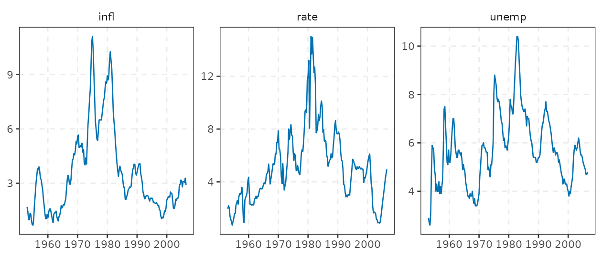
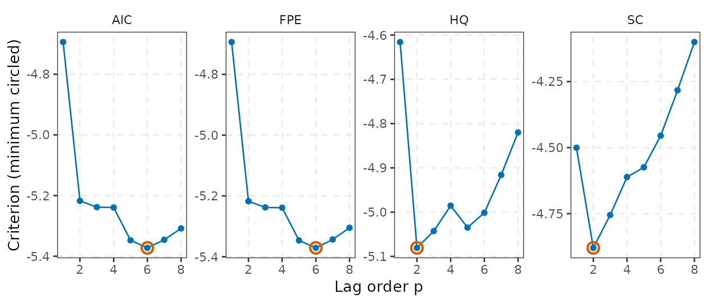
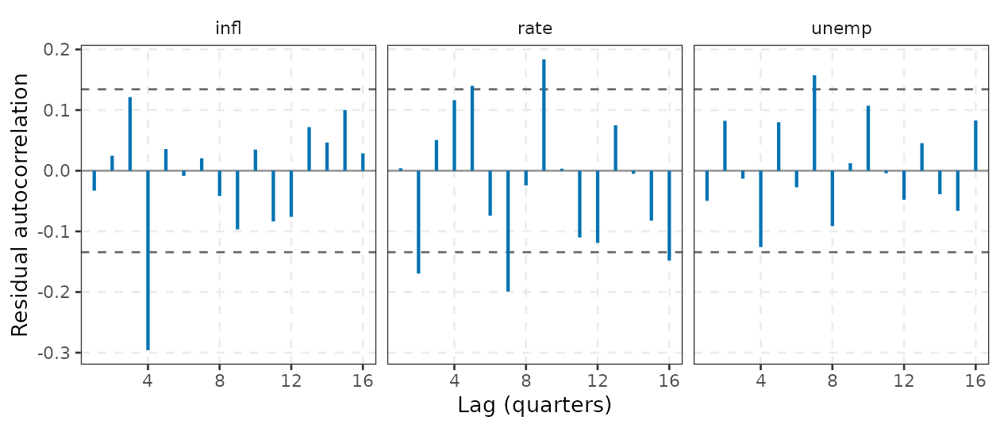
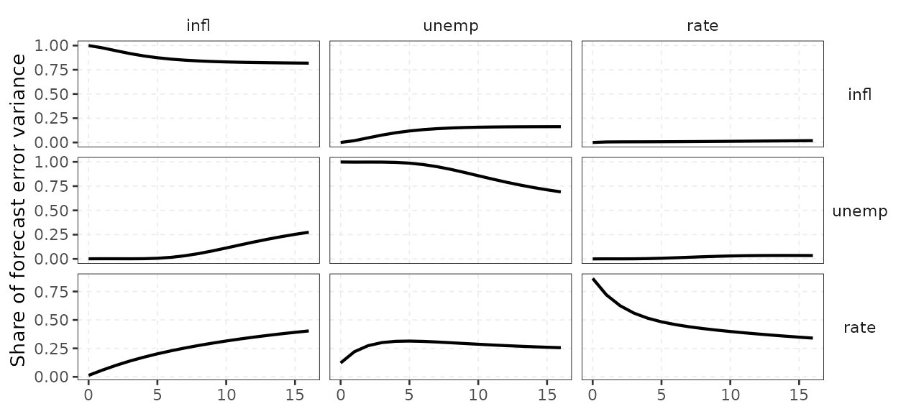
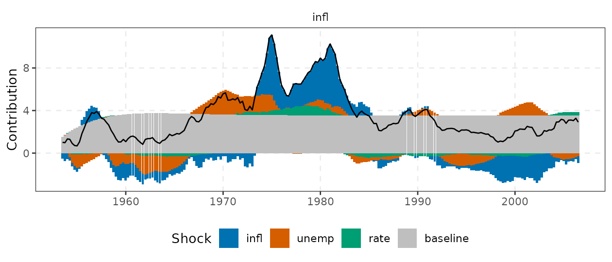
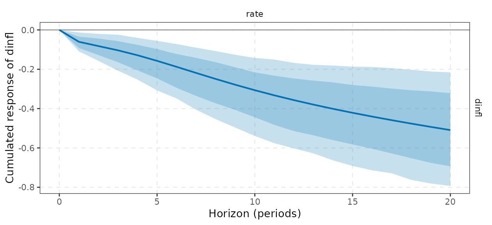
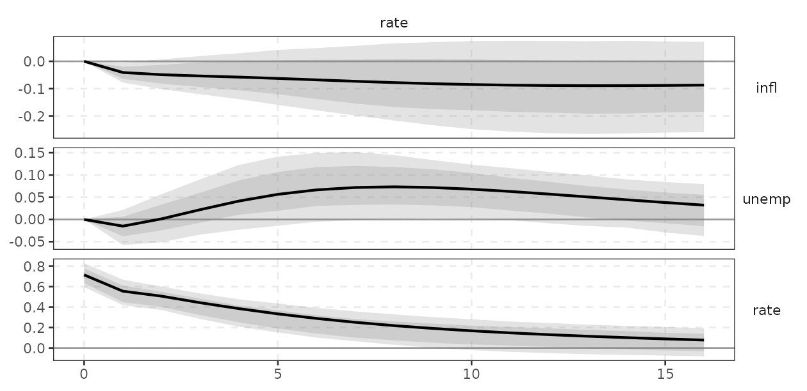
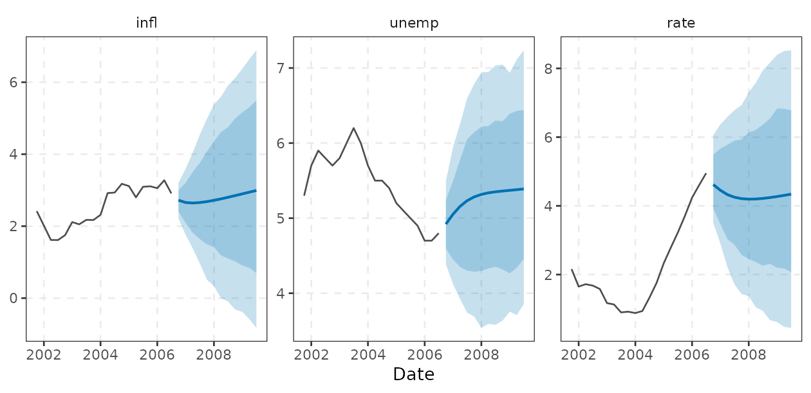
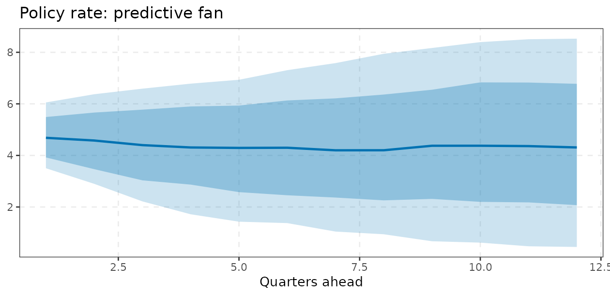

# Reduced-form VAR: theory, inference and use

This vignette defines the objects that `varm` computes for a
reduced-form vector autoregression, states the formulas that the C++
engine implements, and says how to read the output economically. All
examples use `yraw`, the quarterly US data of Koop and Korobilis:
inflation, the unemployment rate and the short-term interest rate, 215
observations (1953Q1 to 2006Q3). Section numbers below follow the order
in which a typical empirical project proceeds: specify, estimate, test,
diagnose, identify, bootstrap, forecast.

The package computes estimates, impulse responses and forecasts; results
come back as tibbles via
[`tidy()`](https://generics.r-lib.org/reference/tidy.html),
[`glance()`](https://generics.r-lib.org/reference/glance.html) and
[`augment()`](https://generics.r-lib.org/reference/augment.html) and
plot with
[`autoplot()`](https://ggplot2.tidyverse.org/reference/autoplot.html)
(ggplot2). The Wald/Granger tests and the residual diagnostics of
Sections 4 and 5 are **not** package functions: `wald_block()`,
`portmanteau()`, `arch_lm()`, `jb_test()` and the ACF helper are defined
inside this vignette, built on
[`coef()`](https://rdrr.io/r/stats/coef.html), `fit$XtXinv`, `fit$Sigma`
and [`augment()`](https://generics.r-lib.org/reference/augment.html), so
do not look for them in the package. They are short enough to copy into
your own scripts.

``` r

long <- do.call(rbind, lapply(vn, function(v) {
  data.frame(date = y$date, variable = v, value = y[[v]])
}))
ggplot(long, aes(date, value)) +
  geom_line(colour = varm_palette(1)) +
  facet_wrap(vars(variable), scales = "free_y") +
  labs(x = NULL, y = NULL) +
  theme_varm()
```



## 1. The model

A VAR($`p`$) for the $`K\times 1`$ vector $`y_t`$ is
``` math
y_t = c + \sum_{l=1}^{p} A_l\, y_{t-l} + \Gamma w_t + u_t,\qquad
u_t \sim (0,\Sigma),\quad E[u_t u_s']=0\ (t\neq s),
```
where $`w_t`$ collects optional trend or exogenous regressors
(`trend = TRUE`, `exog =`). Stacking regressors
$`x_t=(y_{t-1}',\dots,y_{t-p}',1,w_t')'`$ gives $`Y = XB + U`$ with
$`B`$ the $`m\times K`$ coefficient matrix ($`m=Kp+d`$), exactly the
layout of `fit$B` (lags first, then deterministics; columns are
equations).

**Companion form.** Define $`\mathbf{y}_t=(y_t',\dots,y_{t-p+1}')'`$.
Then
``` math
\mathbf{y}_t = \mathbf{c} + \mathbf{A}\,\mathbf{y}_{t-1} + \mathbf{u}_t,\qquad
\mathbf{A}=\begin{pmatrix}A_1&A_2&\cdots&A_p\\ I_K&0&\cdots&0\\ &\ddots&&\vdots\\ 0&&I_K&0\end{pmatrix}.
```
The process is covariance stationary iff all eigenvalues of
$`\mathbf{A}`$ lie inside the unit circle.
[`stability()`](https://kvasilopoulos.github.io/varm/reference/stability.md)
returns their moduli.

``` r

fit <- varm(y, p = 2)          # the Date column is dropped from the estimation, kept for plots
fit
#> <varm> VAR(2) with 3 variables, 213 effective observations
#> logLik = -338.416; max |eigenvalue| = 0.946
#> 
#>             infl   unemp    rate
#> infl.l1   1.5378 -0.0095  0.5457
#> unemp.l1 -0.2809  1.3297 -0.6475
#> rate.l1  -0.0571 -0.0210  0.7766
#> infl.l2  -0.5418  0.0341 -0.4395
#> unemp.l2  0.2336 -0.4290  0.6730
#> rate.l2   0.0580  0.0457  0.1232
#> const     0.2872  0.3654  0.0052
A <- lag_matrices(fit)           # array [K, K, p]: A[, , l] is the coefficient matrix on lag l
round(A[, , 1], 3)
#>         infl  unemp   rate
#> infl   1.538 -0.281 -0.057
#> unemp -0.010  1.330 -0.021
#> rate   0.546 -0.647  0.777
round(drop(stability(fit)), 3)   # moduli of the companion eigenvalues
#> [1] 0.946 0.946 0.746 0.746 0.432 0.139
glance(fit)                      # one-row summary: nobs, logLik, AIC, BIC, HQ, max_root
#> # A tibble: 1 × 8
#>       K     p  nobs logLik   AIC   BIC    HQ max_root
#>   <int> <int> <int>  <dbl> <dbl> <dbl> <dbl>    <dbl>
#> 1     3     2   213  -338.  731.  822.  768.    0.946
```

`varm(y, p = 2, vars = c(infl, rate))` fits a subset of the columns
(tidyselect).

**Moving-average representation.** If the VAR is stable,
``` math
y_t = \mu + \sum_{h=0}^{\infty}\Phi_h u_{t-h},\quad \Phi_0=I,\quad
\Phi_h=\sum_{l=1}^{\min(h,p)}\Phi_{h-l}A_l .
```
The $`\Phi_h`$ are the reduced-form impulse responses to the
*innovations* $`u_t`$. They are not yet responses to economically
meaningful shocks, because the elements of $`u_t`$ are contemporaneously
correlated (see
[`vignette("identification")`](https://kvasilopoulos.github.io/varm/articles/identification.md)).

### Economic intuition / how to use it

The largest eigenvalue modulus is a persistence summary: the response of
any variable to any shock decays roughly like $`|\lambda_{\max}|^h`$.
For macro data in levels the value is typically 0.9 or above, which is
why long-horizon VAR results are fragile (an eigenvalue of 0.98 versus
1.00 is not distinguishable in 200 quarterly observations, but the
implied long-run behaviour differs completely). If the modulus exceeds
one the model is explosive and forecasts and IRFs should not be trusted;
for Bayesian fits `stability(fit)` returns a matrix of moduli across
draws, so you can report the share of explosive draws.

## 2. Estimation and the covariance of the estimates

Equation-by-equation OLS, $`\hat B=(X'X)^{-1}X'Y`$, equals Gaussian
maximum likelihood for $`B`$ because all equations share the same
regressors. The residual covariance is estimated with two
normalisations,
``` math
\hat\Sigma_{ML}=\frac{\hat U'\hat U}{T_e},\qquad
\hat\Sigma=\frac{\hat U'\hat U}{T_e-m},
```
with $`T_e=T-p`$ effective observations. `fit$Sigma` is the
degrees-of-freedom corrected $`\hat\Sigma`$; `fit$Sigma_ml` is the ML
version. The Gaussian log-likelihood at the optimum is
``` math
\ell=-\tfrac{T_e K}{2}\log(2\pi)-\tfrac{T_e}{2}\log|\hat\Sigma_{ML}|-\tfrac{T_e K}{2}.
```
For a stable VAR,
$`\sqrt{T_e}\,\mathrm{vec}(\hat B-B)\overset{d}{\to}N\!\big(0,\Sigma\otimes Q^{-1}\big)`$
with $`Q=\mathrm{plim}\,X'X/T_e`$, so the standard errors reported by
[`summary()`](https://rdrr.io/r/base/summary.html) are
``` math
\widehat{\mathrm{se}}(\hat B_{ik})=\sqrt{\big[(X'X)^{-1}\big]_{ii}\,\hat\Sigma_{kk}} .
```
(`fit$XtXinv` stores $`(X'X)^{-1}`$.) This is the same formula used by
[`lm()`](https://rdrr.io/r/stats/lm.html) in each equation, which we can
verify:

``` r

d <- as.data.frame(embed(as.matrix(yraw), 3))
names(d) <- c(paste0(vn, ".l0"), paste0(vn, ".l1"), paste0(vn, ".l2"))
m1 <- lm(rate.l0 ~ infl.l1 + unemp.l1 + rate.l1 + infl.l2 + unemp.l2 + rate.l2, d)
cbind(lm = coef(m1)[-1], varm = coef(fit)[1:6, "rate"])[1:3, ]
#>                  lm       varm
#> infl.l1   0.5456700  0.5456700
#> unemp.l1 -0.6474938 -0.6474938
#> rate.l1   0.7766035  0.7766035
max(abs(summary(m1)$coefficients[-1, 2] - summary(fit)$se[1:6, "rate"]))
#> [1] 2.206568e-14
```

[`tidy()`](https://generics.r-lib.org/reference/tidy.html) returns the
same numbers in long form, one row per equation and regressor
(`response`, `term`, `estimate`, `std.error`, `statistic`, `p.value`,
and `conf.low`/`conf.high` with `conf.int = TRUE`):

``` r

s <- summary(fit)
co <- tidy(fit, conf.int = TRUE)
co[co$response == "rate", ]
#> # A tibble: 7 × 8
#>   response term     estimate std.error statistic  p.value conf.low conf.high
#>   <chr>    <chr>       <dbl>     <dbl>     <dbl>    <dbl>    <dbl>     <dbl>
#> 1 rate     infl.l1   0.546      0.149     3.66   3.16e- 4   0.252      0.839
#> 2 rate     unemp.l1 -0.647      0.155    -4.17   4.47e- 5  -0.954     -0.341
#> 3 rate     rate.l1   0.777      0.0738   10.5    5.19e-21   0.631      0.922
#> 4 rate     infl.l2  -0.440      0.153    -2.87   4.52e- 3  -0.741     -0.138
#> 5 rate     unemp.l2  0.673      0.148     4.55   9.03e- 6   0.382      0.964
#> 6 rate     rate.l2   0.123      0.0726    1.70   9.10e- 2  -0.0198     0.266
#> 7 rate     const     0.00517    0.238     0.0217 9.83e- 1  -0.465      0.475
round(s$r.squared, 3)
#>  infl unemp  rate 
#> 0.983 0.949 0.928
```

### Economic intuition / how to use it

The interest-rate equation is a *reaction function* in reduced form: the
coefficient on lagged inflation is the central bank’s response (together
with everything else correlated with it) and the very large own-lag
coefficient is interest-rate smoothing. Individual VAR coefficients are
rarely interpreted one by one; they are highly collinear and their signs
depend on the lag order. Use them for (i) Granger-causality style tests
of a block of coefficients, (ii) diagnosing stability, and (iii) as the
input to the dynamic objects below. The residual correlation matrix
printed by [`summary()`](https://rdrr.io/r/base/summary.html) is the
first diagnostic of identification: large correlations mean the Cholesky
ordering will matter.

``` r

round(cor(resid(fit)), 2)
#>        infl unemp  rate
#> infl   1.00 -0.04  0.11
#> unemp -0.04  1.00 -0.35
#> rate   0.11 -0.35  1.00
```

The residuals are also available next to the data through
[`augment()`](https://generics.r-lib.org/reference/augment.html), which
pads the first $`p`$ rows with `NA`; the diagnostics of Section 5 start
from it.

### Degrees-of-freedom conventions, in one place

| quantity | divisor | where |
|----|----|----|
| $`\hat\Sigma`$ (`fit$Sigma`, `vcov(fit)`) | $`T_e-m`$ | standard errors, t-tests, bootstrap and MC draws of $`\Sigma`$, IRF (default Cholesky) |
| $`\hat\Sigma_{ML}`$ (`fit$Sigma_ml`) | $`T_e`$ | log-likelihood, information criteria |
| t-test reference distribution | $`t_{T_e-m}`$ | `summary(fit)$pvalue` |
| `nobs(fit)` | $`T_e=T-p`$ | `glance(fit)$nobs` |

where $`m=Kp+d`$ is the number of regressors per equation. The
[`logLik()`](https://rdrr.io/r/stats/logLik.html) degrees of freedom are
$`mK+K(K+1)/2`$ (here 27 for $`p=2`$).

``` r

c(Te = nobs(fit), m = fit$npar)
#>  Te   m 
#> 213   7
all.equal(fit$Sigma, fit$Sigma_ml * nobs(fit) / (nobs(fit) - fit$npar), check.attributes = FALSE)
#> [1] TRUE
logLik(fit)
#> 'log Lik.' -338.4159 (df=27)
```

### t-tests

Under Gaussian errors
$`\hat B_{ik}/\widehat{\mathrm{se}}(\hat B_{ik})\sim t_{T_e-m}`$ exactly
when the regressors are strictly exogenous, and asymptotically
$`N(0,1)`$ in a stable VAR. `summary(fit)$pvalue` uses
$`2\Pr(t_{T_e-m}>|t|)`$. These tests apply to *one coefficient at a
time*; to test whether a whole variable matters use the Wald tests of
the next section, because lags of the same variable are strongly
collinear and individually insignificant even when jointly very
significant.

## 3. Choosing the lag order

On a common sample of $`T_e=T-p_{\max}`$ observations, let
$`\tilde\Sigma(p)=\hat U_p'\hat U_p/T_e`$ and $`n_p=pK^2+Kd`$ the number
of mean parameters.
[`var_select()`](https://kvasilopoulos.github.io/varm/reference/var_select.md)
reports
``` math
\begin{align}
\mathrm{AIC}(p)&=\log|\tilde\Sigma(p)|+\frac{2}{T_e}n_p,\\
\mathrm{HQ}(p)&=\log|\tilde\Sigma(p)|+\frac{2\log\log T_e}{T_e}n_p,\\
\mathrm{SC}(p)&=\log|\tilde\Sigma(p)|+\frac{\log T_e}{T_e}n_p,\\
\log\mathrm{FPE}(p)&=K\log\frac{T_e+Kp+d}{T_e-Kp-d}+\log|\tilde\Sigma(p)|.
\end{align}
```
These are Lütkepohl’s (2005) formulas (the FPE is returned on the log
scale, which has the same argmin) and the selected lags agree with
[`vars::VARselect()`](https://rdrr.io/pkg/vars/man/VARselect.html).
Because the sample is common, a criterion value is comparable across
$`p`$ but *not* across different `pmax`.

``` r

sel <- var_select(y, pmax = 8)
sel$selection
#> AIC  HQ  SC FPE 
#>   6   2   2   6
round(sel$criteria, 3)
#>      AIC     HQ     SC    FPE
#> 1 -4.694 -4.616 -4.501 -4.694
#> 2 -5.217 -5.081 -4.879 -5.217
#> 3 -5.238 -5.043 -4.755 -5.238
#> 4 -5.239 -4.985 -4.611 -5.239
#> 5 -5.347 -5.035 -4.575 -5.346
#> 6 -5.372 -5.001 -4.455 -5.371
#> 7 -5.346 -4.916 -4.283 -5.343
#> 8 -5.308 -4.820 -4.101 -5.305
```

``` r

crit <- data.frame(
  p = rep(seq_len(nrow(sel$criteria)), ncol(sel$criteria)),
  criterion = rep(colnames(sel$criteria), each = nrow(sel$criteria)),
  value = as.vector(sel$criteria)
)
best <- data.frame(p = unname(sel$selection), criterion = names(sel$selection))
best$value <- mapply(function(p, cr) sel$criteria[p, cr], best$p, best$criterion)
ggplot(crit, aes(p, value)) +
  geom_line(colour = varm_palette(1)) +
  geom_point(colour = varm_palette(1)) +
  geom_point(data = best, colour = varm_palette(2)[2], size = 3, shape = 1, stroke = 1.2) +
  facet_wrap(vars(criterion), nrow = 1, scales = "free_y") +
  labs(x = "Lag order p", y = "Criterion (minimum circled)") +
  theme_varm()
```



### Economic intuition / how to use it

AIC and FPE penalise parameters lightly and tend to overfit in small
samples, whereas SC and HQ are consistent and pick short lags. A
sensible workflow is to take the SC/HQ choice as a baseline, check
residual autocorrelation (Section 5), and use a longer lag only if short
lags leave serial correlation. More lags is not free: the number of
parameters grows as $`pK^2`$. With $`K=3`$ and $`p=6`$ there are 54
slope coefficients for about 209 observations. If you need long lags
with many variables, use a Bayesian VAR
([`vignette("bayesian-var")`](https://kvasilopoulos.github.io/varm/articles/bayesian-var.md)),
which shrinks the extra parameters.

## 4. Wald tests, Granger causality and block exogeneity

**Definition.** Because
$`\mathrm{Var}(\mathrm{vec}\,\hat B)=\Sigma\otimes(X'X)^{-1}`$ (`vec`
stacks the columns of $`\hat B`$, i.e. equation by equation), any linear
hypothesis $`H_0:R\,\mathrm{vec}(B)=0`$ is tested with
``` math
W=\mathrm{vec}(\hat B)'R'\big[R(\hat\Sigma\otimes(X'X)^{-1})R'\big]^{-1}R\,\mathrm{vec}(\hat B)\ \overset{a}{\sim}\ \chi^2(r),
\qquad F=W/r\ \approx\ F(r,\,T_e-m).
```
Variable $`j`$**does not Granger-cause** variable $`k`$ if the
coefficients on all $`p`$ lags of $`j`$ in equation $`k`$ are zero
($`r=p`$). A **block-exogeneity** test generalises this to a set of
variables $`J`$ not entering a set of equations $`G`$ ($`r=p|J||G|`$).
Granger causality is about *predictive content*, not structural
causation: a variable that anticipates the future (an interest rate that
responds to expected inflation) will “cause” the variable it responds
to. `varm` has no dedicated function for these tests. The helper
`wald_block()` below is **defined in this vignette; it is not exported
by the package**. It uses only `fit$B`, `fit$XtXinv` and `fit$Sigma`,
and takes variable names as strings.

``` r

# H0: variables `from` do not enter equations `to` (all lags). Returns Wald/F statistics.
wald_block <- function(fit, from, to = setdiff(fit$varnames, from)) {
  K <- fit$K; p <- fit$p; m <- nrow(fit$B); vn <- fit$varnames
  idx <- c(outer(sort(match(from, vn)) , (seq_len(p) - 1) * K, "+"))   # rows of B for lags of `from`
  cols <- match(to, vn)
  sel <- unlist(lapply(cols, function(k) (k - 1) * m + idx))           # positions in vec(B)
  V <- kronecker(fit$Sigma, fit$XtXinv)[sel, sel, drop = FALSE]
  b <- c(fit$B)[sel]
  W <- drop(t(b) %*% solve(V, b)); r <- length(sel)
  c(Wald = W, df = r, p_chisq = pchisq(W, r, lower.tail = FALSE),
    F = W / r, p_F = pf(W / r, r, nobs(fit) - m, lower.tail = FALSE))
}
tab <- t(sapply(vn, function(v) wald_block(fit, from = v, to = setdiff(vn, v))))
round(tab, 4)                                  # row = causing variable; H0: does not help predict the others
#>          Wald df p_chisq       F    p_F
#> infl  33.8805  4  0.0000  8.4701 0.0000
#> unemp 40.1811  4  0.0000 10.0453 0.0000
#> rate   9.9457  4  0.0414  2.4864 0.0447
round(wald_block(fit, "rate", "infl"), 4)     # a single pair
#>    Wald      df p_chisq       F     p_F 
#>  4.0282  2.0000  0.1334  2.0141  0.1361
round(wald_block(fit, c("infl", "unemp"), "rate"), 4)  # the rate equation ignores both
#>    Wald      df p_chisq       F     p_F 
#> 36.4323  4.0000  0.0000  9.1081  0.0000
```

``` r

# cross-check one case against nested lm() fits (F test of the rate lags in the inflation equation)
d2 <- as.data.frame(embed(as.matrix(yraw), 3)); names(d2) <- paste0(rep(vn, 3), ".l", rep(0:2, each = 3))
full <- lm(infl.l0 ~ infl.l1 + unemp.l1 + rate.l1 + infl.l2 + unemp.l2 + rate.l2, d2)
rest <- update(full, . ~ . - rate.l1 - rate.l2)
c(lm_F = anova(rest, full)$F[2], wald_F = unname(wald_block(fit, "rate", "infl")["F"]))
#>     lm_F   wald_F 
#> 2.014086 2.014086
```

The two F statistics agree exactly in the single-equation case, which
confirms that the Kronecker covariance is implemented as stated.

### Economic intuition / how to use it

Use the table as a map of the system’s information flow before
interpreting any IRF. If the policy rate Granger-causes neither
inflation nor unemployment, any “policy shock” IRF will be weakly
identified in the sense of being small relative to noise; if a variable
is block-exogenous to the rest (a world commodity price vis-a-vis a
small economy) it can be ordered first in a Cholesky scheme and, if you
want, estimated as an exogenous block. Test results depend on $`p`$ and
on the other variables in the system (omitted-variable causality), so
report them for a lag order that passes the diagnostics below.

## 5. Residual diagnostics

A VAR is only as good as its residuals: inference (Section 4), bootstrap
bands and the Cholesky decomposition all assume the innovations are
serially uncorrelated and (for the iid bootstrap) homoskedastic. Three
checks follow. As with the Wald test, they are **helper functions
defined in this vignette** (`portmanteau()`, `arch_lm()`, `jb_test()`;
none is exported by `varm`). All of them start from `augment(fit)`: the
`.resid_*` columns hold the residuals and are `NA` for the first $`p`$
rows, which the helper `resid_matrix()` drops.

**Autocorrelation (multivariate portmanteau, adjusted).** With
$`\hat C_j=T_e^{-1}\sum_{t}\hat u_t\hat u_{t-j}'`$,
``` math
Q_h=T_e^2\sum_{j=1}^{h}\frac{1}{T_e-j}\,\mathrm{tr}\big(\hat C_j'\hat C_0^{-1}\hat C_j\hat C_0^{-1}\big)\ \overset{a}{\sim}\ \chi^2\big(K^2(h-p)\big).
```
**ARCH-LM.** For each equation regress $`\hat u_t^2`$ on $`q`$ of its
own lags and a constant; $`T_e R^2\overset{a}{\sim}\chi^2(q)`$ under
conditional homoskedasticity. **Normality (Jarque-Bera).** Orthogonalise
with the Cholesky factor of $`\hat\Sigma_{ML}`$,
$`\hat e_t=P^{-1}\hat u_t`$, then
$`\mathrm{JB}_k=T_e\big(\hat s_k^2/6+(\hat\kappa_k-3)^2/24\big)\sim\chi^2(2)`$
for each component ($`\hat s,\hat\kappa`$ = skewness and kurtosis), and
$`\sum_k\mathrm{JB}_k\sim\chi^2(2K)`$.

``` r

resid_matrix <- function(fit) {
  a <- augment(fit)
  r <- a[startsWith(names(a), ".resid_")]
  r <- as.matrix(r[-seq_len(fit$p), ])
  colnames(r) <- sub(".resid_", "", colnames(r), fixed = TRUE)
  r
}
portmanteau <- function(fit, h = 12) {
  U <- resid_matrix(fit); Te <- nrow(U); C0i <- solve(crossprod(U) / Te)
  Q <- 0
  for (j in 1:h) { Cj <- crossprod(U[-(1:j), ], U[1:(Te - j), ]) / Te
                   Q <- Q + sum(diag(t(Cj) %*% C0i %*% Cj %*% C0i)) / (Te - j) }
  Q <- Te^2 * Q; df <- fit$K^2 * (h - fit$p)
  c(Q = Q, df = df, p = pchisq(Q, df, lower.tail = FALSE))
}
arch_lm <- function(fit, q = 4) {
  U <- resid_matrix(fit)
  sapply(colnames(U), function(v) {
    e2 <- U[, v]^2; Z <- embed(e2, q + 1)
    r2 <- summary(lm(Z[, 1] ~ Z[, -1]))$r.squared; st <- nrow(Z) * r2
    c(LM = st, p = pchisq(st, q, lower.tail = FALSE))
  })
}
jb_test <- function(fit) {
  U <- resid_matrix(fit); Te <- nrow(U)
  E <- U %*% t(solve(t(chol(fit$Sigma_ml))))          # e_t = P^{-1} u_t with P = chol lower
  s <- colMeans(E^3) / colMeans(E^2)^1.5; k <- colMeans(E^4) / colMeans(E^2)^2
  jb <- Te * (s^2 / 6 + (k - 3)^2 / 24)
  rbind(skew = s, kurt = k, JB = jb, p = pchisq(jb, 2, lower.tail = FALSE))
}
fit6 <- varm(y, p = 6)
round(rbind(`p=2` = portmanteau(fit, 12), `p=6` = portmanteau(fit6, 12)), 4)
#>            Q df      p
#> p=2 165.4792 90 0.0000
#> p=6  82.3773 54 0.0077
round(arch_lm(fit), 4)
#>       infl  unemp    rate
#> LM 29.7822 3.7408 47.5408
#> p   0.0000 0.4422  0.0000
round(jb_test(fit), 3)
#>        infl   unemp    rate
#> skew  0.271   1.176  -0.405
#> kurt  4.018   7.952  10.400
#> JB   11.808 266.691 491.820
#> p     0.003   0.000   0.000
```

``` r

# residual ACF from augment(): one panel per equation, approximate 95% bounds
U <- resid_matrix(fit)
acf_tbl <- do.call(rbind, lapply(colnames(U), function(v) {
  a <- acf(U[, v], lag.max = 16, plot = FALSE)
  data.frame(variable = v, lag = drop(a$lag)[-1], acf = drop(a$acf)[-1])
}))
ggplot(acf_tbl, aes(lag, acf)) +
  geom_hline(yintercept = 0, colour = "grey60") +
  geom_hline(yintercept = c(-1, 1) * 1.96 / sqrt(nrow(U)), linetype = 2, colour = "grey40") +
  geom_segment(aes(xend = lag, yend = 0), colour = varm_palette(1), linewidth = 0.8) +
  facet_wrap(vars(variable), nrow = 1) +
  labs(x = "Lag (quarters)", y = "Residual autocorrelation") +
  theme_varm()
```



### Economic intuition / how to use it

A strongly significant portmanteau statistic at $`p=2`$ means the lag
order is too short (the persistent inflation and rate series need more
dynamics): the standard errors, the Granger tests and the bands are then
unreliable, and the remedy is to increase $`p`$. The $`p=6`$ row shows
the statistic roughly halves, though the test still rejects at 1% with
$`h=12`$; in practice one would settle on a lag between the SC and AIC
choices, or move to a Bayesian VAR, rather than chase a non-rejection.
Rejection of ARCH-LM and normality is the norm for macro data (the
volatility of the 1970s-80s was not that of the Great Moderation, and
there are outliers around the 1970s oil shocks). Neither invalidates the
point estimates, which only need $`E[u_t|x_t]=0`$, but they argue for
the **wild bootstrap** (Section 8), which does not assume
homoskedasticity, and against reading the Gaussian log-likelihood or the
MC bands literally. Correct autocorrelation first; do not “fix”
non-normality by adding lags.

## 6. Impulse responses, variance and historical decompositions

Write $`u_t=P\varepsilon_t`$ with $`PP'=\Sigma`$ and
$`E[\varepsilon_t\varepsilon_t']=I`$. The structural moving-average
coefficients are $`\Theta_h=\Phi_h P`$ and the response of variable
$`i`$ at horizon $`h`$ to structural shock $`j`$ is
``` math
\mathrm{IRF}_{ij}(h)=e_i'\,\Phi_h P\, e_j .
```
[`irf()`](https://kvasilopoulos.github.io/varm/reference/dynamics.md)
returns an object whose `$estimate` is an array
`[response, shock, horizon]` (horizon 0 is impact). The default
identification is a Cholesky factorisation; other choices of $`P`$ are
the subject of
[`vignette("identification")`](https://kvasilopoulos.github.io/varm/articles/identification.md).
With a Cholesky $`P`$ lower triangular, variable $`i`$ is allowed to
react to shock $`j`$ on impact only if $`i\ge j`$ in the ordering: the
first variable is the “most exogenous” and the last responds to
everything contemporaneously.

**Forecast error variance decomposition.** The $`h`$-step forecast error
is $`\sum_{s=0}^{h-1}\Theta_s\varepsilon_{t+h-s}`$, so the share of
variable $`i`$’s forecast error variance due to shock $`j`$ is
``` math
\mathrm{FEVD}_{ij}(h)=\frac{\sum_{s=0}^{h}\big(e_i'\Theta_s e_j\big)^2}{\sum_{s=0}^{h}\sum_{k=1}^{K}\big(e_i'\Theta_s e_k\big)^2},
```
which sums to one over $`j`$
([`fevd()`](https://kvasilopoulos.github.io/varm/reference/dynamics.md);
as implemented, index $`h=0`$ is the impact decomposition and index
$`h`$ cumulates horizons $`0,\dots,h`$).

**Historical decomposition.** Recursing the VAR from the initial
conditions,
``` math
y_{t}= \underbrace{\hat\mu_t}_{\text{deterministic + initial conditions}}+
\sum_{j=1}^{K}\underbrace{\sum_{s=0}^{t-1}\Theta_s e_j\,\hat\varepsilon_{j,t-s}}_{\text{contribution of shock } j},
\qquad \hat\varepsilon_t=P^{-1}\hat u_t ,
```
so that the observed path is exactly the baseline plus the sum of shock
contributions
([`hd()`](https://kvasilopoulos.github.io/varm/reference/dynamics.md)).

``` r

ir <- irf(fit, horizon = 16, ci = "none")
round(ir$estimate[, "rate", c(1, 2, 5, 9, 17)], 3)   # responses to the policy-rate shock (Cholesky)
#>         h
#> response     0      1      4      8     16
#>    infl  0.000 -0.041 -0.058 -0.078 -0.087
#>    unemp 0.000 -0.015  0.041  0.073  0.032
#>    rate  0.715  0.555  0.385  0.219  0.077
head(tidy(ir, bands = FALSE), 3)                      # the same estimates as a tibble
#> # A tibble: 3 × 4
#>   response shock horizon estimate
#>   <fct>    <fct>   <int>    <dbl>
#> 1 infl     infl        0   0.308 
#> 2 unemp    infl        0  -0.0117
#> 3 rate     infl        0   0.0877
fv <- fevd(fit, horizon = 16, ci = "none")
round(fv$estimate[, , 17], 2)                         # rows: variable; columns: shock; horizon 16
#>         shock
#> response infl unemp rate
#>    infl  0.82  0.16 0.02
#>    unemp 0.27  0.69 0.03
#>    rate  0.40  0.26 0.34
rowSums(fv$estimate[, , 17])
#>  infl unemp  rate 
#>     1     1     1
# the impact matrix is the Cholesky factor of Sigma
round(ir$estimate[, , 1] - t(chol(fit$Sigma)), 10)
#>         shock
#> response infl unemp rate
#>    infl     0     0    0
#>    unemp    0     0    0
#>    rate     0     0    0
```

``` r

autoplot(fv) + labs(y = "Share of forecast error variance")
```



``` r

h <- hd(fit)
dim(h$contributions)                     # [time, variable, shock]
#> [1] 213   3   3
# the identity y = baseline + sum of contributions holds exactly
max(abs(h$actual - h$baseline - apply(h$contributions, c(1, 2), sum)))
#> [1] 8.881784e-16
```

``` r

# stacked shock contributions to inflation, actual series as the black line
autoplot(h, responses = infl)
```



### Economic intuition / how to use it

- **IRF**: the dynamic causal effect of a one-time shock, e.g. the path
  of unemployment after a surprise tightening. Everything depends on
  $`P`$.
- **FEVD**: how much of the *unpredictable* movement in a variable at
  horizon $`h`$ is attributable to each shock. A shock that explains 30%
  of inflation variance at horizon 16 is important for medium-run
  inflation fluctuations; it says nothing about the *level* of
  inflation. Because the FEVD is a ratio of squared IRFs, uncertainty
  about it is large and its bands are only reliable with bootstrap or
  Bayesian draws. At horizon 0 the FEVD is determined entirely by the
  ordering (the first variable’s impact variance is 100% its own shock).
- **HD**: a narrative device: which shocks pushed inflation above or
  below its baseline in a given episode (for example, the contribution
  of the “rate” shock in the early 1980s). It inherits all
  identification assumptions, and with a single draw of a set-identified
  model it is conditional on that draw.

## 7. Normalisation, cumulative responses and ordering

**Unit versus one-standard-deviation shocks.** By default each column of
$`P`$ gives the response to a shock of *one standard deviation* of the
structural shock, so IRF sizes in different columns are not comparable
in the units of the shock. To report “a 1 percentage-point rise in the
policy rate”, rescale shock $`j`$ by $`1/\Theta_{0,ij}`$ so the *impact*
response of a chosen variable $`i`$ equals `size`:
``` math
\widetilde{\mathrm{IRF}}_{\cdot j}(h)=\frac{\mathrm{size}}{e_i'\Theta_0e_j}\,\Theta_h e_j ,
```
which is `normalise = normalise_to(shock, variable, size)` (the older
`list(shock =, variable =, size =)` form still works). The normalisation
applies draw by draw, so the bands are for the *normalised* response.

**Cumulative IRFs.** If a variable enters in differences,
$`\Delta x_t`$, the response of its *level* is
$`\sum_{s=0}^{h}\mathrm{IRF}_{\Delta x}(s)`$. `cumulative =`
(tidyselect) sums the responses of the selected variables over the
horizon, again draw by draw (apply it *before* computing bands, never to
the band endpoints).

``` r

ir_sd   <- irf(fit, horizon = 16, ci = "none")
ir_unit <- irf(fit, horizon = 16, ci = "none",
               normalise = normalise_to(rate, rate, 1))
round(rbind(`1 sd` = ir_sd$estimate[, "rate", 1], unit = ir_unit$estimate[, "rate", 1]), 3)
#>      infl unemp  rate
#> 1 sd    0     0 0.715
#> unit    0     0 1.000
sd_rate_shock <- ir_sd$estimate["rate", "rate", 1]
all.equal(ir_unit$estimate[, "rate", ], ir_sd$estimate[, "rate", ] / sd_rate_shock)
#> [1] TRUE
```

``` r

dy <- data.frame(dinfl = diff(y$infl), unemp = y$unemp[-1], rate = y$rate[-1])
fd <- varm(dy, p = 2)
ic <- irf(fd, horizon = 20, ci = "bootstrap", nboot = 300, cumulative = dinfl,
          normalise = normalise_to(rate, rate, 1))
# response of the LEVEL of inflation to a 1pp rate shock
autoplot(ic, shocks = rate, responses = dinfl) +
  labs(y = "Cumulated response of dinfl")
```



**Ordering.** With a Cholesky identification, reordering the variables
changes the impact matrix and therefore every structural IRF, although
the reduced-form $`\Phi_h`$ and the fit are unchanged. A quick
robustness check is to compare orderings:

``` r

i1 <- irf(fit, id = id_chol(), horizon = 16, ci = "none")
i2 <- irf(fit, id = id_chol(order = c(rate, unemp, infl)), horizon = 16, ci = "none")
# response of unemployment to the rate shock at h = 0, 4, 8: rate ordered last versus first
round(rbind(`rate last` = i1$estimate["unemp", "rate", c(1, 5, 9)],
            `rate first` = i2$estimate["unemp", "rate", c(1, 5, 9)]), 3)
#>                 0      4     8
#> rate last   0.000  0.041 0.073
#> rate first -0.117 -0.069 0.071
round(cor(resid(fit)), 2)[3, ]
#>  infl unemp  rate 
#>  0.11 -0.35  1.00
```

### Economic intuition / how to use it

Normalise to a meaningful unit (1pp, 25bp) whenever you compare to other
studies or across methods (the LP vignette uses exactly this
normalisation). Cumulate only variables that are in differences; for a
level variable the plain IRF is already the level response. Ordering
matters most when the residual correlations are large: the
rate-with-inflation and rate-with-unemployment correlations printed
above tell you how much the “rate last” assumption (the policy rate
reacts to current inflation and unemployment, but they react to the rate
only with a lag) matters.

## 8. Inference: bootstrap and Monte Carlo

All bands in `varm` come from the same device: a `varm_draws` object
containing $`N`$ reduced-form pairs $`(B^{(n)},\Sigma^{(n)})`$, mapped
through the identification scheme one at a time. The
[`draws()`](https://kvasilopoulos.github.io/varm/reference/draws.md)
generic produces them
([`irf()`](https://kvasilopoulos.github.io/varm/reference/dynamics.md),
[`fevd()`](https://kvasilopoulos.github.io/varm/reference/dynamics.md)
and
[`forecast()`](https://kvasilopoulos.github.io/varm/reference/dynamics.md)
call it internally when you pass `ci =`):

| method | construction | when |
|----|----|----|
| `"bootstrap"` | recursive design: resample residuals $`\hat u_t`$ i.i.d., rebuild $`y^*_t`$ from $`\hat B`$ and the initial values, re-estimate | homoskedastic errors, default |
| `"wild"` | $`u^*_t=\eta_t\hat u_t`$, $`\eta_t=\pm1`$ with probability 1/2 (Rademacher) | conditional heteroskedasticity (the Great Moderation!) |
| `"wild_mammen"` | $`\eta_t`$ from Mammen’s two-point distribution (mean 0, variance 1, skewness) | skewed residuals |
| `"mc"` | asymptotic draw $`\Sigma^{(n)}\sim IW(\hat U'\hat U,\,T_e-m)`$ and $`\mathrm{vec}B^{(n)}\mid\Sigma^{(n)}\sim N(\mathrm{vec}\hat B,\Sigma^{(n)}\otimes(X'X)^{-1})`$ | fast; approximates a flat-prior Bayesian posterior |

In the bootstrap variants the residuals are first centred and rescaled
by $`\sqrt{T_e/(T_e-m)}`$, and each replication re-estimates $`B^*`$ and
$`\Sigma^*=\hat U^{*\prime}\hat U^*/(T_e-m)`$. Draws use R’s RNG, so
[`set.seed()`](https://rdrr.io/r/base/Random.html) makes them
reproducible.

**Algorithm 1: recursive-design residual (wild) bootstrap.**

1.  Estimate $`\hat B`$ and residuals $`\hat u_t`$; centre and rescale
    them to $`\tilde u_t`$.
2.  For $`n=1,\dots,N`$: set $`y^*_{1..p}=y_{1..p}`$. Draw $`e^*_t`$:
    for the iid bootstrap $`e^*_t=\tilde u_{\tau(t)}`$ with $`\tau(t)`$
    uniform on $`\{1,\dots,T_e\}`$; for the wild bootstrap
    $`e^*_t=\eta_t\tilde u_t`$.
3.  Build $`y^*_t=\hat c+\sum_l\hat A_ly^*_{t-l}+\hat\Gamma w_t+e^*_t`$
    for $`t=p+1,\dots,T`$.
4.  Re-estimate the VAR on $`y^*`$ to get $`(B^{(n)},\Sigma^{(n)})`$.
5.  Map each draw through $`P(\cdot)`$ to IRF/FEVD/forecast; take
    percentiles over $`n`$.

The wild bootstrap keeps each residual vector $`\tilde u_t`$ intact in
its original period (so contemporaneous correlation *and* time-varying
variance are preserved) and multiplies it by an independent mean-zero,
unit-variance scalar.

**Algorithm 2: Kilian (1998) bootstrap-after-bootstrap bias
correction.**

1.  Run Algorithm 1 around $`\hat B`$ and compute
    $`\hat b=\overline{B^{*}}-\hat B`$.
2.  Set $`B^c=\hat B-\hat b`$. If $`B^c`$ is not stable, replace it by
    $`\hat B-\delta\hat b`$ with the largest
    $`\delta\in\{1,0.99,\dots,0\}`$ for which the companion eigenvalues
    are all inside the unit circle.
3.  Recompute residuals at $`B^c`$ and rerun Algorithm 1 around $`B^c`$.
4.  Correct each resulting coefficient draw in the same way,
    $`B^{(n)}-\hat b`$ (with the same stability shrinkage), and map
    through $`P(\cdot)`$. The bootstrap $`\Sigma^{(n)}`$ draws are left
    as they are.

OLS is biased towards zero for persistent processes,
$`E[\hat A]\approx A-b`$ with $`b=O(1/T)`$; the correction removes this
to first order. With `irf(bias_correct = TRUE)` the bands come from the
corrected draws while the point estimate returned in `$estimate` remains
the plain sample IRF.

Two limits to keep in mind. First, `bias_correct` applies to **bootstrap
draws only** (`"bootstrap"`, `"wild"`, `"wild_mammen"`): the Monte Carlo
draws have no resampling step to estimate $`\hat b`$ from, so with
`method = "mc"` (or `ci = "mc"` in
[`irf()`](https://kvasilopoulos.github.io/varm/reference/dynamics.md))
the argument is ignored and a warning says so. Second, Kilian’s
correction adjusts the **coefficient matrix $`B`$ only**; it does not
bias-correct the bootstrap $`\Sigma^{(n)}`$ draws, which are those of
the bootstrap around $`B^c`$.

Bands are equal-tailed percentiles of the draws at each `level` (default
68% and 90%): `$bands[response, shock, h, ]` holds the quantiles at
$`(5\%, 16\%, 84\%, 95\%)`$.

``` r

ir_boot <- irf(fit, horizon = 16, ci = "bootstrap", nboot = 300)
dimnames(ir_boot$bands)[[4]]
#> [1] "0.05" "0.16" "0.84" "0.95"
autoplot(ir_boot, shocks = rate)
```



The same bands are available in tidy form, one row per cell and `level`
(`level`, `conf.low`, `conf.high`), which makes comparisons across
methods a matter of subsetting a tibble:

``` r

methods <- c("bootstrap", "wild", "mc")
w90 <- sapply(methods, function(m) {
  r <- tidy(irf(fit, horizon = 16, ci = m, nboot = 300))
  r <- r[r$response == "infl" & r$shock == "rate" & r$level == 0.9 &
           r$horizon %in% c(4, 8, 16), ]
  r$conf.high - r$conf.low                                # width of the 90% band
})
rownames(w90) <- paste0("h=", c(4, 8, 16))
round(w90, 3)
#>      bootstrap  wild    mc
#> h=4      0.179 0.247 0.166
#> h=8      0.286 0.337 0.295
#> h=16     0.309 0.350 0.370
irbc <- irf(fit, horizon = 16, ci = "bootstrap", nboot = 300, bias_correct = TRUE)
band16 <- function(r) {
  r <- tidy(r)
  r <- r[r$response == "rate" & r$shock == "rate" & r$level == 0.9 & r$horizon == 16, ]
  c(conf.low = r$conf.low, conf.high = r$conf.high)
}
round(rbind(plain = band16(ir_boot), kilian = band16(irbc)), 3)
#>        conf.low conf.high
#> plain    -0.081     0.192
#> kilian   -0.120     0.357
# bias correction needs bootstrap draws: with "mc" it warns and is ignored
tryCatch(draws(fit, "mc", n = 10, bias_correct = TRUE), warning = function(w) conditionMessage(w))
#> [1] "`bias_correct` only applies to bootstrap draws; ignored for `method = \"mc\"`"
```

### Economic intuition / how to use it

Differences between `bootstrap`, `wild` and `mc` bands are themselves a
diagnostic: if they disagree materially, the i.i.d. Gaussian assumption
is doing work and `wild` is the safe choice (the ARCH-LM test above is
the formal version of this check). Bias correction matters when the
largest eigenvalue is close to one and the horizon is long, where the
uncorrected VAR understates persistence and so implies IRFs that die out
too fast. The asymptotic (“mc”) bands treat $`\hat B`$ as exactly normal
and can be too narrow at long horizons for the same reason; this is the
main motivation for either bootstrap-after-bootstrap or a Bayesian VAR
with a unit-root prior. Use `nboot = 1000` or more for published bands;
the 300 draws here are for speed.

Bands are *pointwise*: the 90% band at each horizon covers the true
response with probability 90% for that horizon alone, so the chance that
the *whole* path leaves the band somewhere is much larger. Simultaneous
(sup-t) bands are available for local projections
([`lp_supt()`](https://kvasilopoulos.github.io/varm/reference/lp_supt.md)),
but not yet for VAR IRFs.

## 9. Forecasting

The point forecast iterates the estimated VAR forward;
$`\hat y_{T+h|T}=\hat c+\sum_l \hat A_l \hat y_{T+h-l|T}`$. With
`ci = "mc"` (the default), `"bootstrap"` or `"wild"`, the bands are
predictive: each draw of $`(B^{(n)},\Sigma^{(n)})`$ is combined with
simulated innovations $`u_{T+s}\sim N(0,\Sigma^{(n)})`$, so they include
both parameter and future-shock uncertainty. The draws themselves are in
`fc$draws` (an unnamed array with layout `[draw, horizon, variable]`),
from which you can compute any density summary.

``` r

fc <- forecast(fit, h = 12, ci = "mc", nboot = 500)
dimnames(fc$bands)[[3]]
#> [1] "0.05" "0.16" "0.84" "0.95"
autoplot(fc, n_history = 20)
#> Warning in ggplot2::geom_ribbon(data = d, mapping, fill = fill, alpha = 0.22, :
#> Ignoring empty aesthetic: `fill`.
```



``` r

head(tidy(fc), 3)               # horizon, variable, estimate, level, conf.low, conf.high
#> # A tibble: 3 × 6
#>   horizon variable estimate level conf.low conf.high
#>     <int> <fct>       <dbl> <dbl>    <dbl>     <dbl>
#> 1       1 infl         2.72   0.9     2.21      3.21
#> 2       2 infl         2.66   0.9     1.76      3.60
#> 3       3 infl         2.64   0.9     1.39      4.04
```

**Density and fan chart.** The stored draws give the full predictive
distribution. A “fan” is just a set of nested quantile bands; a
probability statement is an empirical frequency over draws:

``` r

dim(fc$draws)
#> [1] 500  12   3
f_rate <- fc$draws[, , 3]                           # [draw, horizon, variable]; variable 3 = rate
fan <- as.data.frame(t(apply(f_rate, 2, quantile, probs = c(0.05, 0.16, 0.5, 0.84, 0.95))))
names(fan) <- c("q05", "q16", "q50", "q84", "q95")
fan$horizon <- 1:12
ggplot(fan, aes(horizon)) +
  geom_ribbon(aes(ymin = q05, ymax = q95), fill = varm_palette(1), alpha = 0.2) +
  geom_ribbon(aes(ymin = q16, ymax = q84), fill = varm_palette(1), alpha = 0.3) +
  geom_line(aes(y = q50), colour = varm_palette(1), linewidth = 0.9) +
  labs(x = "Quarters ahead", y = NULL, title = "Policy rate: predictive fan") +
  theme_varm()
```



``` r

mean(f_rate[, 12] > mean(y$rate))                    # P(rate in 12 quarters above its sample mean)
#> [1] 0.382
```

### Economic intuition / how to use it

The fan widens and the mean reverts to the unconditional mean at the
speed of the companion eigenvalues. A forecast that quickly returns to
the sample mean says the model sees little persistence; if you believe
the series has a unit root (random-walk interest rate, say), prefer a
prior that encodes it. The bands are predictive (they include shock
uncertainty), so they are far wider than the bands on the IRF. Evaluate
forecasts out of sample (Section 11) rather than by in-sample fit.

## 10. Deterministic terms and exogenous regressors

`const = TRUE` (default) adds an intercept, `trend = TRUE` a linear
trend $`t=1,\dots,T`$, and `exog` a $`T\times q`$ matrix of
contemporaneous exogenous regressors $`w_t`$. They enter after the lags
in `fit$B` (rows `const`, `trend`, column names of `exog`) and are
counted in $`m`$ (and hence in the degrees of freedom and information
criteria). They are not part of the companion matrix, so stability, IRFs
and FEVDs refer to the endogenous dynamics only. For forecasting the
future values must be known: the trend is extended automatically, `exog`
requires `exog_future` ($`h\times q`$).

``` r

fit_tr <- varm(y, p = 2, trend = TRUE)
round(fit_tr$B[c("const", "trend"), ], 4)
#>          infl   unemp   rate
#> const  0.2989  0.3722 0.0022
#> trend -0.0002 -0.0001 0.0001
post84 <- cbind(post84 = as.numeric(y$date >= as.Date("1984-01-01")))          # Great-Moderation dummy
fit_x <- varm(y, p = 2, exog = post84)
round(tail(fit_x$B, 3), 3)
#>           infl unemp   rate
#> rate.l2  0.061 0.045  0.124
#> const    0.302 0.364  0.010
#> post84  -0.057 0.007 -0.018
fcx <- forecast(fit_x, h = 4, exog_future = matrix(1, 4, 1), ci = "none")
round(fcx$mean, 2)
#>      infl unemp rate
#> [1,] 2.68  4.93 4.61
#> [2,] 2.57  5.06 4.41
#> [3,] 2.50  5.17 4.25
#> [4,] 2.45  5.25 4.13
c(max_eig_const = max(stability(fit)), max_eig_trend = max(stability(fit_tr)))
#> max_eig_const max_eig_trend 
#>     0.9460450     0.9446784
```

### Economic intuition / how to use it

A trend absorbs deterministic drift and is appropriate for trending
levels (log GDP); it is *not* a substitute for differencing a stochastic
trend, and a linear trend extrapolated over a long forecast horizon is
rarely credible. Exogenous regressors are for variables that are not
influenced by the system: dummies for known breaks (a post-1984 dummy
shifts the intercepts), oil prices for a small open economy, or a
pandemic indicator. They do *not* produce structural shocks and their
effect is excluded from the IRF; remember that forecasts condition on
your assumed path for them.

## 11. Mistakes to avoid

**Spurious regressions in levels.** Regressing one random walk on
another gives large $`R^2`$ and “significant” t-statistics with
probability close to one; the t-tests of Section 2 are invalid when the
regressors are integrated. A VAR in levels is still *consistent* (and is
the right model if series may be cointegrated) but its individual
t-tests are not $`t`$-distributed; use the bootstrap bands, Wald tests
only with care (Sims, Stock and Watson, 1990), and look at the largest
eigenvalue.

``` r

set.seed(11)
sim <- replicate(500, {
  r <- apply(matrix(rnorm(400), 200, 2), 2, cumsum)       # two independent random walks, T = 200
  c(R2 = summary(lm(r[, 1] ~ r[, 2]))$r.squared, t = summary(lm(r[, 1] ~ r[, 2]))$coefficients[2, 3])
})
c(median_R2 = median(sim["R2", ]), rejection_rate_5pct_test = mean(abs(sim["t", ]) > 1.96))
#>                median_R2 rejection_rate_5pct_test 
#>                 0.194372                 0.846000
```

**Too many lags.** The parameter count $`pK^2`$ eats degrees of freedom,
makes the companion matrix noisy (spurious oscillating IRFs) and worsens
out-of-sample forecasts. A pseudo out-of-sample check (expanding window,
1- and 4-step-ahead RMSE for the rate):

``` r

oos <- function(p, h, start = 120) {
  e <- sapply(start:(nrow(y) - h), function(t) {
    f <- varm(y[1:t, ], p = p)
    forecast(f, h = h, ci = "none")$mean[h, "rate"] - y$rate[t + h]
  })
  sqrt(mean(e^2))
}
res <- sapply(c(1, 2, 4, 8), function(p) c(h1 = oos(p, 1), h4 = oos(p, 4)))
colnames(res) <- paste0("p=", c(1, 2, 4, 8))
round(res, 3)
#>     p=1   p=2   p=4   p=8
#> h1 0.55 0.499 0.528 0.558
#> h4 1.51 1.275 1.305 1.393
```

**Ordering without thought.** A Cholesky ordering is an economic
assumption, not a technicality (Section 7). **Reading individual
coefficients** as causal effects, **reading pointwise bands as
simultaneous**, **ignoring residual diagnostics** (Section 5), and
**using `mc` bands with persistent data** (Section 8) are the other
common errors. Finally, a bootstrap that includes an **unstable** draw
has an explosive IRF; check `stability(draws(fit, "bootstrap", 300))`
for the share of non-stationary replications:

``` r

mean(apply(stability(draws(fit, "bootstrap", 500)), 1, max) >= 1)
#> [1] 0
```

## 12. Speed

The estimation loop, the bootstrap and the IRF mapping are all compiled
(RcppArmadillo). On an Apple M4 Pro a
[`varm()`](https://kvasilopoulos.github.io/varm/reference/varm.md) fit
takes about 0.05 ms, a 1000-draw wild bootstrap about 0.02 s, and an
impulse response with bands from 1000 wild draws about 0.03 s. The chunk
below re-measures these on your machine (timings vary with hardware and
load):

``` r

t_fit <- system.time(for (i in 1:100) varm(y, p = 2))[["elapsed"]] / 100
t_draw <- system.time(draws(fit, "wild", n = 1000))[["elapsed"]]
t_irf <- system.time(irf(fit, horizon = 20, ci = "wild", nboot = 1000))[["elapsed"]]
c(varm_ms = 1000 * t_fit, wild_1000_draws_sec = t_draw, irf_1000_wild_draws_sec = t_irf)
#>                 varm_ms     wild_1000_draws_sec irf_1000_wild_draws_sec 
#>                   0.250                   0.043                   0.059
```

## Extensions

Pending: simultaneous (sup-t) bands for VAR impulse responses; the
local-projection analogue is already available as
[`lp_supt()`](https://kvasilopoulos.github.io/varm/reference/lp_supt.md)
([`vignette("local-projections")`](https://kvasilopoulos.github.io/varm/articles/local-projections.md)).

## References

- Hamilton, J. D. (1994). *Time Series Analysis*. Princeton University
  Press.
- Kilian, L. (1998). Small-sample confidence intervals for impulse
  response functions. *Review of Economics and Statistics*, 80(2),
  218-230.
- Kilian, L. and Lütkepohl, H. (2017). *Structural Vector Autoregressive
  Analysis*. Cambridge University Press.
- Koop, G. and Korobilis, D. (2010). Bayesian multivariate time series
  methods for empirical macroeconomics. *Foundations and Trends in
  Econometrics*, 3(4), 267-358.
- Lütkepohl, H. (2005). *New Introduction to Multiple Time Series
  Analysis*. Springer.
- Gonçalves, S. and Kilian, L. (2004). Bootstrapping autoregressions
  with conditional heteroskedasticity of unknown form. *Journal of
  Econometrics*, 123(1), 89-120.
- Granger, C. W. J. (1969). Investigating causal relations by
  econometric models and cross-spectral methods. *Econometrica*, 37(3),
  424-438.
- Sims, C. A. (1980). Macroeconomics and reality. *Econometrica*, 48(1),
  1-48.
- Sims, C. A., Stock, J. H. and Watson, M. W. (1990). Inference in
  linear time series models with some unit roots. *Econometrica*, 58(1),
  113-144.
